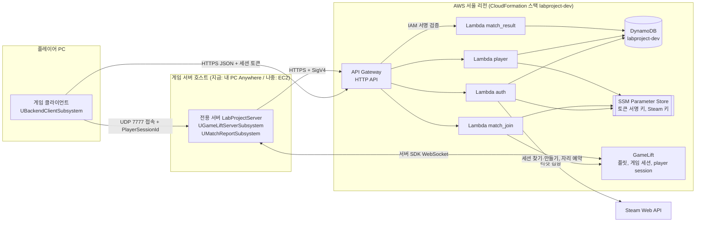
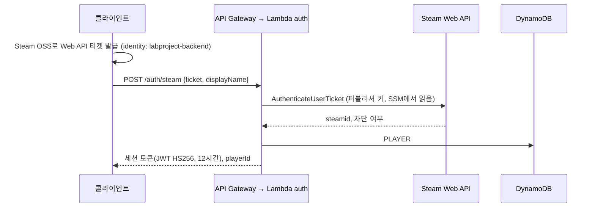
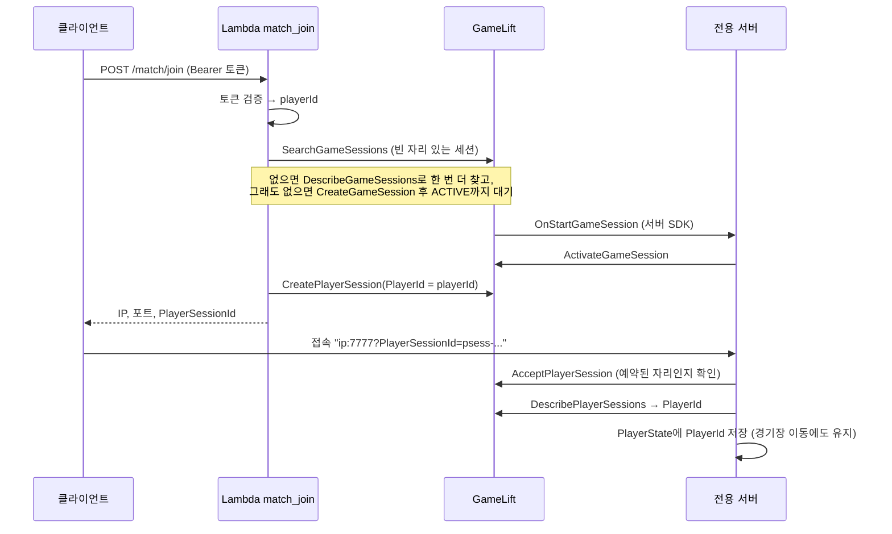
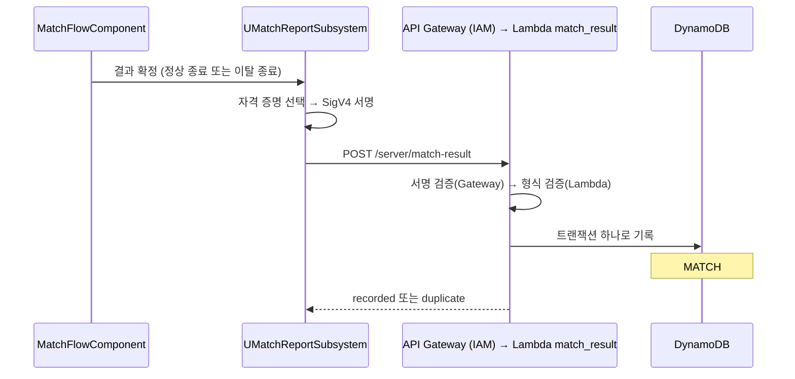
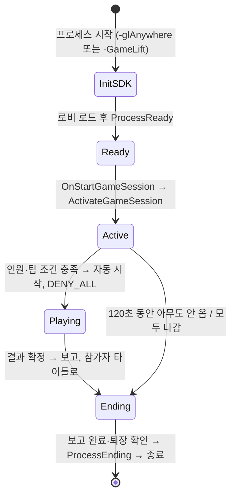

# AWS·DB 연결 구조

이 문서는 게임(클라이언트·전용 서버)이 AWS와 DB에 어떻게 연결되는지 설명합니다. 설치와 실행 절차는 [GameLift 호스팅과 백엔드](GameLift_Backend.md)에 있습니다.

핵심은 세 가지입니다.

1. **클라이언트는 DB와 GameLift를 직접 만지지 않습니다.** 모든 요청은 백엔드 API(API Gateway + Lambda)를 거칩니다.
2. **전적은 전용 서버만 쓸 수 있습니다.** 서버는 AWS IAM 서명(SigV4)으로 자신을 증명하고, 클라이언트 토큰으로는 쓰기 경로가 열리지 않습니다.
3. **플레이어 신원은 한 번 검증된 값이 끝까지 이어집니다.** Steam이 확인한 SteamID → 백엔드 토큰 → GameLift player session → 서버의 PlayerState → DB 전적 키 순서입니다.

## 1. 한눈에 보기

| 구성 요소 | 어디서 도는가 | 하는 일 | 코드 |
| --- | --- | --- | --- |
| 게임 클라이언트 | 플레이어 PC (UE) | 로그인, 매치 참가 요청, 전적 조회, 게임 서버 접속 | [`BackendClientSubsystem`](../Source/LabProject/Online/Backend/BackendClientSubsystem.h) |
| 백엔드 API | API Gateway HTTP API | 경로별로 Lambda 연결, 결과 보고 경로의 IAM 서명 검증, 초당 10회 호출 제한 | [`template.yaml`](../Backend/template.yaml) |
| Lambda 4개 | AWS (Python 3.13, ARM) | 로그인, 매치 참가, 전적 조회, 결과 기록 | [`Backend/src`](../Backend/src) |
| DynamoDB | AWS | 프로필, 누적 전적, 경기 기록 (테이블 하나) | [`match_result.py`](../Backend/src/match_result.py) |
| SSM Parameter Store | AWS | 세션 토큰 서명 키, Steam Web API 키 (암호화 저장) | [`common.py`](../Backend/src/common.py) |
| GameLift | AWS | 서버 프로세스 관리, 게임 세션 배정, player session 발급·검증 | [`match_join.py`](../Backend/src/match_join.py) |
| 전용 서버 | Anywhere(내 PC) 또는 EC2 | 접속 검증, 경기 진행, 결과 보고, 세션 종료 | [`GameLiftServerSubsystem`](../Source/LabProject/Online/GameLift/GameLiftServerSubsystem.h), [`MatchReportSubsystem`](../Source/LabProject/Online/Backend/MatchReportSubsystem.h) |
| Steam Web API | Valve | 클라이언트가 보낸 티켓이 진짜 Steam 계정인지 확인 | [`auth.py`](../Backend/src/auth.py) |

AWS 리소스는 모두 [`Backend/template.yaml`](../Backend/template.yaml) 하나에 코드로 정의되어 있습니다. [`deploy.ps1`](../Backend/deploy.ps1) 한 번으로 같은 환경을 다시 만들 수 있습니다.

## 2. 흐름 ① 로그인

- **비밀번호가 없습니다.** 플레이어는 이미 Steam에 로그인해 있습니다. 백엔드는 Steam에 "이 티켓이 진짜인가"만 묻습니다.
- **토큰:** 백엔드가 직접 서명한 JWT이고, 서명 키는 SSM에만 있습니다. 이후 요청은 `Authorization: Bearer <토큰>`으로 보냅니다.
- **개발용 로그인(`POST /auth/dev`):** 한 PC에서 클라이언트 여러 개를 시험할 때만 씁니다. 스택 파라미터 `AllowDevLogin`으로 켜고 끕니다.

## 3. 흐름 ② 매치 참가와 접속 검증

- **자리 예약과 확인을 나눕니다.** 백엔드는 로그인한 사람에게만 player session(자리 예약)을 만들어 줍니다. 서버는 접속한 사람이 그 예약을 가졌는지 GameLift에 확인합니다.
  - 주소만 알아낸 사람이나 다른 세션의 ID로는 들어올 수 없습니다.
  - 한 번 쓴 ID는 다시 쓸 수 없습니다.
- **서버는 클라이언트가 말하는 신원을 믿지 않습니다.** 전적에 쓸 PlayerId는 GameLift가 돌려준 값, 즉 백엔드가 예약할 때 넣은 값입니다.
- **경기가 시작되면 새 참가를 막습니다(`DENY_ALL`).** 퇴장하면 `RemovePlayerSession`으로 자리를 돌려줍니다.
- **세션은 모드로 나눕니다.** 요청 본문의 `mode`(`match` 또는 `bossraid`)를 게임 속성 `mode`에 넣고, 검색도 이 속성으로 거릅니다.
  - 보스 레이드 세션은 서버가 공유 월드를 연 뒤에 활성화하고, 참가를 막지 않습니다. 자세한 흐름은 [보스 레이드](BossRaid.md)에 있습니다.

## 4. 흐름 ③ 경기 결과 기록

- **서버가 자신을 증명하는 방법:** 결과 보고 경로는 API Gateway가 AWS IAM 서명을 검증합니다. 서버는 자격 증명을 다음 순서로 고릅니다.
  1. Anywhere 실행 인자
  2. 관리형 EC2 플릿의 인스턴스 역할(`GetFleetRoleCredentials`, 임시 키)
  3. 로컬 시험용 환경 변수
  - 서명은 AWS C++ SDK 없이 직접 구현했습니다([`AwsSigV4`](../Source/LabProject/Online/Backend/AwsSigV4.h)). AWS 공개 예제값으로 테스트합니다.
- **권한을 최소로 줬습니다.** 플릿 역할(`GameServerFleetRole`)은 이 경로 하나만 호출할 수 있습니다.
- **같은 경기는 한 번만 기록됩니다.** 첫 항목(경기 결과)이 "아직 없을 때만" 쓰이도록 조건을 걸었습니다.
  - 네트워크 재시도로 같은 보고가 두 번 와도 트랜잭션 전체가 취소되어 전적이 두 번 더해지지 않습니다.
  - 경기 ID는 GameLift 게임 세션 ID입니다. 한 세션은 한 경기만 진행합니다.

## 5. 흐름 ④ 서버 프로세스 수명

- **한 게임 세션은 한 경기로 끝납니다.** 경기 후 로비로 돌아가지 않고 프로세스를 끝냅니다. 관리형 플릿에서는 GameLift가 새 프로세스를 띄웁니다.
- **보스 레이드 세션은 경기가 없습니다.** 활성화 전에 공유 월드로 이동하고, 모두 나간 뒤 5분 동안 비어 있으면 끝냅니다.
- **종료 시점:** 감시 틱(1초)이 "결과 보고 완료 + 전원 퇴장 또는 제한 시간"을 확인한 뒤 종료합니다. 보고가 진행 중이면 끝날 때까지 기다립니다.
- **영향 범위:** 이 모든 동작은 GameLift 실행 인자가 있고 SDK와 함께 빌드된 서버에서만 켜집니다. Listen Server와 로컬 전용 서버는 기존 흐름 그대로입니다.

## 6. DynamoDB 설계

테이블 하나(`labproject-dev`)에 키(PK/SK)로 세 종류의 항목을 구분합니다. 요청량 과금이라 쓰지 않을 때 비용이 거의 없습니다.

| PK | SK | 내용 | 쓰는 곳 |
| --- | --- | --- | --- |
| `PLAYER#steam:<id>` | `PROFILE` | 표시 이름, 로그인 시각, 누적 `Matches/Wins/Losses/Draws/Kills/Deaths` | 로그인, 결과 기록 |
| `PLAYER#steam:<id>` | `MATCH#<기록 시각>#<경기 ID>` | 그 경기의 결과·팀·킬·데스·맵 | 결과 기록 |
| `MATCH#<경기 ID>` | `RESULT` | 경기 전체 결과, 보고한 서버의 IAM ARN | 결과 기록(중복 방지) |

- **조회 한 번:** "내 전적과 최근 경기"는 `PK = PLAYER#<id>`를 SK 내림차순으로 한 번 조회합니다(`GET /player/me`).
  - `PROFILE`이 `MATCH#…`보다 뒤에 정렬되어 첫 항목이 프로필이고, 나머지가 최신 경기 순서입니다.
- **원자적 증가:** 누적 전적은 `ADD`로 더합니다. 동시에 끝난 여러 경기가 같은 플레이어를 갱신해도 값을 잃지 않습니다.
- **테이블 하나를 쓴 이유:** 조회 패턴이 "플레이어 단위"와 "경기 단위" 두 가지뿐이라 키 설계만으로 충분하고, 한 트랜잭션 안에서 서로 다른 종류의 항목을 함께 쓸 수 있습니다.

## 7. 비밀 값과 설정의 위치

| 값 | 위치 | 누가 읽는가 |
| --- | --- | --- |
| Steam Web API 퍼블리셔 키 | SSM `/labproject/dev/steam-web-api-key` (SecureString) | Lambda auth |
| 세션 토큰 서명 키 | SSM `/labproject/dev/token-signing-key` (배포 스크립트가 생성) | Lambda auth, match_join, player |
| API 주소, 리전 | `Config/DefaultGame.ini`의 `BackendSettings` | 클라이언트, 서버 |
| GameLift 플릿 ID·위치 | 스택 파라미터 → Lambda 환경 변수 | Lambda match_join |
| 서버 AWS 자격 증명 | 실행 인자 / 플릿 역할 / 환경 변수 (저장소에 없음) | 전용 서버 |

저장소와 게임 빌드에는 비밀 값이 들어가지 않습니다. 클라이언트가 가진 것은 공개 API 주소뿐입니다.

## 8. 코드 지도

| 영역 | 파일 |
| --- | --- |
| 클라이언트 API 호출 | [`BackendClientSubsystem`](../Source/LabProject/Online/Backend/BackendClientSubsystem.cpp), [`BackendHttp`](../Source/LabProject/Online/Backend/BackendHttp.cpp), [`BackendSettings`](../Source/LabProject/Online/Backend/BackendSettings.h) |
| 서버 GameLift 수명 주기 | [`GameLiftServerSubsystem`](../Source/LabProject/Online/GameLift/GameLiftServerSubsystem.cpp) |
| 서버 결과 보고·서명 | [`MatchReportSubsystem`](../Source/LabProject/Online/Backend/MatchReportSubsystem.cpp), [`AwsSigV4`](../Source/LabProject/Online/Backend/AwsSigV4.cpp) |
| 게임 흐름 연결 지점 | [`LobbyGameMode`](../Source/LabProject/Lobby/Contents/LobbyGameMode.cpp) (ProcessReady, PreLogin, DENY_ALL), [`ExperienceGameMode`](../Source/LabProject/Mode/ExperienceGameMode.cpp), [`MatchFlowComponent`](../Source/LabProject/Component/Match/MatchFlowComponent.cpp) (결과 보고, 세션 종료), [`PdPlayerState`](../Source/LabProject/Mode/PdPlayerState.h) (신원 유지) |
| 백엔드 | [`auth.py`](../Backend/src/auth.py), [`match_join.py`](../Backend/src/match_join.py), [`player.py`](../Backend/src/player.py), [`match_result.py`](../Backend/src/match_result.py), [`common.py`](../Backend/src/common.py) |
| 인프라 | [`template.yaml`](../Backend/template.yaml), [`deploy.ps1`](../Backend/deploy.ps1), [`run-anywhere-server.ps1`](../Backend/run-anywhere-server.ps1) |
| 테스트 | [`Backend/tests`](../Backend/tests) (19개), [`AwsSigV4Tests`](../Source/LabProject/Tests/AwsSigV4Tests.cpp) (SHA-256·HMAC·SigV4) |

## 9. 지금 환경과 앞으로

| 항목 | 지금 (dev) | 실서비스로 갈 때 |
| --- | --- | --- |
| 게임 서버 | GameLift Anywhere: 내 PC가 서버 | 관리형 EC2 플릿(Linux), 오토스케일링, 여러 리전 큐 |
| 매칭 | 빈 자리 있는 세션 찾기 → 없으면 생성 | FlexMatch 규칙 기반 매칭, 결과는 이벤트로 통지 |
| 인증 | 자체 JWT를 Lambda에서 검증 | Lambda Authorizer 또는 Cognito, 토큰 갱신 |
| 서버 자격 증명 | 개발자 키(환경 변수) | 플릿 인스턴스 역할 (코드 준비됨) |
| 운영 | 로그만 | CloudWatch 알람, DB 백업(PITR), dev·prod 분리 |

**엔진 버전 제약**
- 클라이언트는 런처 엔진(5.8.2), 서버는 소스 엔진(5.8.3)으로 빌드합니다.
- 소스 빌드는 네트워크 호환 체인지리스트가 0이라, 서버를 `-networkversionoverride=55116800`으로 실행해 맞춥니다.
- 엔진을 올릴 때는 두 엔진과 이 값을 함께 바꿉니다.
