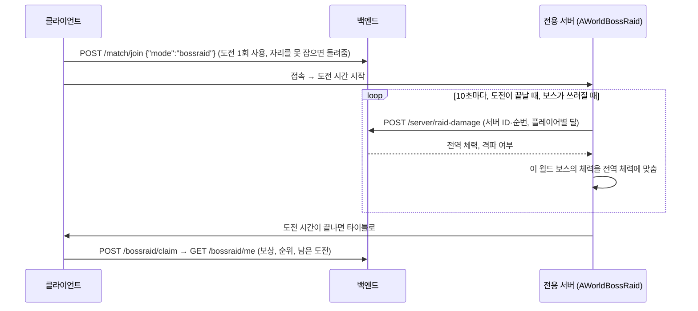
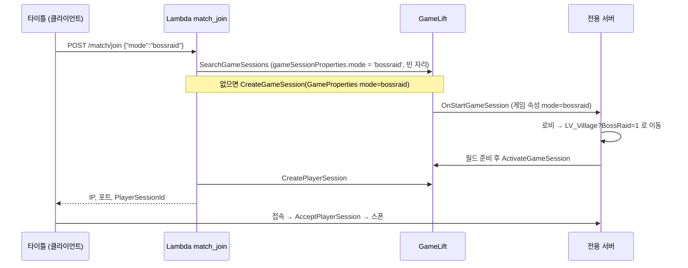

# 보스 레이드 (월드 보스)

타이틀의 **보스 레이드** 버튼을 누르면 GameLift 전용 서버의 레이드 월드(`LV_Colosseum`)에 들어갑니다. 드래곤은 **월드 보스**입니다. 모든 서버가 하나의 체력을 함께 깎고, 플레이어마다 정해진 도전 시간 동안 딜을 넣습니다.

## 월드 보스

| 규칙 | 내용 |
| --- | --- |
| 체력 | 회차마다 하나. 모든 서버가 함께 깎는다(DynamoDB `RAID#<회차>/STATE`의 `Hp`) |
| 도전 | 하루 정해진 횟수(기본 3회, 한국 시간 자정에 다시 채움). 한 번에 정해진 시간(기본 5분) |
| 순위 | 회차 동안 넣은 누적 딜. 보조 인덱스 `RaidRanking`(RankKey, Damage)으로 상위 10명과 내 순위를 읽는다 |
| 보상 | 보스가 쓰러지면 그 회차에 딜을 넣은 모든 플레이어에게 골드. 다음에 타이틀에 들어올 때 한 번만 받는다 |



- **딜 집계는 서버가 한다.** 보스가 실제로 잃은 체력만 센다. 남은 체력을 넘는 피해와 빗나간 공격은 빠진다. 클라이언트는 값을 바꿀 수 없다.
- **보스 체력 = 전역 체력.** 서버는 보스의 최대 체력을 전역 최대 체력으로 두고, 보고 응답의 전역 체력에서 아직 보내지 않은 딜을 뺀 값으로 맞춘다. 그래서 페이즈 소환(체력 절반)과 사망이 기존 체력 흐름 그대로 전역 체력을 따른다. 이 월드에서 체력이 0이 되면 전역 체력도 0 이하다.
- **중복 보고 방지.** 서버마다 보고 순번을 늘린다. 실패한 보고는 같은 순번과 내용으로 다시 보내므로, 이미 반영된 보고가 다시 와도 한 번만 더해진다.
- **격파.** 전역 체력이 0 이하가 되면 백엔드가 회차를 격파로 바꾸고, 각 서버는 다음 응답에서 알아 보스를 쓰러뜨린다. 10초 동안 연출을 보여 준 뒤 모두를 타이틀로 보내고 게임 세션을 끝낸다.
- **백엔드 없이.** 주소나 자격 증명이 없거나 열린 회차가 없으면 서버는 보고하지 않고, 보스는 이 월드의 체력(3,000)으로 싸우다 다시 나온다.
- **HUD.** 처치 수 자리(화면 가운데 위)에 긴 체력바가 뜬다. 보스 이름, 체력 숫자와 퍼센트, 남은 도전 시간, 이번 도전 딜을 보여 주고, 깎인 양은 밝은 잔상으로 보인다.
- **타이틀.** 버튼 툴팁에 보스 체력, 오늘 남은 도전, 내 순위와 상위 10명이 나온다. 레이드에서 돌아오면 Luna가 누적 딜·순위·남은 도전을, 격파 뒤에는 받은 보상 골드를 알려 준다. 골드는 로컬 프로필에 더한다.

| 코드 | 역할 |
| --- | --- |
| [`AWorldBossRaid`](../Source/LabProject/Mode/WorldBossRaid.cpp) | 서버: 딜 집계·보고·체력 맞춤·도전 시간·격파. 클라이언트: HUD가 읽는 복제 값 |
| [`AMonsterCharacter`](../Source/LabProject/AI/Monster/MonsterCharacter.cpp) `bWorldBoss` | `BP_DragonUsurper`에 켜 둔 표시. 피해를 받을 때 실제로 깎인 체력을 레이드에 넘긴다 |
| [`UWorldBossBarWidget`](../Source/LabProject/UI/HUD/Player/WorldBossBarWidget.cpp) | 코드로 만든 긴 체력바 |
| [`boss_raid.py`](../Backend/src/boss_raid.py) | 회차 상태, 도전 횟수, 순위, 보상 |
| [`raid_damage.py`](../Backend/src/raid_damage.py) | 서버 딜 보고(IAM SigV4) |
| `LabProject.Integration.BossRaid.WorldBossDamage` | 피해 → 도전 딜(오버킬 제외) → HUD 체력바 연결 테스트 |

| | PvP 경기 (빠른 매칭·방) | 보스 레이드 |
| --- | --- | --- |
| 서버 | 리슨 서버, 또는 GameLift `match` 세션 | GameLift `bossraid` 세션 (전용 서버) |
| 시작 | 로비에서 인원·팀 조건 → 카운트다운 | 접속하면 바로 월드에 스폰 |
| 경기 타이머·승패·결과 화면 | 있음 | 없음 |
| 중간 참가 | 경기 시작 후 막음(`DENY_ALL`) | 언제든 가능(`ACCEPT_ALL` 유지) |
| 누가 나가면 | 경기 종료(이탈 종료) | 남은 사람은 계속 플레이 |
| 서버 종료 | 경기 1회 후 | 모두 나가고 5분 동안 비어 있으면 |

## 흐름



- **세션을 모드로 나눕니다.** 백엔드는 요청의 `mode`를 게임 세션의 게임 속성 `mode`에 넣고, 검색도 같은 속성으로 거릅니다. 그래서 PvP 요청이 보스 레이드 세션에 들어가거나 그 반대가 되지 않습니다.
- **월드가 열린 뒤 세션을 활성화합니다.** 서버는 보스 레이드 세션을 받으면 먼저 공유 월드로 이동하고, 맵이 열리면(GameMode `BeginPlay`) `ActivateGameSession`을 부릅니다. 백엔드는 세션이 ACTIVE가 된 뒤에만 player session을 만들므로, 클라이언트가 이동 중인 서버에 접속하는 일이 없습니다.
  - Experience 로딩까지는 기다리지 않습니다. 로딩 중에 들어온 참가자는 로비에서 넘어온 참가자와 같은 경로로, 준비가 끝난 뒤 스폰됩니다.
  - 처음에는 Experience까지 기다렸는데, 첫 참가 응답이 23.6초로 백엔드 대기 한도(24초)에 너무 가까웠습니다. 맵이 열릴 때 활성화하자 10.4초로 줄었습니다.
- **월드는 GameMode의 travel 옵션으로 구분합니다.** `?BossRaid=1`로 연 맵에서 `UMatchFlowComponent`가 타이머를 멈추고(`Suppressed`), 이탈 종료를 하지 않습니다. 타이머가 끝나지 않으니 승자 판정·결과·로비 복귀도 일어나지 않습니다.
- **몬스터와 보상은 기존 시스템을 그대로 씁니다.** `LV_Village`에 배치된 `AServerOnlyMonsterSpawner`가 서버에서 몬스터를 만들고 다시 만듭니다. 처치 보상(경험치·소울 더스트·물약)은 `UPlayerRewardComponent`가 줍니다.
- **플레이어끼리는 싸우지 않습니다.** 로비를 거치지 않은 참가자는 모두 기본 팀(0)이라 아군 판정이 됩니다.

## 코드

| 위치 | 역할 |
| --- | --- |
| [`TitleWidget`](../Source/LabProject/UI/Title/TitleWidget.cpp) `Btn_BossRaid` | `WBP_Title`의 훈련장 줄 오른쪽 반쪽에 놓인 보스 레이드 버튼입니다. 반쪽 버튼은 전용 프레임 `T_TitleSecondaryHalf`와 아이콘 `T_TitleIconBossRaid`를 씁니다(원본 SVG는 `Content/UI/Asset/TitleStyle/SourceArt`). |
| [`TitleHUD`](../Source/LabProject/UI/Title/TitleHUD.cpp) `HandleBossRaidRequested` | 백엔드 참가 요청, Luna 안내(찾는 중·실패), 버튼 비활성화 |
| [`BackendClientSubsystem`](../Source/LabProject/Online/Backend/BackendClientSubsystem.cpp) | `JoinOnlineMatch(EOnlineMatchMode::BossRaid)` → 요청 본문 `mode` |
| [`match_join.py`](../Backend/src/match_join.py) | 모드별 검색·생성, 보스 레이드 세션 정원(`MaxPlayersPerBossRaidSession`, 기본 6) |
| [`GameLiftServerSubsystem`](../Source/LabProject/Online/GameLift/GameLiftServerSubsystem.cpp) | 게임 속성 `mode` 읽기, 공유 월드 이동, 활성화 지연, 보스 레이드 전용 빈 세션 시간 |
| [`ExperienceGameMode`](../Source/LabProject/Mode/ExperienceGameMode.cpp) `NotifyBossRaidWorldReadyIfNeeded` | 월드가 준비되면 대기 중인 세션 활성화. 비어도 로비로 돌아가지 않음 |
| [`MatchFlowComponent`](../Source/LabProject/Component/Match/MatchFlowComponent.cpp) | `BossRaid` 옵션 → 타이머 없음, 이탈 종료 없음 |
| [`LevelDefinition`](../Source/LabProject/Definition/Level/LevelDefinition.h) `BossRaidLevel` | 공유 월드 맵. 기본값 `LV_Village` |

| CVar (서버) | 기본값 | 설명 |
| --- | --- | --- |
| `pd.GameLift.BossRaidEmptySessionTimeout` | 300 | 모두 나간 보스 레이드 세션을 유지하는 시간(초). 그 사이에 다시 들어올 수 있습니다. |
| `pd.GameLift.BossRaidWorldReadyTimeout` | 60 | 공유 월드 로딩을 기다리는 최대 시간(초). 넘으면 프로세스를 끝냅니다. |

## 열고 닫기

보스 레이드는 상시 열지 않고 운영자가 여는 기간에만 참가를 받습니다. 회차와 열림 여부는 백엔드 테이블에 있어서 게임 패치나 백엔드 배포 없이 바꿉니다.

```powershell
.\Backend\bossraid.ps1                                    # 현재 회차, 전역 체력, 규칙
.\Backend\bossraid.ps1 open -Hp 3000000 -RewardGold 1000  # 새 회차 (-DailyAttempts 3 -AttemptSeconds 300이 기본)
.\Backend\bossraid.ps1 close                              # 새 참가만 막음
.\Backend\bossraid.ps1 open                               # 닫았던 회차를 이어서 엶
```

- 타이틀은 들어올 때마다 `GET /bossraid/status`로 묻고, 닫혀 있으면 버튼을 끈 채 마우스를 올리면 **아직 개최되지 않았습니다**를 보여 줍니다. 응답을 받지 못해도 닫힌 것으로 봅니다. 오늘 도전을 다 썼어도 버튼이 꺼집니다.
- 닫으면 새 참가만 막습니다. 이미 들어간 플레이어는 도전 시간이 끝날 때까지 계속 플레이합니다.
- 격파된 회차는 다시 열 수 없습니다. 새 회차를 엽니다.
- 타이틀에 머무는 동안 닫혀서 참가가 거절되면 버튼이 꺼지고 Luna가 아직 열리지 않았다고 알립니다.
- 여기서 연 상태는 개발 빌드와 에디터에도 똑같이 적용됩니다. 공개 전에 시험할 때는 아래 로컬 전용 서버 방법을 씁니다.

## 시험

### GameLift Anywhere (버튼 그대로)

서버 실행 파일을 다시 빌드하고 스테이징한 뒤([GameLift 호스팅과 백엔드](GameLift_Backend.md#서버-빌드쿡스테이징)), 서버를 띄웁니다. 레이드가 닫혀 있으면 `bossraid.ps1 open`으로 먼저 엽니다.

```powershell
.\Backend\run-anywhere-server.ps1 -ServerExe D:\GL\Stage\WindowsServer\LabProject\Binaries\Win64\LabProjectServer.exe -ExtraArgs @('-nosteam')
```

클라이언트를 띄우고 타이틀에서 **보스 레이드**를 누릅니다. 한 PC에서 여러 명을 시험할 때는 `alice`, `bob`처럼 ID를 바꿔 실행합니다.

```powershell
& "C:\UE\UE_5.8\Engine\Binaries\Win64\UnrealEditor.exe" "<경로>\LabProject.uproject" -game -nosteam -log -windowed -ResX=960 -ResY=540 -BackendDevLogin=alice
```

- 버튼 대신 콘솔에서 `pd.Backend.JoinMatch bossraid`를 입력해도 됩니다.
- 서버 로그 순서: `Boss raid game session … opening /Game/Map/LV_Village` → `game session activated: … (bossraid, max 6 players)` → `Accepted player session`

### GameLift 없이 (로컬 전용 서버)

공유 월드 맵을 `BossRaid` 옵션과 함께 바로 엽니다.

```powershell
& "C:\UE\UE_5.8\Engine\Binaries\Win64\UnrealEditor-Cmd.exe" "<경로>\LabProject.uproject" "/Game/Map/LV_Village?BossRaid=1" -server -log -port=7777 -nosteam
```

```powershell
& "C:\UE\UE_5.8\Engine\Binaries\Win64\UnrealEditor.exe" "<경로>\LabProject.uproject" "127.0.0.1:7777" -game -nosteam -log -windowed -ResX=960 -ResY=540
```

### 검증 결과 (2026-10-01, Anywhere)

| 확인 항목 | 결과 |
| --- | --- |
| 타이틀 버튼 | 훈련장 옆에 표시. 누르면 버튼이 꺼지고 Luna가 자리를 찾는 중이라고 안내함 |
| 첫 참가 (새 세션) | 게임 속성 `mode=bossraid` 세션 생성 → 서버가 `LV_Village?BossRaid=1`로 이동(7.1초) → 활성화 → 접속. 버튼부터 백엔드 응답까지 10.4초 |
| 중간 참가 | 두 번째 플레이어가 같은 세션에 들어감(버튼부터 맵 로드까지 4초) |
| 한 명 퇴장 | 남은 플레이어는 계속 플레이. 세션은 ACTIVE, `ACCEPT_ALL`, 인원 2 → 1 |
| 모두 퇴장 | 빈 세션 유지 시간(시험용 20초) 뒤 `All players left the game session` → 프로세스 종료, 세션 TERMINATED |
| 몬스터 | 로컬 보스 레이드 서버에서 `obj list class=MonsterCharacter` → `BP_Bug_C` 8마리 |
| 로컬 경로 | `LV_Village?BossRaid=1` 전용 서버에 접속·퇴장해도 로비로 돌아가지 않음 |

빈 세션 유지 시간은 `-ini:Engine:[ConsoleVariables]:pd.GameLift.BossRaidEmptySessionTimeout=20`처럼 실행 인자로 줄일 수 있습니다.

**주의 (Anywhere):** 서버 프로세스를 강제 종료하면 `ProcessEnding`이 호출되지 않아, 그 게임 세션이 몇 분(시험에서는 약 5분) 동안 ACTIVE로 남습니다.
- 그 사이 백엔드가 남은 세션의 자리를 내주면, 새 서버가 접속을 거절하고(`Game session is not accepting players`) 클라이언트는 타이틀로 돌아옵니다.
- 서버는 창을 닫거나 Ctrl+C로 끝내세요. 엔진이 정상 종료되면 서브시스템 정리(`Deinitialize`)에서 `ProcessEnding`을 호출합니다.

## 한계와 다음 단계

- **성장 저장:** 몬스터 보상은 지금 서버 메모리의 PlayerState에만 쌓입니다. 경험치·레벨을 DynamoDB에 저장하려면, 서버가 SigV4로 서명한 진행 보고 경로(`/server/match-result`와 같은 방식)를 추가합니다.
- **외형:** 시험에서 보스 레이드 월드의 캐릭터는 기본 외형(흰색)으로 보였습니다. 로비가 넘겨주는 스킨·로드아웃 캐시를 거치지 않기 때문으로 보이며, 프로필의 장착 스킨을 적용하는 경로는 아직 확인하지 않았습니다.
- **이름 표시:** 로비를 거치지 않으므로 경기 표시 이름은 기본 규칙(`ULobbyRuntimeSubsystem::ResolveDefaultPlayerNickname`)으로 정해집니다. player session의 `PlayerData`에 백엔드 표시 이름이 들어 있으니, 서버가 이를 쓰게 바꿀 수 있습니다.
- **같은 맵의 PvP:** `LV_Village`는 PvP 경기 맵으로도 쓰입니다. PvP 경기에도 몬스터가 나오는 기존 동작은 바꾸지 않았습니다.
- **Anywhere 재시작:** Anywhere는 끝난 프로세스를 다시 띄우지 않습니다. 세션이 끝나면 실행 스크립트를 다시 실행합니다(관리형 플릿은 GameLift가 띄웁니다).
