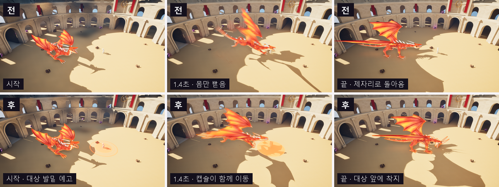
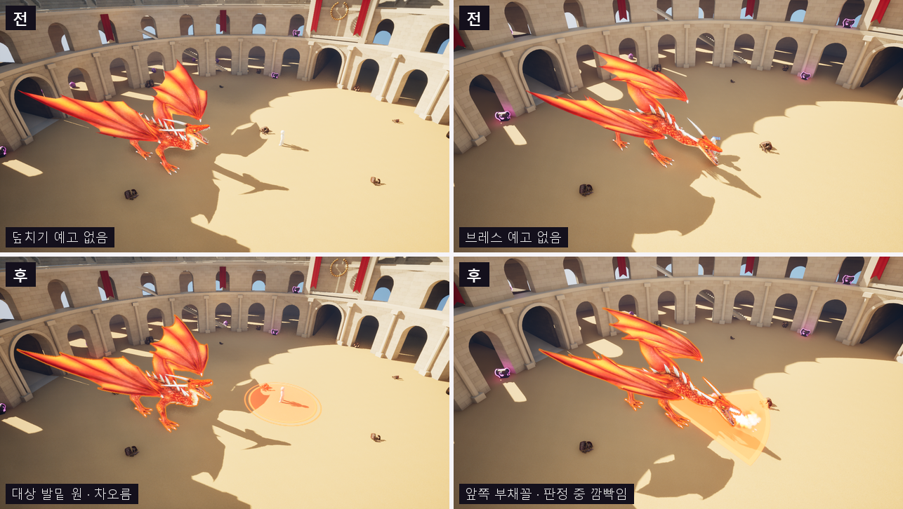
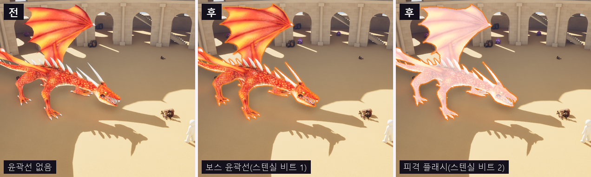
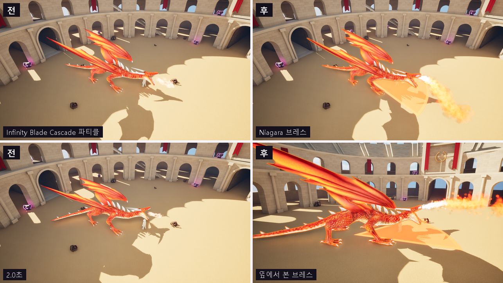
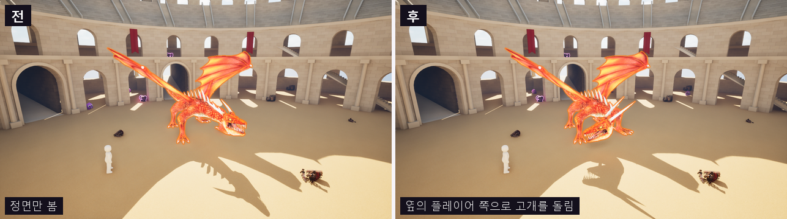
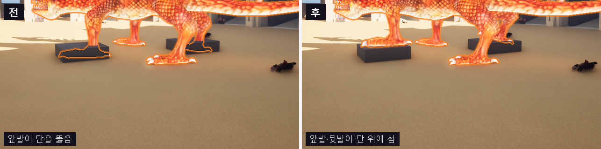

# 보스 연출: 그래픽스와 애니메이션

보스 레이드 드래곤(Usurper)의 공격을 읽을 수 있게 만들고, 몸이 공간과 맞물려 보이게 한 작업입니다. 다섯 가지를 했습니다.

| 항목 | 한 일 | 코드 · 애셋 |
| --- | --- | --- |
| 덮치기 루트 모션 | 애니메이션의 전진 이동을 떼어 내 캡슐을 실제로 옮긴다 | [`AnimNotifyState_LeapToTarget`](../Source/LabProject/Animation/AnimNotifyState_LeapToTarget.h), `A_DragonUsurper_AttackHand_InPlace`, `Curve_DragonUsurper_PounceTravel` |
| 공격 예고 장판 | 공격 범위를 바닥에 미리 그리는 데칼, 커스텀 HLSL | [`Shaders/AttackTelegraph.ush`](../Shaders/AttackTelegraph.ush), [`AAttackTelegraphActor`](../Source/LabProject/AI/Monster/AttackTelegraphActor.h), `M_AttackTelegraph` |
| 보스 윤곽선 · 피격 플래시 | CustomDepth 스텐실 비트를 읽는 포스트 프로세스 | [`Shaders/CombatHighlight.ush`](../Shaders/CombatHighlight.ush), `PP_CombatHighlight`, [`AMonsterCharacter`](../Source/LabProject/AI/Monster/MonsterCharacter.cpp) |
| 화염 브레스 | Cascade 파티클을 드래곤 크기의 Niagara 시스템으로 교체 | `NS_DragonBreath`, `AM_DragonUsurper_AttackFlame` |
| 머리 Look-At · 발 IK | Control Rig와 커스텀 Rig Unit | `CR_DragonUsurper`, [`FRigUnit_PdFootPlant`](../Source/LabProject/Animation/RigUnit_PdFootPlant.h), [`UMonsterAnimInstance`](../Source/LabProject/Animation/MonsterAnimInstance.h) |

전후 캡처는 같은 장면을 같은 카메라로 찍었습니다(찍는 방법은 [맨 아래](#캡처-방법)).

## 덮치기 루트 모션

**문제 1: 앞으로 나가지 않는다.** 덮치기 애니메이션은 제자리에서 몸을 약 11 m 앞으로 뻗었다가 원래 자리로 돌아옵니다. 캡슐은 그대로라서 몸만 플레이어에게 닿았다가 되돌아갑니다. 맞는 판정(캡슐)도 몸과 따로 놉니다.

**문제 2: 엔진 루트 모션을 바로 쓸 수 없다.** 이 드래곤 팩은 첫 뼈(`Root`)가 골반입니다. 언리얼의 애니메이션 루트 모션은 첫 뼈를 통째로 고정(root lock)하고 그 움직임을 캡슐로 옮깁니다. 그러면 골반의 높이와 회전까지 사라져서 몸이 뻣뻣하게 미끄러집니다.

**해결:** 전진 성분만 떼어 냈습니다.

1. **제자리 애니메이션.** 에디터 스크립트로 `Root` 뼈 위치 키에서 전진 축(Y)만 첫 프레임 값으로 고정했습니다. 높이와 회전은 그대로 남깁니다. 결과는 `A_DragonUsurper_AttackHand_InPlace`입니다.
2. **이동 곡선.** 떼어 낸 전진 이동이 시간에 따라 얼마나 진행되는지를 `Curve_DragonUsurper_PounceTravel`에 담았습니다.
   - 구간은 몸이 가장 뒤로 물러난 1.07초부터 가장 앞으로 나간 2.23초까지입니다.
   - 곡선의 25% 시점에서 54%, 50% 시점에서 95%를 이동합니다.
3. **도약 노티파이.** 몽타주의 그 구간에 `AnimNotifyState_LeapToTarget`을 두었습니다.
   - 서버에서 `FRootMotionSource_MoveToDynamicForce`를 걸어 캡슐을 대상 앞까지 옮깁니다.
   - 이동 시간 비율은 위 곡선을 따릅니다.
   - 도착 지점은 도약을 시작하는 순간의 대상 위치로 정합니다. 그 뒤에 피하면 빗나갑니다.
   - 대상과 가장자리 사이 300 cm에서 멈춥니다. 한 번에 최대 1500 cm까지 이동합니다.
   - 끝날 때 속도를 0으로 둬서 미끄러지지 않습니다.
   - 루트 모션 소스는 이동 컴포넌트가 원격 화면에 복제하고 시뮬레이션합니다.

결과: 캡슐 가장자리 사이 거리가 공격 전 1094 cm에서 공격 후 295 cm가 됐습니다(목표 300 cm).

**함께 고친 버그: 덮치기가 한 번도 나오지 않았다.** 드래곤의 공격은 거리별로 나뉩니다. 물기는 0–700 cm, 브레스는 0–800 cm, 덮치기는 750–1500 cm입니다. 그런데 졸개와 함께 쓰는 StateTree의 "Move to Target"이 늘 대상 100 cm 앞까지 다가간 뒤 공격 상태로 넘어갔습니다. 그래서 덮치기 거리에서는 공격을 고를 일이 없었습니다.

[`AMonsterAIController::MoveTo`](../Source/LabProject/AI/Monster/MonsterAIController.cpp)를 고쳤습니다.

- 공격 대상을 쫓는 이동은 "공격 패턴 중 가장 먼 사거리"에서 멈춥니다. 공격을 시작할 수 있는 거리보다 멀리서는 멈추지 않습니다.
- 사거리 상한이 없는 졸개(`BP_Bug`)는 이전과 같습니다.

## 공격 예고 장판

- **셰이더:** [`Shaders/AttackTelegraph.ush`](../Shaders/AttackTelegraph.ush)가 데칼 UV 위에 원 또는 부채꼴을 그립니다.
  - 테두리는 처음부터 보입니다.
  - 안쪽은 중심에서 바깥으로 차오르고, 다 차는 순간 피해가 들어옵니다.
  - 아직 차지 않은 곳에는 바깥으로 흐르는 줄무늬가 깔립니다.
  - 판정이 열려 있는 동안 깜빡이고, 끝나면 0.15초 동안 사라집니다.
  - 경계는 `fwidth`로 픽셀 크기만큼 부드럽게 해서 멀리서도 계단이 생기지 않습니다.
- **시간 계산:** 모든 시간은 머티리얼 `Time`(월드 시간)으로 셰이더가 계산합니다.
  - 게임 코드는 생성할 때 시작 시각, 채움 시간, 종료 시각만 넘깁니다. 매 프레임 머티리얼 파라미터를 바꾸지 않습니다.
- **셰이더 경로:** 머티리얼 Custom 노드가 저장소의 `Shaders/`를 `/LabProject/...`로 include합니다.
  - 이 가상 경로는 셰이더 컴파일 전에 있어야 합니다.
  - 그래서 `PostConfigInit` 단계에 올라오는 작은 모듈 [`LabProjectShaders`](../Source/LabProjectShaders/LabProjectShaders.cpp)가 등록합니다.
- **언제 그리는가:** 몽타주의 노티파이에서 읽습니다. 데이터를 따로 맞출 필요가 없습니다.
  - 가득 차는 시각은 피해 구간(`AnimNotifyState_AttackDamageWindow`)의 시작입니다.
  - 사라지는 시각은 피해 구간의 끝입니다.
  - 원이 멈추는 시각은 도약 노티파이의 시작입니다.
- **모양:** 공격 패턴(`FMonsterAttackPattern::Telegraph`)에 정합니다.
  - 덮치기는 대상 발밑의 원(반지름 450 cm)입니다. 도약이 시작될 때까지 대상을 따라가다 멈춥니다. 서버도 같은 순간의 대상 위치로 도착 지점을 정합니다.
  - 브레스는 드래곤 앞쪽 부채꼴(길이 1100 cm, 반각 28°)입니다. 몸을 따라 움직입니다.
- **복제:** 장판은 복제하지 않습니다. 화면을 그리는 인스턴스마다 공격 멀티캐스트와 함께 만듭니다. 그래서 멀티캐스트에 공격 대상을 함께 보냅니다.
- **데칼이 묻는 곳:** 몬스터 메시는 데칼을 받지 않아 보스 몸에는 장판이 묻지 않습니다. 장판 안에 선 플레이어에게는 묻어서 위험하다는 것을 보여 줍니다.

## 보스 윤곽선과 피격 플래시

- **스텐실 비트:** `r.CustomDepth=3`(스텐실 사용)로 켜고, 메시의 CustomDepth 스텐실 비트로 대상을 고릅니다.
  - **비트 1, 윤곽선:** 스텐실이 없는 픽셀 둘레 4 px 안(8방향 × 4단계)에 비트 1 픽셀이 있으면 테두리 색을 칠합니다.
  - CustomDepth는 장면 깊이와 따로 그려지므로, 기둥 뒤에 가려진 보스의 윤곽도 보입니다.
  - **비트 2, 피격 플래시:** 맞는 순간 0.12초 동안 켭니다.
  - 장면 깊이와 CustomDepth를 비교해서 실제로 보이는 픽셀만 하얗게 섞습니다. 이전에는 벽 뒤 부분까지 하얗게 칠해졌습니다.
- **포스트 프로세스:** [`Shaders/CombatHighlight.ush`](../Shaders/CombatHighlight.ush)를 쓰는 `PP_CombatHighlight`입니다.
  - 톤매핑 뒤에 섞어서 노출이나 블룸과 관계없이 색이 일정합니다.
  - 이 머티리얼을 쓰는 몬스터가 처음 나타날 때, 그 화면에만 있는 무한 범위 포스트 프로세스 볼륨을 한 번 깝니다.
- **비용:** 스텐실 값만 바꾸는 것은 싸지만, CustomDepth를 켜고 끄면 렌더 상태를 다시 만듭니다.
  - 그래서 윤곽선이나 플래시를 쓰는 몬스터는 살아 있는 동안 CustomDepth를 켜 둡니다.
  - 지금은 보스만 씁니다. 수백 마리 졸개는 CustomDepth를 그리지 않습니다.
- **피격 감지:** 서버가 확정한 피해 표현 RPC(`MulticastHandleDamageTaken`)에 플래시를 덧붙였습니다.

## 화염 브레스

**교체:** 몽타주의 Cascade 노티파이(Infinity Blade의 작은 불꽃)를 `AnimNotifyState_TimedNiagaraEffect`로 바꿨습니다.

**드래곤 크기로 키우기:** 기반은 레퍼런스 팩의 사람 크기 화염방사기(약 2 m)입니다.

- 이 시스템은 월드 공간 입자라서 컴포넌트 스케일로는 커지지 않았습니다.
- 그래서 에미터 모듈 상수를 직접 키워 `NS_DragonBreath`로 만들었습니다.
  - 초기 속도: 200 → 1100 cm/s
  - 속도 상한: 5배
  - 입자 크기: 6배
  - 퍼짐: 3배
  - 생성률: 1.5배
- 수명은 그대로 두고 속도로 길이(약 8–9 m)를 늘렸습니다.

**붙이는 위치와 시간:**

- 위치와 방향은 머리 뼈 공간에서 위턱(`UpperMouth01`)을 향하는 방향을 참조 자세로 계산해 넣었습니다.
- 불을 뿜는 시간은 화염 피해 구간과 같습니다(0.6–2.4초). 판정과 그림이 어긋나지 않습니다.

## 머리 Look-At과 발 IK (Control Rig)

`ABP_DragonUsurper`의 몽타주 슬롯과 출력 사이에 `CR_DragonUsurper` Control Rig 노드를 넣었습니다. Forward Solve는 다음 순서로 돕니다.

1. **Aim(Neck02):** 목을 대상 쪽으로 절반만 돌립니다.
2. **Aim(Head):** 머리가 나머지를 맞춥니다.
   - 두 뼈의 겨눔 축은 각 뼈 공간에서 위턱을 향하는 방향입니다(참조 자세에서 계산).
3. **Pd Foot Plant:** C++로 만든 Rig Unit([`FRigUnit_PdFootPlant`](../Source/LabProject/Animation/RigUnit_PdFootPlant.cpp))입니다.
   - 애니메이션은 발밑을 평평한 바닥(리그 공간 Z=0)으로 가정합니다.
   - 네 발마다 실제 지면 높이를 재서, 그 차이만큼 발을 올리거나 내립니다.
   - 가장 많이 내려가야 하는 발만큼 골반을 먼저 내립니다.
   - 각 다리는 지금 무릎이 굽은 면을 유지한 채 2본 IK로 풉니다. 축을 몰라도 되게 위치 기반으로 풀고, 뼈 방향 차이만큼 회전시킵니다.
   - 발의 방향은 애니메이션 그대로 둡니다.

입력은 [`UMonsterAnimInstance`](../Source/LabProject/Animation/MonsterAnimInstance.cpp)가 정합니다.

- **LookAtLocation:** 공격 대상 위치(메시 공간)를 부드럽게 따라갑니다.
- **LookAtWeight:**
  - 대상이 몸 정면 110° 안에 있고 몽타주가 없을 때만 1로 올라갑니다.
  - 공격 동작이 겨누는 방향(브레스, 덮치기)은 바꾸지 않기 위해서입니다.
- **FootIKWeight:**
  - 몽타주가 없을 때만 1입니다.
  - 덮치기처럼 발을 드는 동작을 IK가 땅에 붙잡지 않게 합니다.
- **공격 대상의 복제:**
  - 공격 대상은 서버 AI가 고릅니다. 몬스터가 이를 푸시 모델로 복제합니다(`ReplicatedAttackTarget`).
  - 그래서 모든 화면에서 같은 쪽을 봅니다.
  - 머리에 붙은 공격 판정도 서버와 클라이언트가 같은 자세로 계산합니다.

경기장 바닥은 평평해서 발 IK가 평소에는 아무것도 바꾸지 않습니다. 캡처에서는 앞발과 뒷발 밑에 60 cm 단을 놓고 비교했습니다.

## 검증

- **자동화 테스트:** `Scripts/RunAutomationTests.ps1`에서 모두 통과했습니다.
  - Unit 8개
  - Integration 에디터 2개
  - Integration 게임 5개
- **서버 빌드:** 전용 서버 타깃(소스 엔진)도 빌드했습니다. 새 모듈(`LabProjectShaders`)과 Control Rig 의존성이 서버에서도 문제없는지 확인하기 위해서입니다.

## 캡처 방법

- **장면:** 임시 자동화 테스트가 `-game -RenderOffscreen`(1280×720)으로 `LV_Colosseum?BossRaid=1`을 열었습니다.
  - 드래곤과 플레이어를 정해진 자리에 세우고, 고정 카메라로 몽타주 재생 위치마다 스크린샷을 남겼습니다.
  - 이 테스트는 저장소에 남기지 않았습니다.
- **"전" 캡처:** 바꾸기 전 애셋으로 찍었습니다. 단, 다음 두 가지는 예외입니다.
  - **윤곽선:** `-dpcvars=r.CustomDepth=0`으로 스텐실을 끄고 찍었습니다.
  - **Look-At과 발 IK:** Control Rig를 넣기 전의 애님 블루프린트로 찍었습니다.

## 저장소에 들어가는 것

- **셰이더와 코드:** `Shaders/*.ush`와 C++ 코드는 모두 저장소에 있습니다.
- **공개 콘텐츠:** `.gitignore`의 콘텐츠 정책에 아래를 추가했습니다. 모두 코드와 직접 연결된 애셋입니다.
  - `M_AttackTelegraph`
  - `PP_CombatHighlight`
  - `CR_DragonUsurper`
  - `Curve_DragonUsurper_PounceTravel`
- **빼 둔 것:** 아래 둘은 팩 애셋에서 만든 파생물이라 다른 팩 콘텐츠처럼 저장소에서 뺐습니다.
  - `A_DragonUsurper_AttackHand_InPlace`(드래곤 팩 애니메이션)
  - `NS_DragonBreath`(레퍼런스 VFX 팩)
