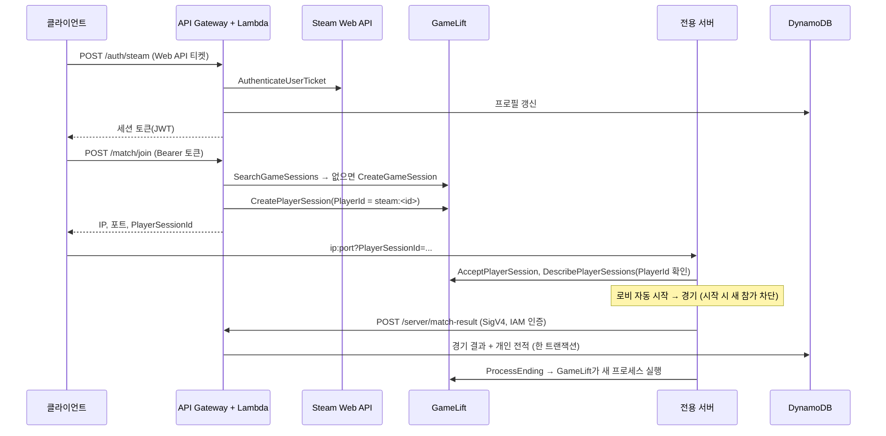

# GameLift 호스팅과 백엔드 (로그인·전적 DB)

[전용 서버와 지연 보상](DedicatedServer_LagCompensation.md)의 다음 단계입니다. 이 문서는 설치·배포·검증 절차를 다룹니다. 구조와 설계 이유는 [AWS·DB 연결 구조](AWS_DB_Architecture.md)에 정리했습니다. 다음 세 가지를 연결합니다.

- **로그인:** Steam 계정으로 백엔드에 로그인합니다. 별도 가입 화면이 없습니다.
- **매치 참가:** 백엔드가 GameLift 게임 세션의 자리를 잡아 주고, 클라이언트는 그 전용 서버로 접속합니다.
- **전적:** 전용 서버가 경기 결과를 보고하면 DynamoDB에 누적 전적과 경기 기록을 남깁니다.

GameLift 코드는 SDK와 함께 빌드한 Server target에서, GameLift 실행 인자가 있을 때만 동작합니다. Listen Server와 GameLift 없는 로컬 전용 서버의 흐름은 바뀌지 않습니다.

## 전체 흐름



## 구성

| 위치 | 역할 |
| --- | --- |
| [`Backend/template.yaml`](../Backend/template.yaml) | HTTP API, Lambda 4개, DynamoDB 테이블, 플릿 인스턴스 역할(SAM) |
| [`Backend/src`](../Backend/src) | Lambda 코드(Python, 외부 라이브러리 없음) |
| [`Backend/deploy.ps1`](../Backend/deploy.ps1) | AWS CLI만으로 패키징·배포. 토큰 서명 키를 처음 한 번 만듭니다. |
| [`Backend/tests`](../Backend/tests) | 토큰·Steam 검증·결과 검증·트랜잭션·세션 배정 단위 테스트 |
| [`BackendClientSubsystem`](../Source/LabProject/Online/Backend/BackendClientSubsystem.h) | 클라이언트 로그인, 매치 참가, 전적 조회 |
| [`GameLiftServerSubsystem`](../Source/LabProject/Online/GameLift/GameLiftServerSubsystem.h) | 서버 SDK 수명 주기, player session 검증, 빈 세션 종료 |
| [`MatchReportSubsystem`](../Source/LabProject/Online/Backend/MatchReportSubsystem.h) | 경기 결과를 SigV4로 서명해 보고 |
| [`AwsSigV4`](../Source/LabProject/Online/Backend/AwsSigV4.h) | SHA-256·HMAC·SigV4 (AWS C++ SDK 없이 구현, 자동화 테스트로 검증) |
| [`BackendSettings`](../Source/LabProject/Online/Backend/BackendSettings.h) | API 주소, 리전, Steam identity (`DefaultGame.ini`) |

### API

| 경로 | 인증 | 설명 |
| --- | --- | --- |
| `POST /auth/steam` | 없음 | `{ticket, displayName}` → Steam 티켓을 검증하고 토큰 발급 |
| `POST /auth/dev` | 없음 | `{devId}` → 개발용 로그인. 스테이지의 `AllowDevLogin=true`일 때만 열립니다. |
| `POST /match/join` | Bearer 토큰 | `{mode}`(`match` 기본 또는 `bossraid`) → 같은 모드의 빈 자리 있는 게임 세션을 찾거나 만들고 player session을 예약. 모드는 게임 속성 `mode`로 서버에 전달됩니다([보스 레이드](BossRaid.md)). |
| `GET /player/me` | Bearer 토큰 | 누적 전적과 최근 경기 20개 |
| `GET /bossraid/status` | 없음 | `{open}` → 보스 레이드 개최 여부. 타이틀이 로그인 전에 묻습니다. 닫힌 동안 `/match/join`의 `bossraid`는 403 `bossraid_closed`입니다. |
| `POST /server/match-result` | IAM (SigV4) | 전용 서버만 호출. 같은 경기 ID는 한 번만 기록 |

### DynamoDB (테이블 하나)

| PK | SK | 내용 |
| --- | --- | --- |
| `PLAYER#steam:<id>` | `PROFILE` | 표시 이름, 로그인 시각, `Matches/Wins/Losses/Draws/Kills/Deaths` |
| `PLAYER#steam:<id>` | `MATCH#<기록 시각>#<경기 ID>` | 그 경기의 결과·킬·데스·팀 |
| `MATCH#<경기 ID>` | `RESULT` | 경기 전체 결과, 보고한 서버의 IAM ARN |
| `CONFIG` | `BOSSRAID` | 보스 레이드 개최 여부 `Open`(BOOL)과 바꾼 시각. 없으면 닫힘. `Backend/bossraid.ps1`로 바꿉니다. |

`GET /player/me`는 PK 하나를 SK 내림차순으로 한 번 조회합니다. `PROFILE`이 `MATCH#`보다 뒤에 정렬되므로 첫 항목이 프로필이고, 나머지가 최신 경기 순서입니다.

결과 보고는 경기 결과(조건: 아직 없음)와 플레이어별 전적 갱신·기록 추가를 한 트랜잭션으로 씁니다. 서버가 같은 경기를 다시 보고해도 첫 조건이 실패해 전적이 두 번 더해지지 않습니다.

### 보안

- **클라이언트 토큰:** HS256 JWT이며, 서명 키는 SSM SecureString(`/labproject/<stage>/token-signing-key`)에 있습니다. 유효 기간은 12시간입니다.
- **결과 보고:** IAM 인증 경로라서 클라이언트 토큰으로는 호출할 수 없습니다. 서버 자격 증명은 다음 순서로 고릅니다.
  1. Anywhere 실행 인자로 받은 키
  2. 관리형 플릿의 인스턴스 역할(`GetFleetRoleCredentials`)
  3. 로컬 시험용 `AWS_*` 환경 변수
- **플레이어 ID:** 서버는 클라이언트가 보낸 값을 믿지 않습니다. `AcceptPlayerSession`으로 검증한 player session의 `PlayerId`(백엔드가 로그인 ID로 넣은 값)를 씁니다.
- **새 참가 차단:** 경기가 시작되면 `DENY_ALL`로 바꿔 새 참가를 막습니다.
- **Steam Web API 키:** 저장소에 두지 않고 SSM에만 넣습니다(`/labproject/<stage>/steam-web-api-key`).
- **호출 제한:** API 전체에 초당 10회(버스트 20)의 제한을 걸었습니다.
- **개발용 로그인:** 저장소가 공개이므로 `ApiBaseUrl`도 공개됩니다.
  - 개발용 로그인이 열린 스테이지에서는 누구나 `dev:` 토큰을 받아 `/match/join`을 호출할 수 있습니다.
  - 관리형 플릿을 연결하기 전에는 `.\Backend\deploy.ps1 -AllowDevLogin false`로 닫습니다.
  - 한 PC에서 클라이언트 여러 개를 시험할 때만 잠시 엽니다.

## 1. 백엔드 배포 (지금 할 수 있음)

1. **Steam Web API 퍼블리셔 키 발급**
   - Steamworks → Users & Permissions → Manage Groups에서 그룹을 고르고 Web API Key를 만듭니다.
   - 키는 채팅이나 Git에 올리지 말고 바로 SSM에 넣습니다.
     ```powershell
     aws ssm put-parameter --profile gamelift-dev --region ap-northeast-2 `
       --name /labproject/dev/steam-web-api-key --type SecureString --value <키>
     ```
   - 키가 없어도 배포는 됩니다. 이때 Steam 로그인은 503을 돌려주고, 개발용 로그인은 동작합니다.
   - 키를 바꿀 때는 같은 명령에 `--overwrite`를 붙입니다. Lambda는 최대 5분 뒤 새 값을 읽습니다.
   - `/auth/steam`이 `steam_key_rejected`를 돌려주면 Steam이 키를 인식하지 못한 것입니다. Lambda 로그에 Steam 응답이 남습니다.
2. **배포**
   ```powershell
   .\Backend\deploy.ps1
   ```
   처음 실행하면 배포 버킷과 토큰 서명 키를 만들고, 마지막에 `ApiUrl`을 출력합니다.
3. **API 주소 설정** — `Config/DefaultGame.ini`에 넣습니다(dev 스테이지 주소는 이미 들어 있습니다).
   ```ini
   [/Script/LabProject.BackendSettings]
   ApiBaseUrl="https://xxxx.execute-api.ap-northeast-2.amazonaws.com"
   ```
   따옴표가 필요합니다. 따옴표가 없으면 ini가 `//`부터를 주석으로 읽어서 `https:`만 남습니다.
4. **단위 테스트**
   ```powershell
   python -m unittest discover -s Backend/tests -v
   ```
   에디터 자동화 테스트 `LabProject.Backend.AwsSigV4.*`는 SHA-256, HMAC, SigV4 서명을 확인합니다.

비용은 요청량 기준입니다(DynamoDB 온디맨드, Lambda, HTTP API). 쓰지 않을 때는 거의 0입니다. 스택을 지우려면 다음 명령을 실행합니다. 테이블 데이터도 함께 삭제됩니다.

```powershell
aws cloudformation delete-stack --stack-name labproject-dev --profile gamelift-dev --region ap-northeast-2
```

## 2. GameLift 없이 전적 기록 확인 (로컬 전용 서버)

GameLift를 연결하기 전에 로그인 → 경기 → DB 기록을 먼저 확인합니다. 이 경로에서는 서버가 클라이언트의 `PlayerId`를 검증 없이 받으므로 개발용입니다.

한 PC에서 같은 Steam 계정으로 클라이언트 두 개를 띄우면 ID가 겹칩니다. 그래서 서버와 클라이언트를 모두 `-nosteam`으로 실행합니다.

1. 개발자 자격 증명을 환경 변수로 넣고 서버를 띄웁니다.
   ```powershell
   aws configure export-credentials --profile gamelift-dev --format powershell | Invoke-Expression
   UnrealEditor-Cmd.exe "<경로>\LabProject.uproject" -server -log -port=7777 -nosteam -ExecCmds="pd.DedicatedServer.MinPlayersToStart 2"
   ```
2. 클라이언트 두 개를 띄웁니다. 접속 주소에 PlayerId를 붙입니다(bob도 같은 방법).
   ```powershell
   UnrealEditor.exe "<경로>\LabProject.uproject" "127.0.0.1:7777?PlayerId=dev:alice" -game -nosteam -log
   ```
   콘솔에서 `pd.Backend.DevLogin alice`를 입력한 뒤 `pd.Backend.ConnectLocal 127.0.0.1:7777`로 접속해도 됩니다.
3. 경기가 끝나면 서버 로그에 `Match local-... reported.`가 나옵니다.
   - 경기 중 한 클라이언트를 닫으면 "이탈 종료"로 바로 보고됩니다.
4. 클라이언트에서 `pd.Backend.Profile`을 실행해 전적이 늘었는지 확인합니다.

## 3. GameLift Anywhere (내 PC를 GameLift 서버로)

**준비 조건**
- AWS 계정이 유료 플랜이어야 합니다. 무료 플랜은 GameLift 호출을 `SubscriptionRequiredException`으로 막습니다.
- GameLift 서버 SDK 모듈은 플러그인 설정상 Server target 전용입니다. 그래서 서버 실행 파일은 소스로 빌드한 엔진이 필요합니다.

### 엔진 역할 나누기

평소 에디터는 런처 엔진을 그대로 쓰고, 소스 엔진은 서버 실행 파일만 빌드합니다.
- 두 엔진의 호환 체인지리스트가 같아(5.8.2 / 5.8.3, `55116800`) 런처 엔진이 쿡한 콘텐츠를 소스 빌드 서버가 읽습니다.
- 프로젝트의 에디터 바이너리가 소스 엔진용으로 바뀌지 않으므로, 런처 에디터를 열 때마다 다시 빌드할 필요가 없습니다.

| 작업 | 엔진 | 결과 |
| --- | --- | --- |
| 에디터·클라이언트 | 런처 `C:\UE\UE_5.8` | 기존과 같음 |
| 서버 콘텐츠 쿡 | 런처 | `Saved/Cooked/WindowsServer` |
| 서버 실행 파일 | 소스 `D:\UE_5.8_Src` | `Binaries/Win64/LabProjectServer.exe` |
| 스테이징 | 소스 UAT | `D:\GL\Stage\WindowsServer` |

**네트워크 버전:** 소스 빌드 엔진은 네트워크 호환 체인지리스트가 0입니다(`NetCL: 0`). 그래서 런처 엔진 클라이언트의 접속을 "incompatible version"으로 거절합니다. 서버를 `-networkversionoverride=55116800`으로 실행해 맞춥니다. 실행 스크립트에 기본값으로 들어 있습니다.

### 소스 엔진 준비 (처음 한 번)

1. GitHub 계정을 Epic 계정에 연결하고, `EpicGames/UnrealEngine`의 `5.8` 브랜치를 받습니다.
   ```powershell
   git -c core.longpaths=true clone --depth 1 --branch 5.8 --single-branch https://github.com/EpicGames/UnrealEngine.git D:\UE_5.8_Src
   ```
2. 의존성(약 31GB)을 받습니다. `Setup.bat` 중 관리자 권한이 필요한 재배포 패키지 설치는 런처 엔진이 이미 했으므로 건너뛰어도 됩니다.
   ```powershell
   D:\UE_5.8_Src\Engine\Binaries\DotNET\GitDependencies\win-x64\GitDependencies.exe --force
   ```

### 서버 SDK 플러그인 설치 (완료됨)

1. [플러그인 릴리스](https://github.com/amazon-gamelift/amazon-gamelift-plugin-unreal/releases/latest) v3.4.0에서 `GameLift-Cpp-ServerSDK-UnrealPlugin-5.6.0.zip`을 받습니다.
   - 서버 SDK만 있는 플러그인입니다. 모듈은 `GameLiftServerSDK`와 `GameLiftMetrics`이고, 둘 다 Server target 전용입니다.
2. 압축 안의 `GameLiftServerSDK` 폴더를 `Plugins/`에 복사합니다.
   - `.uproject`에는 `{"Name": "GameLiftServerSDK", "Enabled": true, "Optional": true}`로 등록되어 있습니다.
   - 플러그인은 저장소에 넣지 않습니다(`.gitignore`). `Optional`이라 플러그인 없이 받아도 프로젝트가 열립니다.

`LabProject.Build.cs`가 `Plugins/` 아래의 `GameLiftServerSDK.Build.cs`를 찾으면, Server target에서 `PD_WITH_GAMELIFT=1`로 SDK를 연결합니다. 다른 target은 `PD_WITH_GAMELIFT=0`입니다.

**전체 플러그인(`amazon-gamelift-plugin-unreal-release-*.zip`)을 쓰지 않는 이유**
- 전체 플러그인에는 에디터 UI와 클라이언트 SDK가 함께 들어 있습니다.
- 클라이언트 SDK는 에디터와 독립 실행 게임이 시작할 때 AWS SDK를 초기화합니다. 그동안 메인 스레드가 약 48초 멈췄습니다(시작 시간 61~66초 → 서버 SDK 전용으로 바꾼 뒤 약 18초).
- 그 사이 창을 닫으면 로딩 중 종료가 되어, 엔진의 오디오 장치 해제에서 크래시가 났습니다.
- 에디터 UI 모듈은 UE 5.8에서 폐기 예정 API 경고(`FCoreDelegates::OnPostEngineInit`)도 냅니다.
- 이 프로젝트는 플릿을 CLI와 스크립트로 관리하고, 클라이언트는 자체 백엔드와 통신하므로 두 기능 모두 필요 없습니다.

### 서버 빌드·쿡·스테이징

```powershell
# 1) 서버 실행 파일 (소스 엔진, 처음에는 엔진 전체를 컴파일해 약 2시간)
D:\UE_5.8_Src\Engine\Build\BatchFiles\Build.bat LabProjectServer Win64 Development -Project="<경로>\LabProject.uproject" -WaitMutex

# 2) 서버 콘텐츠 쿡 (런처 엔진)
C:\UE\UE_5.8\Engine\Binaries\Win64\UnrealEditor-Cmd.exe "<경로>\LabProject.uproject" -run=cook -targetplatform=WindowsServer -unattended

# 3) 스테이징 (소스 UAT, 빌드와 쿡은 건너뜀)
D:\UE_5.8_Src\Engine\Build\BatchFiles\RunUAT.bat BuildCookRun -project="<경로>\LabProject.uproject" -platform=Win64 -server -serverplatform=Win64 -noclient -serverconfig=Development -skipbuild -skipcook -stage -stagingdirectory=D:\GL\Stage -nop4 -unattended
```

코드만 바꿨다면 1)과 3)만, 콘텐츠만 바꿨다면 2)와 3)만 다시 하면 됩니다.

### Anywhere 플릿 (dev 스택에 만들어 둠)

| 항목 | 값 |
| --- | --- |
| 위치 | `custom-labproject-dev` |
| 플릿 | `fleet-51383f38-c462-47e6-bbc9-e0e41cad61ac` |
| compute | `labproject-dev-pc` (127.0.0.1) |

새로 만들 때는 다음 명령을 씁니다.

```powershell
$p = "--profile", "gamelift-dev", "--region", "ap-northeast-2"
aws gamelift create-location --location-name custom-labproject-dev @p
aws gamelift create-fleet --name labproject-anywhere-dev --compute-type ANYWHERE --locations "Location=custom-labproject-dev" @p
aws gamelift register-compute --fleet-id <fleet-id> --compute-name labproject-dev-pc --ip-address 127.0.0.1 --location custom-labproject-dev @p
.\Backend\deploy.ps1 -GameLiftFleetId <fleet-id> -GameLiftLocation custom-labproject-dev
```

### 실행

[`Backend/run-anywhere-server.ps1`](../Backend/run-anywhere-server.ps1)이 다음을 한 번에 합니다.
- compute 인증 토큰 발급
- `-glAnywhere` 인자와 네트워크 버전 맞춤
- 결과 보고 서명용 자격 증명 전달(환경 변수)

```powershell
.\Backend\run-anywhere-server.ps1 -ServerExe D:\GL\Stage\WindowsServer\LabProject\Binaries\Win64\LabProjectServer.exe
```

- 한 PC에서 클라이언트 두 개로 시험할 때는 서버도 `-ExtraArgs @('-nosteam')`로 띄웁니다.
- 클라이언트도 `-nosteam -BackendDevLogin=alice`로 실행하고 콘솔에서 `pd.Backend.JoinMatch`를 입력합니다(또는 `-ExecCmds="pd.Backend.JoinMatch"`).
- 실제 Steam 계정 한 명으로 시험할 때는 서버와 클라이언트 모두 Steam으로 띄웁니다.
- 서버 로그 첫 부분에 명령줄(인증 토큰 포함)이 찍힙니다. 토큰은 곧 만료되지만 로그를 공유할 때는 지우세요.

### 검증 결과 (2026-09-30)

클라이언트 두 개(`dev:alice`, `dev:bob`)로 다음 순서를 확인했습니다.
1. 서버: `GameLift InitSDK succeeded (Anywhere)` → 로비에서 `ProcessReady sent. Port=7777`
2. alice의 `pd.Backend.JoinMatch`
   - 백엔드가 게임 세션을 만들고, 서버에 `game session activated`가 찍힙니다.
   - 서버가 `Accepted player session psess-… (dev:alice)`를 기록합니다.
3. bob의 `pd.Backend.JoinMatch` → 같은 세션에 `Accepted player session … (dev:bob)`
4. 로비 자동 시작 → 콜로세움 경기 → bob 종료
   - 서버에 `session end requested`와 `RemovePlayerSession` 2회가 찍힙니다.
   - 이어서 `Match arn:…gsess-… reported`, `Ending GameLift server process`가 나옵니다.
5. GameLift 게임 세션은 `TERMINATED`(참가 정책 `DENY_ALL`), player session 두 개는 `COMPLETED`입니다.
6. DynamoDB의 경기 ID는 GameLift 게임 세션 ID이고, alice는 승, bob은 패로 기록됐습니다.

참가자가 오지 않는 세션은 `pd.GameLift.FirstPlayerTimeout`(120초) 뒤 서버가 스스로 종료하는 것도 확인했습니다.

Anywhere는 프로세스를 자동으로 다시 띄우지 않습니다. 다음 경기는 스크립트를 다시 실행합니다(관리형 플릿은 GameLift가 실행).

## 4. 관리형 EC2 플릿으로 옮길 때

- 플릿 인스턴스 역할에 스택 출력 `GameServerFleetRoleArn`을 지정합니다.
- 런타임 설정의 실행 인자는 `-GameLift -FleetRoleArn=<같은 ARN> -port=7777 -log`입니다.
  - `-GameLift`가 있어야 서버가 관리형 모드로 `InitSDK()`를 호출합니다.
- 플릿 인바운드 포트는 7777 UDP를 엽니다. 평소 최소 인스턴스는 0으로 둡니다.
- 확인이 필요한 점: Steam 클라이언트가 없는 EC2에서 서버의 Steam 온라인 서브시스템이 초기화되는지, 그리고 Steam ID를 가진 클라이언트가 PreLogin의 ID 호환 검사를 통과하는지 봐야 합니다.
- 백엔드에 플릿을 연결합니다(Location은 비웁니다).
  ```powershell
  .\Backend\deploy.ps1 -GameLiftFleetId <fleet-id>
  ```

## 서버 동작 상세

| 시점 | 코드 | 동작 |
| --- | --- | --- |
| 프로세스 시작 | `UGameLiftServerSubsystem::Initialize` | `-glAnywhere`면 인자로, `-GameLift`면 환경에서 `InitSDK`. 실패하면 종료 |
| 로비 BeginPlay | `ALobbyGameMode::BeginPlay` | `ProcessReady`(한 번). 포트는 월드 URL의 포트 |
| 세션 배정 | `OnStartGameSession` → 게임 스레드 | 게임 속성 `mode`가 `match`면 바로 `ActivateGameSession`(로비는 이미 열려 있음). `bossraid`면 보스 레이드 맵으로 이동한 뒤 월드가 준비되면 활성화 |
| PreLogin | 로비·경기 GameMode | 정원 검사 뒤 `AcceptPlayerSession`, `DescribePlayerSessions`로 PlayerId 확인 |
| PostLogin | 엔진 전역 이벤트 | 연결 URL의 PlayerSessionId와 PlayerId를 `APdPlayerState`에 저장. 심리스 이동 시 `CopyProperties`로 이어짐 |
| 경기 시작 | `HandleStartCountdownElapsed` | `DENY_ALL`. 시작이 취소되면 `ACCEPT_ALL` |
| 퇴장 | 엔진 전역 이벤트 | `RemovePlayerSession` |
| 결과 확정 | `UMatchFlowComponent` | 결과 보고(정상 종료·이탈 종료 모두) |
| 결과 화면 후 | `ReturnToLobbyAfterGameResult` | 로비 대신 전원을 타이틀로 보내고 세션 종료 요청 |
| 종료 | 감시 틱(1초) | 보고 완료 + 전원 퇴장 또는 제한 시간 뒤 `ProcessEnding` → 프로세스 종료 |

| CVar | 기본값 | 설명 |
| --- | --- | --- |
| `pd.GameLift.FirstPlayerTimeout` | 120 | 세션이 배정된 뒤 첫 참가자를 기다리는 시간(초) |
| `pd.GameLift.EmptySessionTimeout` | 15 | 참가자가 모두 나간 세션을 유지하는 시간(초) |
| `pd.GameLift.SessionEndTimeout` | 20 | 경기 종료 후 보고·퇴장을 기다리는 최대 시간(초) |
| `pd.GameLift.BossRaidEmptySessionTimeout` | 300 | 보스 레이드 세션이 비어 있어도 유지하는 시간(초) |
| `pd.GameLift.BossRaidWorldReadyTimeout` | 60 | 보스 레이드 세션이 공유 월드 로딩을 기다리는 최대 시간(초) |

| 콘솔 명령 (클라이언트) | 설명 |
| --- | --- |
| `pd.Backend.Login` | Steam 로그인. 실행 인자 `-BackendDevLogin=<id>`가 있으면 개발용 로그인 |
| `pd.Backend.DevLogin <id>` | 개발용 로그인 |
| `pd.Backend.JoinMatch [bossraid]` | 필요하면 로그인한 뒤 GameLift 게임 세션으로 이동. `bossraid`를 붙이면 보스 레이드 |
| `pd.Backend.Profile` | 누적 전적과 최근 경기 수를 로그에 출력 |
| `pd.Backend.ConnectLocal <ip:port>` | GameLift 없이 로컬 전용 서버에 PlayerId를 붙여 접속 |

## 남은 일과 한계

- **UI:** 타이틀의 **보스 레이드** 버튼은 GameLift로 갑니다([보스 레이드](BossRaid.md)). PvP 온라인 매치 버튼은 아직 없습니다.
  - 빠른 매칭·방 목록은 지금도 리슨 서버(Steam 세션)입니다. PvP를 GameLift로 보내려면 보스 레이드 버튼처럼 `JoinOnlineMatch(EOnlineMatchMode::Match)`를 호출하면 됩니다.
  - 전적 화면은 `RequestMyProfile`과 `OnProfileReceived`를 씁니다.
  - 지금은 콘솔 명령으로 확인합니다.
- **인원 모으기:** `/match/join`은 빈 자리가 있는 세션을 찾고, 없으면 새로 만듭니다.
  - `SearchGameSessions` 색인은 새 세션을 몇 초 늦게 반영합니다. 그래서 검색 결과가 비면 `DescribeGameSessions`로 한 번 더 찾습니다.
  - 그래도 여러 명이 거의 동시에 빈 서버에 요청하면 각자 다른 세션에 들어갈 수 있습니다.
  - 인원을 모아 한 세션에 넣는 일은 FlexMatch로 옮길 때 해결합니다.
- **엔진 버전 맞춤:** 런처 엔진 클라이언트와 소스 엔진 서버를 섞어 쓰므로, 엔진을 올릴 때는 두 엔진의 버전과 `-networkversionoverride` 값을 함께 바꿔야 합니다.
- **결과 화면 문구:** GameLift 경기에서는 결과 화면 뒤 로비가 아니라 타이틀로 이동합니다. 화면의 안내 문구는 아직 로비 기준입니다.
- **표시 이름:** Steam 닉네임은 클라이언트가 보낸 값을 표시용으로만 저장합니다. 전적의 키는 검증된 SteamID입니다.
- **검증 범위**
  - 에디터 target 빌드, 백엔드 단위 테스트, SigV4 자동화 테스트를 확인했습니다.
  - 배포한 dev 스택에서 다음을 실제 요청으로 확인했습니다.
    - 개발용 로그인
    - 서명 없는 보고와 클라이언트 토큰 보고가 403으로 거절됨
    - SigV4 서명 보고 기록, 같은 경기의 재보고 무시
    - 전적 반영, 변조 토큰 401
  - 게임 클라이언트의 실제 Steam 계정 로그인(`steam:<SteamID>` 프로필 생성)을 확인했습니다.
  - 로컬 전용 서버(2단계)와 GameLift Anywhere(3단계) 모두에서 경기 → 결과 보고 → 전적 반영을 확인했습니다.
  - 아직 확인하지 않은 것
    - 정상 종료(시간 만료·킬 승리) 경로의 보고. 시험은 이탈 종료 경로로 했고, 두 경로는 같은 보고 함수를 씁니다.
    - 관리형 EC2 플릿에서의 동작(`GetFleetRoleCredentials`, Steam 온라인 서브시스템 초기화)
