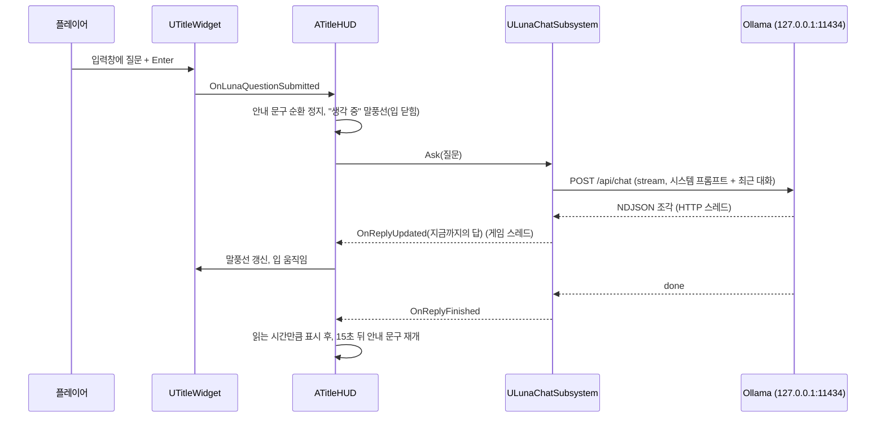

# Luna 대화 (로컬 LLM)

타이틀의 안내자 Luna에게 질문을 입력하면, 같은 PC에서 도는 Ollama 모델이 답을 만들어 말풍선에 보여 줍니다.
- 답은 토큰이 도착하는 대로 말풍선에 이어 쓰고, 그동안 Luna의 입 모양 morph target이 움직입니다.
- 게임 서버나 외부 API를 쓰지 않습니다.

## 흐름



| 코드 | 역할 |
| --- | --- |
| [`LunaChatSubsystem`](../Source/LabProject/Luna/LunaChatSubsystem.h) | 요청 생성, 스트리밍 수신, 대화 기록(최근 4쌍), 취소 |
| [`LunaChatProtocol`](../Source/LabProject/Luna/LunaChatProtocol.h) | NDJSON 줄 해석, `<think>` 구간 제거, 말풍선용 정리(자동화 테스트) |
| [`LunaChatSettings`](../Source/LabProject/Luna/LunaChatSettings.h) | 주소, 모델, 온도, 최대 토큰, 시간 제한 (Project Settings → Game → Luna Chat) |
| [`TitleWidget`](../Source/LabProject/UI/Title/TitleWidget.cpp) | 입력창 생성(말풍선처럼 C++ 위젯 트리로), Enter 처리 |
| [`TitleHUD`](../Source/LabProject/Lobby/Contents/TitleHUD.cpp) | 말풍선 타이밍, 입 모양, 안내 문구와 대화의 전환 |

## 설계 포인트

- **근거가 있는 답:** 시스템 프롬프트의 게임 지식은 따로 쓰지 않고, `DT_MenuText`의 Luna 안내 문구 20개를 현재 메뉴 언어로 읽어 넣습니다.
  - 안내 문구를 고치면 Luna의 답도 따라 바뀝니다.
  - 문구에 없는 내용은 모른다고 말하고 가이드 메뉴를 권하게 했습니다.
- **답하는 언어:** 플레이어가 어떤 언어로 물어도 메뉴 언어(12개 중 하나)로 답합니다. 언어가 바뀌면 이전 대화를 비웁니다.
- **스레드:** 스트림 콜백은 HTTP 스레드에서 옵니다.
  - 이 콜백에서는 잠금이 걸린 버퍼에 바이트만 쌓고, 해석과 UI 알림은 게임 스레드에서 합니다.
  - 완료 콜백이 마지막 조각보다 먼저 올 수 있어, 완료 시점에 남은 바이트를 먼저 처리합니다.
- **조각 경계:** 네트워크 조각은 줄이나 한글(UTF-8 3바이트) 중간에서 끊길 수 있습니다.
  - 바이트를 모아 두었다가 `\n`까지 온 줄만 해석합니다. `\n`은 UTF-8 다중 바이트 문자 안에 나오지 않습니다.
  - 테스트는 1바이트씩 넣어 모든 경계를 확인합니다.
- **취소:** 답하는 중에 새 질문이 오거나 타이틀을 떠나면 요청을 취소합니다. 요청 번호를 먼저 바꿔서 늦게 도착한 조각은 버립니다.
- **입력창 스타일:** UE 5.8의 `UEditableTextBox::SetWidgetStyle`은 Slate 위젯이 만들어진 뒤에는 인자의 주소를 Slate에 넘깁니다.
  - 그래서 Slate 위젯이 생기기 전(`NativeOnInitialized`)에 한 번만 설정합니다.
  - 플레이어가 어떤 언어로 쳐도 깨지지 않게 CJK 폰트를 씁니다.
- **말풍선 위치:** 꼬리는 말풍선 폭의 75% 지점에 두고, 그 꼬리 끝을 Luna 머리 위에 맞춥니다(`LunaSpeechTailFraction`).
  - 몸통이 주로 왼쪽으로 펼쳐집니다. 그래서 가장 긴 답(줄바꿈 폭 420 + 여백)도 오른쪽 위 게임 설정 버튼에 가리지 않습니다.
- **Luna 머티리얼:** 눈 깜빡임(`Key_1`)과 입(`Key_2`)은 모프 타깃이고, 얼굴이 있는 몸 머티리얼 영역에 걸려 있습니다.
  - 모프 타깃이 켜질 때 머티리얼에 "Used with Morph Targets"가 없으면, 엔진이 그 영역을 기본 머티리얼(회색)로 바꿉니다. 모프를 꺼도 되돌리지 않습니다.
  - 에디터 PIE에서는 이 플래그가 자동으로 켜지지만, 독립 실행(`-game`)과 패키징 빌드에서는 켜지지 않습니다. 그래서 피부가 가끔 회색으로 보였습니다.
  - 가져올 때 만들어진 부모(엔진 플러그인의 `FBXLegacyPhongSurfaceMaterial`)는 고칠 수 없습니다. 그래서 프로젝트에 복사본 `M_LunaSurface`를 만들어 플래그를 켜고, Luna 머티리얼 4개의 부모로 바꿨습니다.
  - Luna FBX를 다시 가져오면 부모가 원래대로 돌아가니, 그때는 `M_LunaSurface`로 다시 바꿉니다.

## 설치

1. Ollama 설치: `winget install --id Ollama.Ollama --exact`
   - 설치하면 백그라운드에서 `127.0.0.1:11434` 서버가 실행됩니다.
2. 모델 받기: `ollama pull gemma3:4b`
   - 약 3.3GB입니다. 12개 메뉴 언어를 모두 다루는 다국어 모델이라 골랐습니다.
   - 이 PC의 네트워크에서는 Ollama 모델 저장소의 일부 IP(Cloudflare R2 `172.64.66.1`)가 응답하지 않습니다. 그래서 같은 가중치를 Hugging Face에서 받아 이름을 맞췄습니다.
     ```powershell
     ollama pull hf.co/ggml-org/gemma-3-4b-it-GGUF:Q4_K_M
     ollama cp hf.co/ggml-org/gemma-3-4b-it-GGUF:Q4_K_M gemma3:4b
     ```
3. 다른 모델을 쓰려면 Project Settings → Game → Luna Chat의 `Model`을 바꿉니다.
   - ini에서 주소를 바꿀 때는 `OllamaUrl="http://..."`처럼 따옴표로 감쌉니다. 따옴표 없는 `//`는 주석으로 잘립니다.

Ollama가 꺼져 있거나 모델이 없으면 Luna가 "지금은 대답하기 어려워요"라고 말합니다. 원인은 `LogLunaChat` 경고에 남습니다.

## 확인 결과 (RX 7600 8GB)

- **속도:** 모델이 GPU에 전부 올라가며(2.7GB), 초당 약 78토큰입니다.
  - 첫 질문은 모델을 올리느라 약 5초가 걸리고, 이후는 1초 안팎입니다.
  - `keep_alive` 15분 동안 메모리에 남습니다.
- **게임 안 확인:** 입력창에 영어로 "What is the training room for?"를 입력하고 Enter를 눌렀습니다.
  - 입력창이 비워지고, Luna가 메뉴 언어인 한국어로 훈련장 안내 문구에 근거한 답을 말풍선에 보여 주었습니다.
- **자동화 테스트:** `LabProject.Luna.Protocol.*` 2개가 통과합니다.

콘솔 명령 `pd.Luna.Ask <질문>`으로 입력창 없이 질문할 수 있습니다. 답은 말풍선과 `LogLunaChat` 로그에 함께 나옵니다.
