# 프로젝트 핵심 함수 50개

| 번호 | 함수 · 흐름도로 이동 | 핵심 역할 |
| --- | --- | --- |
| 1 | [UOnlineSessionsSubsystem::BeginCreateRoomSession](#fn-uonlinesessionssubsystem-begincreateroomsession) | 세션 생성 요청을 검증하고 방 생성 절차를 시작한다. |
| 2 | [UOnlineSessionsSubsystem::BeginJoinRoomSession](#fn-uonlinesessionssubsystem-beginjoinroomsession) | 선택한 세션을 검증하고 참가 절차를 시작한다. |
| 3 | [ULobbyMatchCoordinator::TryStartGame](#fn-ulobbymatchcoordinator-trystartgame) | 인원·팀 균형·Experience 준비 상태를 검사하고 게임 시작을 예약한다. |
| 4 | [ULobbyTravelCoordinator::PreloadContentAndScheduleTravel](#fn-ulobbytravelcoordinator-preloadcontentandscheduletravel) | 게임 진입 콘텐츠가 준비되면 서버의 맵 이동을 예약한다. |
| 5 | [UExperienceManagerComponent::SetCurrentExperienceAuth](#fn-uexperiencemanagercomponent-setcurrentexperienceauth) | 서버에서 Experience ID를 설정하고 복제와 로딩을 시작한다. |
| 6 | [UExperienceManagerComponent::StartExperienceLoad](#fn-uexperiencemanagercomponent-startexperienceload) | Experience Primary Asset의 비동기 로딩과 핸들 수명을 관리한다. |
| 7 | [UGameFeatureAction_AddAbilities::RegisterAbilityExtension](#fn-ugamefeatureaction-addabilities-registerabilityextension) | 액터가 준비됐을 때 능력을 부여하고 비활성화 시 회수하도록 등록한다. |
| 8 | [ACharacterBase::TryInitializeCharacterRuntime](#fn-acharacterbase-tryinitializecharacterruntime) | BeginPlay와 콘텐츠 준비가 끝난 뒤 캐릭터 시스템을 한 번 초기화한다. |
| 9 | [UAbilityStateComponent::TryInitializeAbilitySystemActorInfo](#fn-uabilitystatecomponent-tryinitializeabilitysystemactorinfo) | ASC의 Owner·Avatar를 연결하고 초기화 지연과 Pawn 교체를 처리한다. |
| 10 | [APdPlayerState::CopyProperties](#fn-apdplayerstate-copyproperties) | PlayerState가 교체될 때 기존 매치 정보를 새 PlayerState에 인계한다. |
| 11 | [UPlayerLoadoutComponent::ApplySelectedLoadout](#fn-uplayerloadoutcomponent-applyselectedloadout) | 선택한 로드아웃에 맞춰 서버의 무기와 판도라를 반영한다. |
| 12 | [FPandoraSkillBinder::GrantPandoraContent](#fn-fpandoraskillbinder-grantpandoracontent) | 해금된 판도라 능력을 중복 없이 부여하고 원본 스킬 정보를 연결한다. |
| 13 | [UAbilityCollectionRuntime::AbilityInputTagPressed](#fn-uabilitycollectionruntime-abilityinputtagpressed) | 입력 태그에 해당하는 능력을 찾아 누름 상태를 전달하거나 활성화한다. |
| 14 | [UPdAbilitySystemComponent::ClientActivateAbilitySucceedWithEventData_Implementation](#fn-updabilitysystemcomponent-clientactivateabilitysucceedwitheventdata-implementation) | 클라이언트의 판도라 원본 데이터가 준비되지 않았다면 활성화 승인을 보류한다. |
| 15 | [UBasicAttributeSet::ApplyIncomingDamage](#fn-ubasicattributeset-applyincomingdamage) | 무적·실드·체력을 고려해 피해를 적용하고 사망 처리로 연결한다. |
| 16 | [UCharacterDeathComponent::HandleDeadTagChanged](#fn-ucharacterdeathcomponent-handledeadtagchanged) | Dead 태그에 따라 사망 상태를 처리하고 서버에서 리스폰을 요청한다. |
| 17 | [UInventoryComponent::AddItemsByPrimaryAssetIdsWithCompletion](#fn-uinventorycomponent-additemsbyprimaryassetidswithcompletion) | 아이템을 비동기로 로드한 뒤 지급하고 실제 추가 결과를 전달한다. |
| 18 | [UInventoryComponent::HandleReplicatedEntryAddedOrChanged](#fn-uinventorycomponent-handlereplicatedentryaddedorchanged) | 복제 엔트리의 데이터를 런타임 아이템 객체와 분류 목록에 반영한다. |
| 19 | [UPaintCanvasComponent::CommitAuthoritativePaintStrokeBatch](#fn-upaintcanvascomponent-commitauthoritativepaintstrokebatch) | 서버에서 스트로크 배치를 검증하고 복제 기록·시퀀스·체크섬을 갱신한다. |
| 20 | [UExperienceMatchFlowComponent::HandleMatchTimerExpired](#fn-uexperiencematchflowcomponent-handlematchtimerexpired) | 시간 종료 시 승자를 판정하고 필요하면 Golden Kill로 전환한다. |
| 21 | [UOnlineSessionsSubsystem::BeginQuickMatch](#fn-uonlinesessionssubsystem-beginquickmatch) | 빠른 참가 요청을 만들고 기존 세션 정리 또는 방 검색을 시작한다. |
| 22 | [UOnlineSessionsSubsystem::CancelSessionRequest](#fn-uonlinesessionssubsystem-cancelsessionrequest) | 진행 중인 온라인 요청을 단계에 맞춰 취소하고 중복 완료 통지를 막는다. |
| 23 | [UOnlineSessionsSubsystem::OnJoinSessionCompleted](#fn-uonlinesessionssubsystem-onjoinsessioncompleted) | 참가 완료 콜백의 요청 ID와 사용자 신원을 검증하고 클라이언트를 이동시킨다. |
| 24 | [UExperienceManagerComponent::HandleGameFeaturesLoaded](#fn-uexperiencemanagercomponent-handlegamefeaturesloaded) | GameFeature별 로딩 결과를 확인하고 Experience 완료 또는 실패를 확정한다. |
| 25 | [UExperienceManagerComponent::DeactivateExperience](#fn-uexperiencemanagercomponent-deactivateexperience) | Experience 종료 시 콜백과 로딩 자원을 해제하고 복제 ID를 비운다. |
| 26 | [UActorExtensionWorldSubsystem::RegisterExtensionForClass](#fn-uactorextensionworldsubsystem-registerextensionforclass) | 클래스별 액터 확장을 등록하고 기존 액터에도 적용을 예약한다. |
| 27 | [UActorExtensionWorldSubsystem::Tick](#fn-uactorextensionworldsubsystem-tick) | 대기 액터의 준비 조건을 확인해 확장을 한 번 활성화한다. |
| 28 | [UGameFeatureAction_AddAttributes::AddAttributesToActor](#fn-ugamefeatureaction-addattributes-addattributestoactor) | GameFeature에서 AttributeSet과 속성 설정을 액터의 ASC에 적용한다. |
| 29 | [UExperiencePlayerProvisioningComponent::PreparePlayerForGameplay](#fn-uexperienceplayerprovisioningcomponent-prepareplayerforgameplay) | 플레이어의 지급 콘텐츠 준비를 기다린 뒤 게임 진입 구성을 시작한다. |
| 30 | [UDefaultPlayerProvisioner::TryProvisionPlayer](#fn-udefaultplayerprovisioner-tryprovisionplayer) | 모드 수치·아이템·판도라·제스처 지급을 진행하고 전체 준비 여부를 반환한다. |
| 31 | [UExperienceSpawnComponent::FinishPlayerRespawn](#fn-uexperiencespawncomponent-finishplayerrespawn) | 기존 Pawn 재사용 또는 새 Pawn 생성으로 리스폰을 마무리한다. |
| 32 | [UPlayerMatchComponent::SetPlayerMatchIdentity](#fn-uplayermatchcomponent-setplayermatchidentity) | 서버에서 매치 식별 정보를 바꾸고 복제와 변경 이벤트를 발생시킨다. |
| 33 | [UPlayerMatchComponent::ResetForNewMatch](#fn-uplayermatchcomponent-resetfornewmatch) | 새 매치에서 점수·사망 횟수·시작 지역을 초기화한다. |
| 34 | [UPlayerLoadoutComponent::ServerSelectLoadout_Implementation](#fn-uplayerloadoutcomponent-serverselectloadout-implementation) | 서버에서 선택 번호를 보정하고 동일한 번호의 로드아웃도 다시 적용한다. |
| 35 | [UPandoraComponent::SelectPandoraByPrimaryAssetId](#fn-upandoracomponent-selectpandorabyprimaryassetid) | 보유 판도라를 선택하거나 해제하고 능력 바인딩을 갱신한다. |
| 36 | [UPandoraComponent::SetPandoraLoadoutSlotInternal](#fn-upandoracomponent-setpandoraloadoutslotinternal) | 판도라 슬롯의 소유권을 검증해 등록·변경·해제하고 선택 중인 슬롯을 재적용한다. |
| 37 | [FPandoraSkillBinder::RefreshInputBindings](#fn-fpandoraskillbinder-refreshinputbindings) | 부여된 능력은 유지하면서 선택 판도라의 입력 태그만 갱신한다. |
| 38 | [UAbilityCollectionRuntime::AbilityInputTagReleased](#fn-uabilitycollectionruntime-abilityinputtagreleased) | 판도라를 바꿔도 입력을 처음 받은 능력에 해제 이벤트를 전달한다. |
| 39 | [UPdGameplayAbility::PreActivate](#fn-updgameplayability-preactivate) | 새 시전 직전에 판도라 방향을 확정하고 이전 연출·장비 전환을 정리한다. |
| 40 | [UPdGameplayAbility::CommitAbility](#fn-updgameplayability-commitability) | 능력 커밋 후 이동·취소 정책과 자기 버프를 적용한다. |
| 41 | [UPdGameplayAbility::MakeConfiguredDamageEffectSpec](#fn-updgameplayability-makeconfigureddamageeffectspec) | 공격자·원본 정보와 SetByCaller 피해량이 담긴 GameplayEffect Spec을 만든다. |
| 42 | [UStatusEffectReplicationComponent::UpdateStatusEffectDecay](#fn-ustatuseffectreplicationcomponent-updatestatuseffectdecay) | 경과 시간으로 상태 이상 스택을 감소시키고 다음 감소 시점을 예약한다. |
| 43 | [UPlayerRewardComponent::ApplyInteractRewardsInternal](#fn-uplayerrewardcomponent-applyinteractrewardsinternal) | 서버에서 상호작용 가능 여부를 검사한 뒤 보상 지급을 요청한다. |
| 44 | [UInventoryComponent::MergeUpgradeableItems](#fn-uinventorycomponent-mergeupgradeableitems) | 장착·슬롯 참조를 보존하면서 중복 아이템을 합쳐 강화한다. |
| 45 | [UInventoryComponent::SplitConsumableStack](#fn-uinventorycomponent-splitconsumablestack) | 서버에서 소비 아이템 스택을 둘로 나누고 변경 통지를 묶어 처리한다. |
| 46 | [UEquipmentComponent::RequestWeaponSelectionForDirection](#fn-uequipmentcomponent-requestweaponselectionfordirection) | 무기 콘텐츠 로딩과 장착·해제 상태를 고려해 선택 요청을 처리한다. |
| 47 | [UPaintCanvasComponent::ReconcileReplicatedPaintState](#fn-upaintcanvascomponent-reconcilereplicatedpaintstate) | 서버 페인트 기록과 예측 화면을 비교해 증분 적용하거나 캔버스를 재구성한다. |
| 48 | [UAbilityStateComponent::OnFrozenTagChanged](#fn-uabilitystatecomponent-onfrozentagchanged) | 빙결 동안 공격·이동·회전을 잠그고 해제 시 살아 있는 캐릭터를 복구한다. |
| 49 | [UHealthBarViewModel::InitializeViewModel](#fn-uhealthbarviewmodel-initializeviewmodel) | ASC 변경에 맞춰 속성 델리게이트를 연결하고 체력바 데이터를 초기화한다. |
| 50 | [UPlayerProfileSubsystem::BeginAsyncSave](#fn-uplayerprofilesubsystem-beginasyncsave) | 프로필 스냅샷으로 비동기 저장을 시작하고 중복 저장·재시도를 관리한다. |

## 1. UOnlineSessionsSubsystem::BeginCreateRoomSession

<a id="fn-uonlinesessionssubsystem-begincreateroomsession"></a>

세션 생성 요청을 검증하고 방 생성 절차를 시작한다.

[소스 코드](../Source/LabProject/Online/OnlineSessionsSubsystem.cpp#L205)

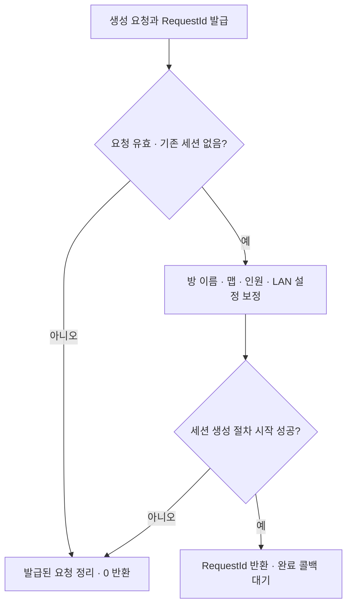

## 2. UOnlineSessionsSubsystem::BeginJoinRoomSession

<a id="fn-uonlinesessionssubsystem-beginjoinroomsession"></a>

선택한 세션을 검증하고 참가 절차를 시작한다.

[소스 코드](../Source/LabProject/Online/OnlineSessionsSubsystem.cpp#L268)

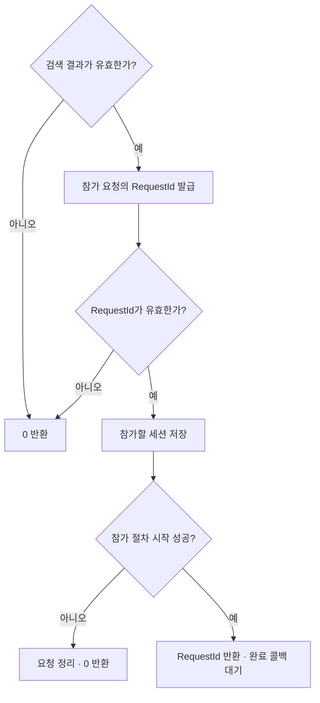

## 3. ULobbyMatchCoordinator::TryStartGame

<a id="fn-ulobbymatchcoordinator-trystartgame"></a>

인원·팀 균형·Experience 준비 상태를 검사하고 게임 시작을 예약한다.

[소스 코드](../Source/LabProject/Lobby/Coordination/LobbyMatchCoordinator.cpp#L62)

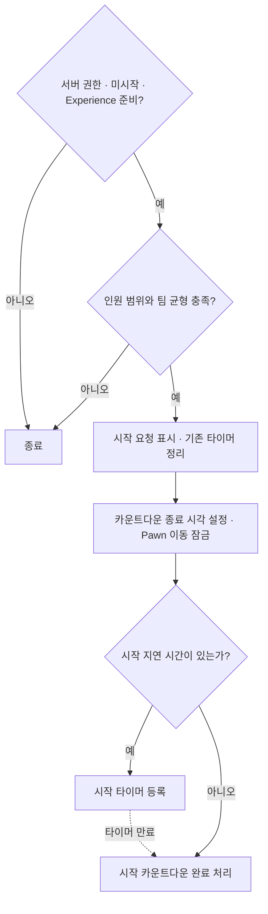

## 4. ULobbyTravelCoordinator::PreloadContentAndScheduleTravel

<a id="fn-ulobbytravelcoordinator-preloadcontentandscheduletravel"></a>

게임 진입 콘텐츠가 준비되면 서버의 맵 이동을 예약한다.

[소스 코드](../Source/LabProject/Lobby/Coordination/LobbyTravelCoordinator.cpp#L259)

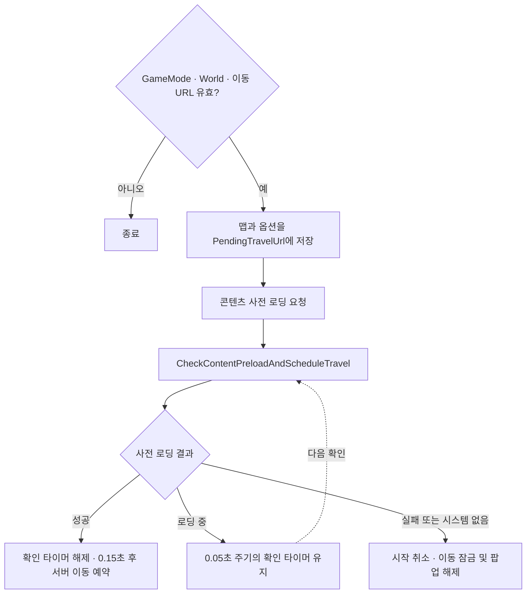

## 5. UExperienceManagerComponent::SetCurrentExperienceAuth

<a id="fn-uexperiencemanagercomponent-setcurrentexperienceauth"></a>

서버에서 Experience ID를 설정하고 복제와 로딩을 시작한다.

[소스 코드](../Source/LabProject/Component/Experience/ExperienceManagerComponent.cpp#L80)

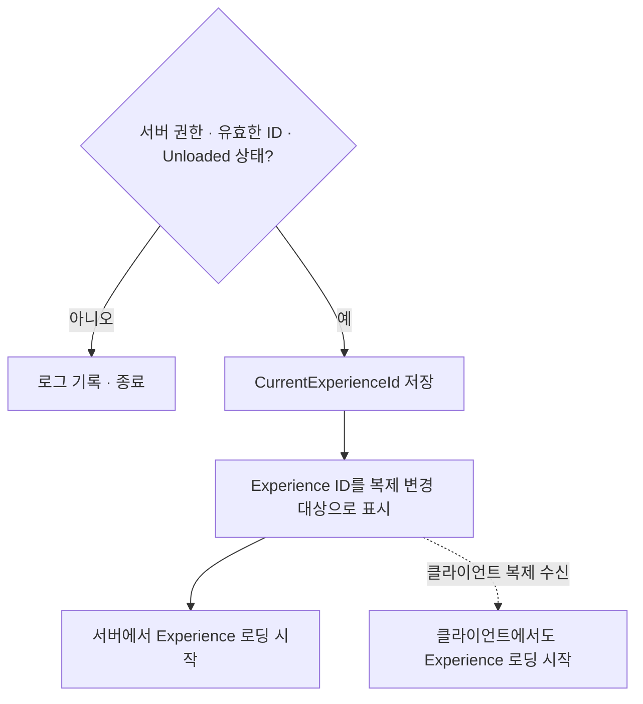

## 6. UExperienceManagerComponent::StartExperienceLoad

<a id="fn-uexperiencemanagercomponent-startexperienceload"></a>

Experience Primary Asset의 비동기 로딩과 핸들 수명을 관리한다.

[소스 코드](../Source/LabProject/Component/Experience/ExperienceManagerComponent.cpp#L152)

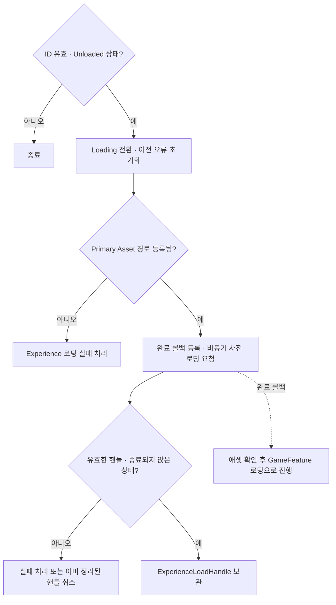

## 7. UGameFeatureAction_AddAbilities::RegisterAbilityExtension

<a id="fn-ugamefeatureaction-addabilities-registerabilityextension"></a>

액터가 준비됐을 때 능력을 부여하고 비활성화 시 회수하도록 등록한다.

[소스 코드](../Source/LabProject/GameFeature/GameFeatureAction_AddAbilities.cpp#L189)

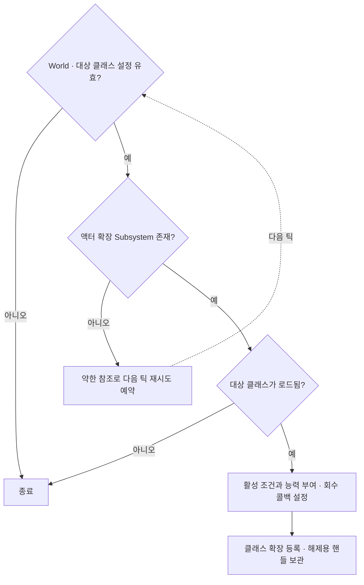

## 8. ACharacterBase::TryInitializeCharacterRuntime

<a id="fn-acharacterbase-tryinitializecharacterruntime"></a>

BeginPlay와 콘텐츠 준비가 끝난 뒤 캐릭터 시스템을 한 번 초기화한다.

[소스 코드](../Source/LabProject/Character/CharacterBase.cpp#L212)

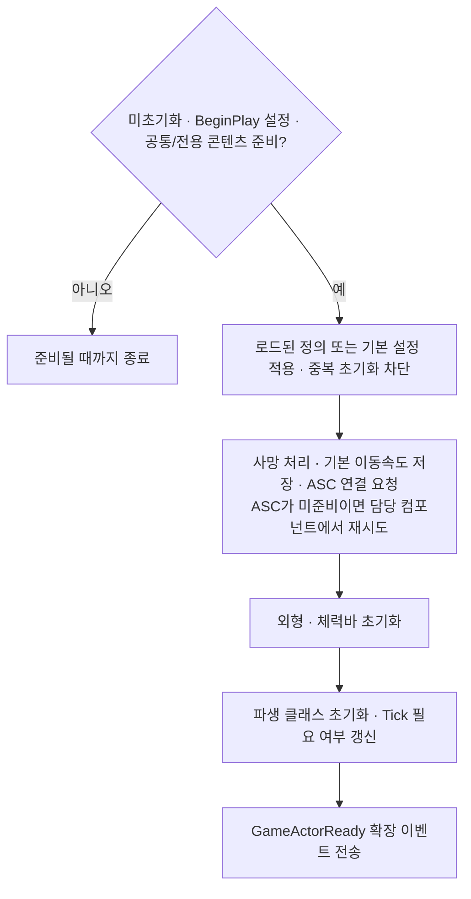

## 9. UAbilityStateComponent::TryInitializeAbilitySystemActorInfo

<a id="fn-uabilitystatecomponent-tryinitializeabilitysystemactorinfo"></a>

ASC의 Owner·Avatar를 연결하고 초기화 지연과 Pawn 교체를 처리한다.

[소스 코드](../Source/LabProject/Component/Character/AbilityStateComponent.cpp#L63)

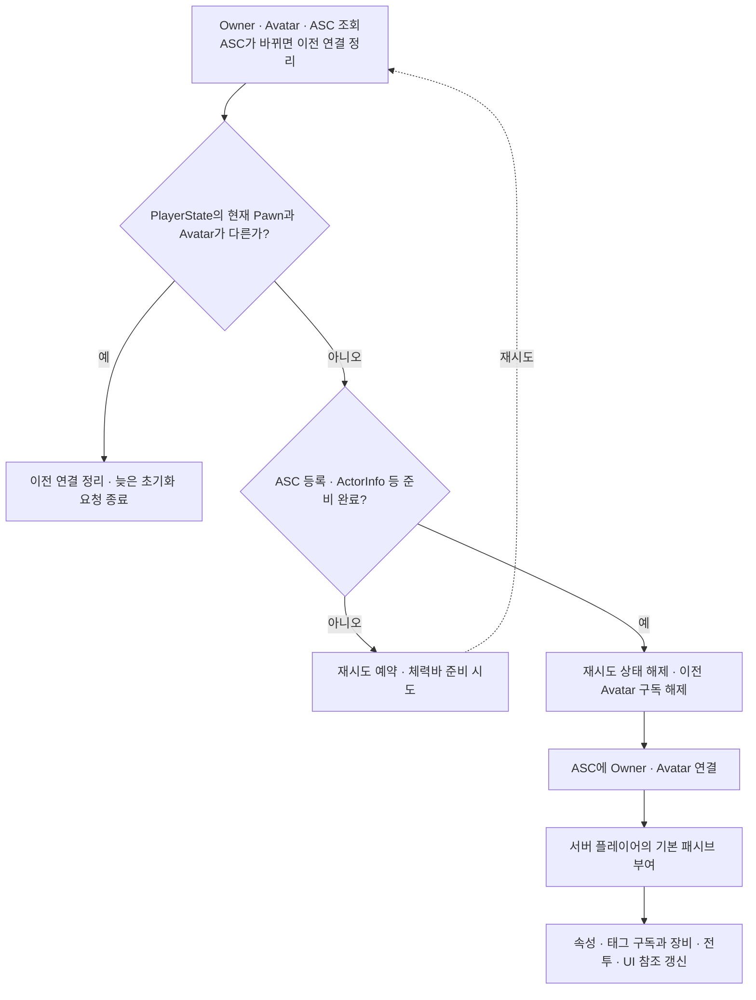

## 10. APdPlayerState::CopyProperties

<a id="fn-apdplayerstate-copyproperties"></a>

PlayerState가 교체될 때 기존 매치 정보를 새 PlayerState에 인계한다.

[소스 코드](../Source/LabProject/Mode/PdPlayerState.cpp#L58)

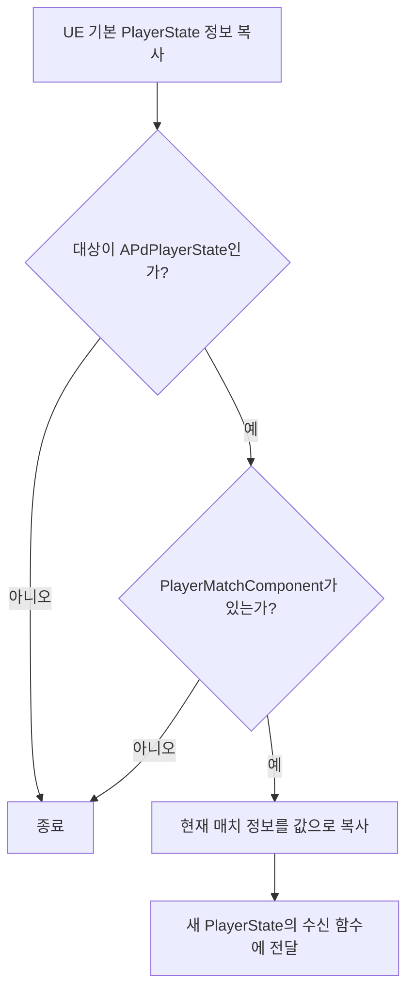

## 11. UPlayerLoadoutComponent::ApplySelectedLoadout

<a id="fn-uplayerloadoutcomponent-applyselectedloadout"></a>

선택한 로드아웃에 맞춰 서버의 무기와 판도라를 반영한다.

[소스 코드](../Source/LabProject/Component/Player/PlayerLoadoutComponent.cpp#L49)

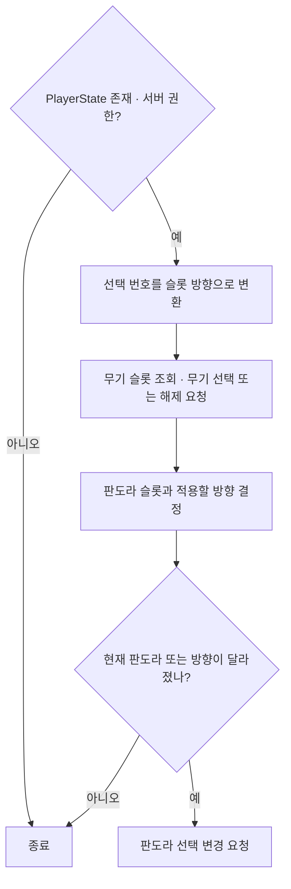

## 12. FPandoraSkillBinder::GrantPandoraContent

<a id="fn-fpandoraskillbinder-grantpandoracontent"></a>

해금된 판도라 능력을 중복 없이 부여하고 원본 스킬 정보를 연결한다.

[소스 코드](../Source/LabProject/Pandora/PandoraSkillBinder.cpp#L63)

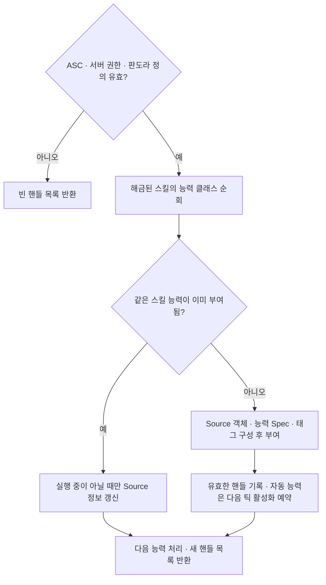

## 13. UAbilityCollectionRuntime::AbilityInputTagPressed

<a id="fn-uabilitycollectionruntime-abilityinputtagpressed"></a>

입력 태그에 해당하는 능력을 찾아 누름 상태를 전달하거나 활성화한다.

[소스 코드](../Source/LabProject/Component/AbilitySystem/AbilityCollectionRuntime.cpp#L63)

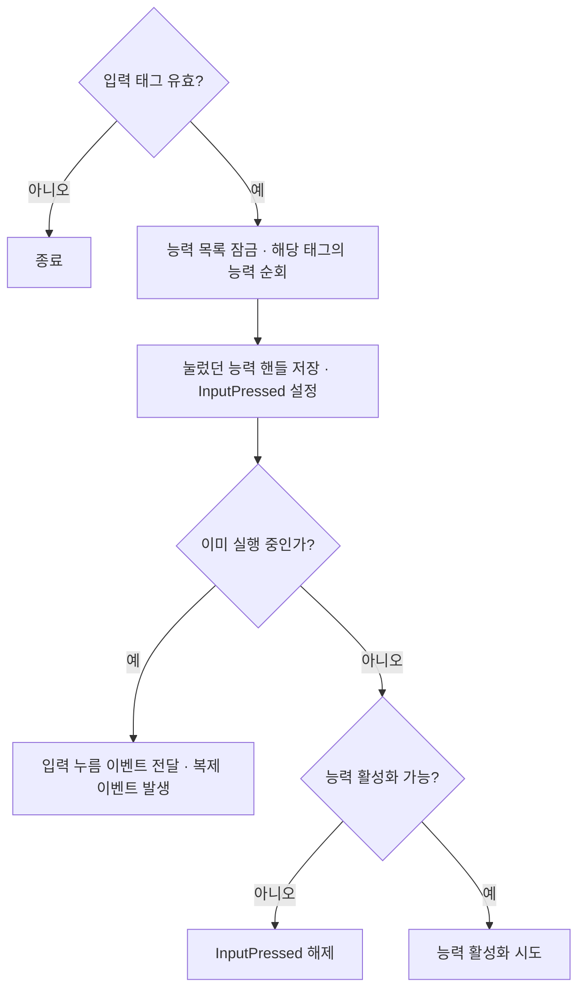

## 14. UPdAbilitySystemComponent::ClientActivateAbilitySucceedWithEventData_Implementation

<a id="fn-updabilitysystemcomponent-clientactivateabilitysucceedwitheventdata-implementation"></a>

클라이언트의 판도라 원본 데이터가 준비되지 않았다면 활성화 승인을 보류한다.

[소스 코드](../Source/LabProject/Component/AbilitySystem/PdAbilitySystemComponent.cpp#L408)

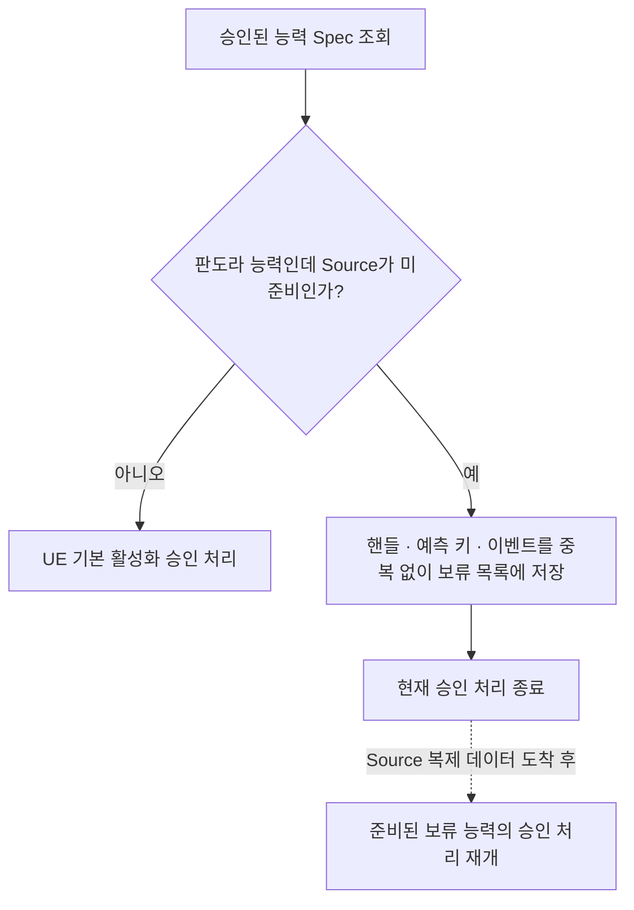

## 15. UBasicAttributeSet::ApplyIncomingDamage

<a id="fn-ubasicattributeset-applyincomingdamage"></a>

무적·실드·체력을 고려해 피해를 적용하고 사망 처리로 연결한다.

[소스 코드](../Source/LabProject/AbilitySystem/AttributeSet/BasicAttributeSet.cpp#L951)

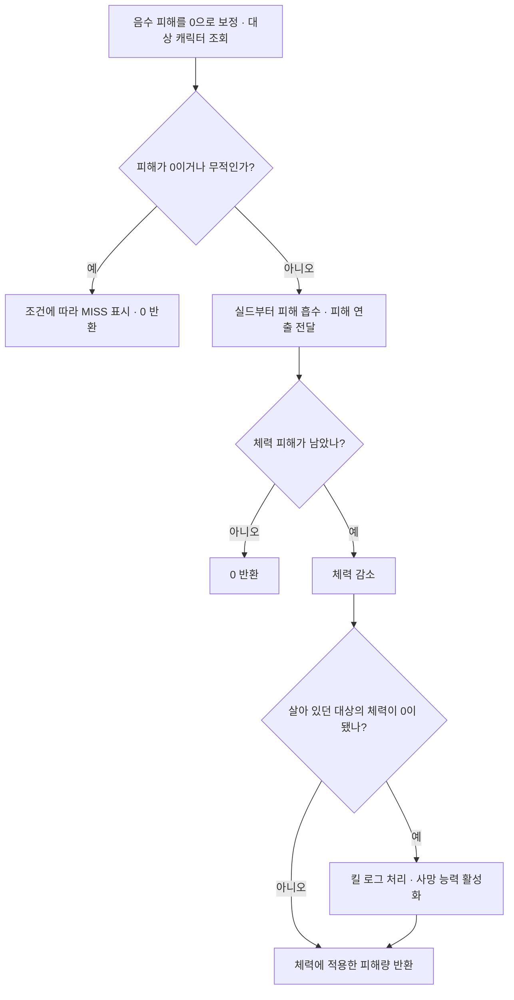

## 16. UCharacterDeathComponent::HandleDeadTagChanged

<a id="fn-ucharacterdeathcomponent-handledeadtagchanged"></a>

Dead 태그에 따라 사망 상태를 처리하고 서버에서 리스폰을 요청한다.

[소스 코드](../Source/LabProject/Component/Character/CharacterDeathComponent.cpp#L62)

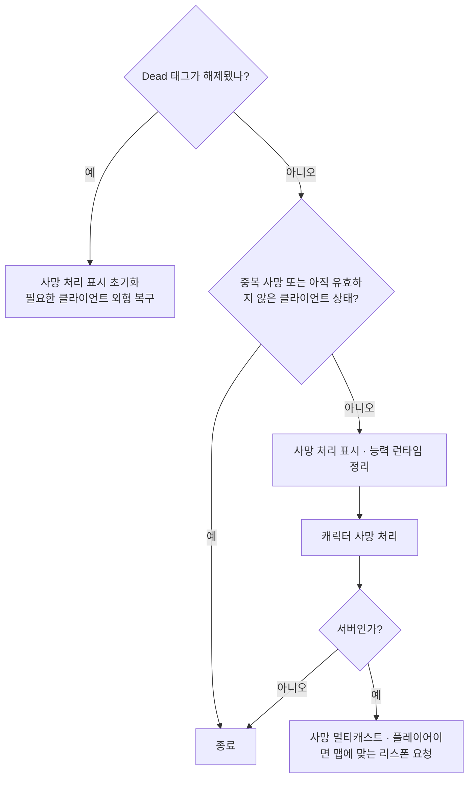

## 17. UInventoryComponent::AddItemsByPrimaryAssetIdsWithCompletion

<a id="fn-uinventorycomponent-additemsbyprimaryassetidswithcompletion"></a>

아이템을 비동기로 로드한 뒤 지급하고 실제 추가 결과를 전달한다.

[소스 코드](../Source/LabProject/Component/Item/InventoryComponent.cpp#L114)

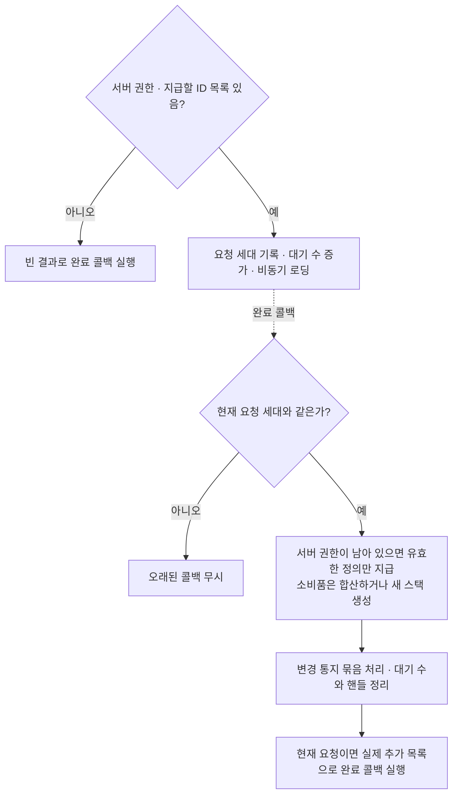

## 18. UInventoryComponent::HandleReplicatedEntryAddedOrChanged

<a id="fn-uinventorycomponent-handlereplicatedentryaddedorchanged"></a>

복제 엔트리의 데이터를 런타임 아이템 객체와 분류 목록에 반영한다.

[소스 코드](../Source/LabProject/Component/Item/InventoryComponentReplication.cpp#L88)

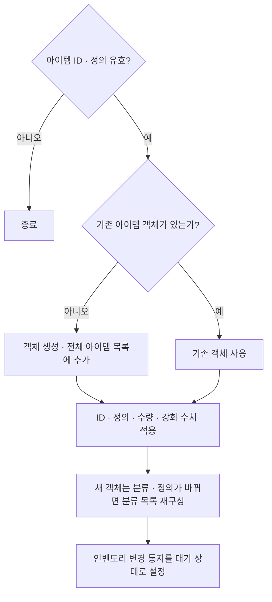

## 19. UPaintCanvasComponent::CommitAuthoritativePaintStrokeBatch

<a id="fn-upaintcanvascomponent-commitauthoritativepaintstrokebatch"></a>

서버에서 스트로크 배치를 검증하고 복제 기록·시퀀스·체크섬을 갱신한다.

[소스 코드](../Source/LabProject/Component/Player/PaintCanvasComponent.cpp#L812)

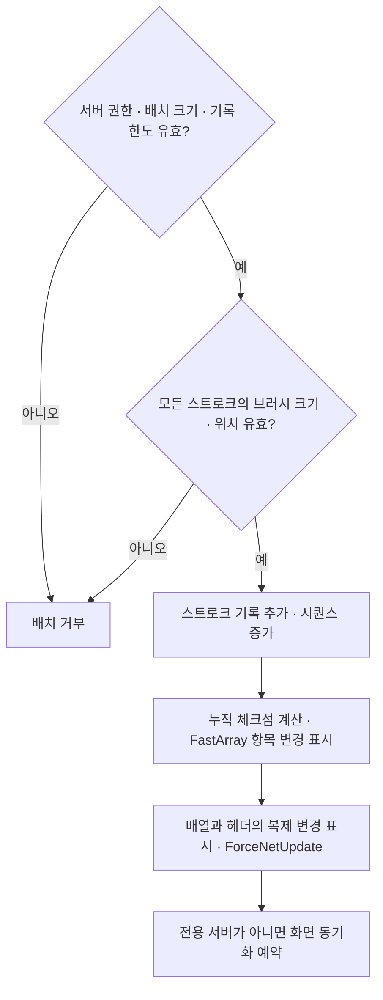

## 20. UExperienceMatchFlowComponent::HandleMatchTimerExpired

<a id="fn-uexperiencematchflowcomponent-handlematchtimerexpired"></a>

시간 종료 시 승자를 판정하고 필요하면 Golden Kill로 전환한다.

[소스 코드](../Source/LabProject/Component/Experience/ExperienceMatchFlowComponent.cpp#L374)

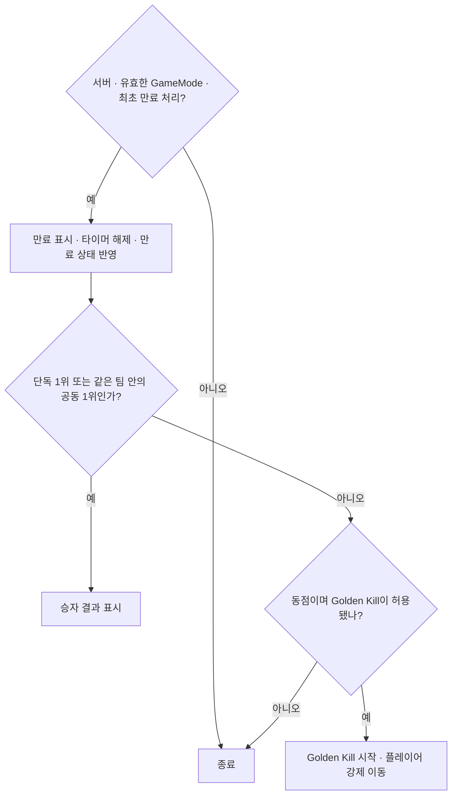

## 21. UOnlineSessionsSubsystem::BeginQuickMatch

<a id="fn-uonlinesessionssubsystem-beginquickmatch"></a>

빠른 참가 요청을 만들고 기존 세션 정리 또는 방 검색을 시작한다.

[소스 코드](../Source/LabProject/Online/OnlineSessionsSubsystem.cpp#L319)

```mermaid
flowchart TD
    A["QuickMatch 요청 ID 발급"] --> B{"요청 시작이 허용됐나?"}
    B -- 아니오 --> X["0 반환"]
    B -- 예 --> C["검색 수 · 인원 · 이름 · LAN · 로비 옵션 보정"]
    C --> D{"기존 세션이 있는가?"}
    D -- 예 --> E["기존 세션 제거 절차 시작"]
    D -- 아니오 --> F["방 검색 절차 시작"]
    E --> G["시작 성공이면 ID 반환<br/>실패하면 요청 정리 후 0 반환"]
    F --> G
```

## 22. UOnlineSessionsSubsystem::CancelSessionRequest

<a id="fn-uonlinesessionssubsystem-cancelsessionrequest"></a>

진행 중인 온라인 요청을 단계에 맞춰 취소하고 중복 완료 통지를 막는다.

[소스 코드](../Source/LabProject/Online/OnlineSessionsSubsystem.cpp#L359)

```mermaid
flowchart TD
    A{"활성 요청 · 미취소 · 미통지 상태?"} -- 아니오 --> X["false 반환"]
    A -- 예 --> B["취소 요청 표시 · 제한 시간 타이머 해제"]
    B --> C{"현재 방 검색 중인가?"}
    C -- 예 --> D["검색 취소 요청 · 실패 통지 · 요청 정리"]
    C -- 아니오 --> E["생성 · 참가 · 제거 단계의 취소 상태로 전환"]
    E --> F["실패 통지 · 후속 완료 콜백에서 정리하도록 대기"]
    D --> G["true 반환"]
    F --> G
```

## 23. UOnlineSessionsSubsystem::OnJoinSessionCompleted

<a id="fn-uonlinesessionssubsystem-onjoinsessioncompleted"></a>

참가 완료 콜백의 요청 ID와 사용자 신원을 검증하고 클라이언트를 이동시킨다.

[소스 코드](../Source/LabProject/Online/OnlineSessionsSubsystemRequestFlow.cpp#L596)

```mermaid
flowchart TD
    A{"현재 요청에 해당하는 콜백인가?"} -- 아니오 --> X["이전 콜백 무시"]
    A -- 예 --> B["참가 결과 · 접속 주소 · 현재 사용자 확인"]
    B --> C["해당 델리게이트와 제한 시간 타이머 해제"]
    C --> D{"취소됐거나 사용자가 달라졌나?"}
    D -- 예 --> E["미통지 실패 알림 · 취소된 참가 결과 정리"]
    D -- 아니오 --> F["성공이면 Controller로 ClientTravel<br/>Controller가 없으면 실패로 처리"]
    F --> G["요청 종류에 맞는 완료 통지 · 활성 요청 정리"]
```

## 24. UExperienceManagerComponent::HandleGameFeaturesLoaded

<a id="fn-uexperiencemanagercomponent-handlegamefeaturesloaded"></a>

GameFeature별 로딩 결과를 확인하고 Experience 완료 또는 실패를 확정한다.

[소스 코드](../Source/LabProject/Component/Experience/ExperienceManagerComponent.cpp#L240)

```mermaid
flowchart TD
    A{"현재 LoadingGameFeatures 상태인가?"} -- 아니오 --> X["늦은 콜백 무시"]
    A -- 예 --> B["플러그인별 로딩 결과 확인"]
    B --> C{"오류가 하나라도 있는가?"}
    C -- 예 --> D["오류 정보와 함께 Experience 실패 처리"]
    C -- 아니오 --> E["Loaded 전환 · 실패 정보 초기화"]
    E --> F["Experience Loaded 이벤트 공개 · 일회성 콜백 정리"]
```

## 25. UExperienceManagerComponent::DeactivateExperience

<a id="fn-uexperiencemanagercomponent-deactivateexperience"></a>

Experience 종료 시 콜백과 로딩 자원을 해제하고 복제 ID를 비운다.

[소스 코드](../Source/LabProject/Component/Experience/ExperienceManagerComponent.cpp#L295)

```mermaid
flowchart TD
    A{"이미 Deactivating 상태인가?"} -- 예 --> X["중복 종료 무시"]
    A -- 아니오 --> B["Deactivating 전환"]
    B --> C["완료 · 실패 델리게이트 제거"]
    C --> D["로드 핸들과 GameFeature 참조 등 런타임 자원 해제"]
    D --> E["Experience ID 초기화 · 서버이면 복제 변경 표시"]
    E --> F["실패 ID · 오류 메시지 초기화"]
```

## 26. UActorExtensionWorldSubsystem::RegisterExtensionForClass

<a id="fn-uactorextensionworldsubsystem-registerextensionforclass"></a>

클래스별 액터 확장을 등록하고 기존 액터에도 적용을 예약한다.

[소스 코드](../Source/LabProject/GameFeature/ActorExtensionWorldSubsystem.cpp#L147)

```mermaid
flowchart TD
    A{"대상 클래스가 있는가?"} -- 아니오 --> X["빈 핸들 반환"]
    A -- 예 --> B["액터 확장 이벤트 연결 · Experience 상태 확인"]
    B --> C["확장 ID 발급"]
    C --> D["확장 설정 저장 · 클래스와 ID 연결"]
    D --> E["기존 대상 액터를 검사 대기 목록에 추가"]
    E --> F["등록 해제에 사용할 공유 핸들 반환"]
```

## 27. UActorExtensionWorldSubsystem::Tick

<a id="fn-uactorextensionworldsubsystem-tick"></a>

대기 액터의 준비 조건을 확인해 확장을 한 번 활성화한다.

[소스 코드](../Source/LabProject/GameFeature/ActorExtensionWorldSubsystem.cpp#L68)

```mermaid
flowchart TD
    A["미검사 액터에서 해당 확장 목록 수집"] --> B["등록 대기 액터와 확장을 순회"]
    B --> C{"무효 · 이미 활성화 · 적용 대상 아님?"}
    C -- 예 --> D["해당 대기 항목 제거"]
    C -- 아니오 --> E{"CanActivate 조건 충족?"}
    E -- 아니오 --> F["대기 유지 · 다음 틱 재확인"]
    E -- 예 --> G["등록된 OnActivate 실행"]
    G --> H["활성화 기록 · 완료된 대기 항목 제거"]
```

## 28. UGameFeatureAction_AddAttributes::AddAttributesToActor

<a id="fn-ugamefeatureaction-addattributes-addattributestoactor"></a>

GameFeature에서 AttributeSet과 속성 설정을 액터의 ASC에 적용한다.

[소스 코드](../Source/LabProject/GameFeature/GameFeatureAction_AddAttributes.cpp#L269)

```mermaid
flowchart TD
    A{"액터 · ASC 유효 · 설정 미등록?"} -- 아니오 --> X["종료"]
    A -- 예 --> B["서버이면 필요한 AttributeSet 부착"]
    B --> C{"속성 설정 데이터가 있는가?"}
    C -- 아니오 --> X
    C -- 예 --> D["ASC에 설정 등록 · 제거용 핸들 저장"]
    D --> E{"서버의 PlayerState인가?"}
    E -- 예 --> F["속성 기본값과 게임 모드의 설정 포인트 적용"]
    E -- 아니오 --> X
```

## 29. UExperiencePlayerProvisioningComponent::PreparePlayerForGameplay

<a id="fn-uexperienceplayerprovisioningcomponent-prepareplayerforgameplay"></a>

플레이어의 지급 콘텐츠 준비를 기다린 뒤 게임 진입 구성을 시작한다.

[소스 코드](../Source/LabProject/Component/Experience/ExperiencePlayerProvisioningComponent.cpp#L81)

```mermaid
flowchart TD
    A{"Controller · Pawn 유효 · 아직 미준비?"} -- 아니오 --> X["종료"]
    A -- 예 --> B["지급 완료 델리게이트를 중복 없이 연결"]
    B --> C{"지급 콘텐츠가 준비됐나?"}
    C -- 아니오 --> D["플레이어를 대기 목록에 추가 · 사전 로딩 요청"]
    D -. 로딩 완료 후 .-> E["대기 플레이어의 지급 준비 재개"]
    C -- 예 --> F["현재 플레이어의 지급 준비 실행"]
```

## 30. UDefaultPlayerProvisioner::TryProvisionPlayer

<a id="fn-udefaultplayerprovisioner-tryprovisionplayer"></a>

모드 수치·아이템·판도라·제스처 지급을 진행하고 전체 준비 여부를 반환한다.

[소스 코드](../Source/LabProject/Provision/DefaultPlayerProvisioner.cpp#L213)

```mermaid
flowchart TD
    A{"PlayerState 존재 · 서버 권한?"} -- 아니오 --> X["false 반환"]
    A -- 예 --> B{"기본 지급 정의가 있는가?"}
    B -- 아니오 --> C["추가 지급 없이 true 반환"]
    B -- 예 --> D["모드 수치 · 아이템 · 판도라 · 제스처 적용 시도"]
    D --> E["PlayerState의 네트워크 갱신 요청"]
    E --> F["네 항목이 모두 준비됐는지 반환"]
```

## 31. UExperienceSpawnComponent::FinishPlayerRespawn

<a id="fn-uexperiencespawncomponent-finishplayerrespawn"></a>

기존 Pawn 재사용 또는 새 Pawn 생성으로 리스폰을 마무리한다.

[소스 코드](../Source/LabProject/Component/Experience/ExperienceSpawnComponent.cpp#L381)

```mermaid
flowchart TD
    A{"서버 · Controller 유효?"} -- 아니오 --> X["종료"]
    A -- 예 --> B["대기 타이머 기록 제거"]
    B --> C{"게임 결과가 이미 표시됐나?"}
    C -- 예 --> Y["리스폰 카운트다운 숨김 · 종료"]
    C -- 아니오 --> D["PlayerState의 리스폰 상태 초기화 · 스폰 위치 탐색"]
    D --> E{"재사용할 Pawn이 있는가?"}
    E -- 예 --> F["필요하면 재빙의 · 지정 위치 또는 기존 위치에서 복구"]
    E -- 아니오 --> G{"지정 스폰 위치가 있는가?"}
    G -- 아니오 --> Y
    G -- 예 --> H["지정 위치에 새 Pawn 생성 · 사망 상태 복구"]
    F --> I["회전 설정 · 클라이언트 상태 복구 통지 · 카운트다운 숨김"]
    H --> I
```

## 32. UPlayerMatchComponent::SetPlayerMatchIdentity

<a id="fn-uplayermatchcomponent-setplayermatchidentity"></a>

서버에서 매치 식별 정보를 바꾸고 복제와 변경 이벤트를 발생시킨다.

[소스 코드](../Source/LabProject/Component/Player/PlayerMatchComponent.cpp#L30)

```mermaid
flowchart TD
    A{"서버 권한이 있고 정보가 달라졌나?"} -- 아니오 --> X["종료"]
    A -- 예 --> B["변경 전 매치 정보 보관"]
    B --> C["PlayerMatchIdentity에 새 정보 저장"]
    C --> D["프로퍼티 변경 표시 · ForceNetUpdate"]
    D --> E["이전 정보와 비교해 매치 정보 변경 이벤트 전달"]
```

## 33. UPlayerMatchComponent::ResetForNewMatch

<a id="fn-uplayermatchcomponent-resetfornewmatch"></a>

새 매치에서 점수·사망 횟수·시작 지역을 초기화한다.

[소스 코드](../Source/LabProject/Component/Player/PlayerMatchComponent.cpp#L113)

```mermaid
flowchart TD
    A{"PlayerState 존재 · 서버 권한?"} -- 아니오 --> X["종료"]
    A -- 예 --> B["점수를 0으로 설정"]
    B --> C["사망 횟수를 0으로 설정"]
    C --> D["플레이어의 맵 지역을 시작 지역으로 설정"]
```

## 34. UPlayerLoadoutComponent::ServerSelectLoadout_Implementation

<a id="fn-uplayerloadoutcomponent-serverselectloadout-implementation"></a>

서버에서 선택 번호를 보정하고 동일한 번호의 로드아웃도 다시 적용한다.

[소스 코드](../Source/LabProject/Component/Player/PlayerLoadoutComponent.cpp#L35)

```mermaid
flowchart TD
    A["로드아웃 번호를 허용 범위로 보정"] --> B{"현재 선택 번호와 다른가?"}
    B -- 예 --> C["선택 번호 저장 · 네트워크 갱신 요청"]
    B -- 아니오 --> D["현재 번호 유지"]
    C --> E["선택한 로드아웃 적용"]
    D --> E
    E --> F["슬롯 내용 또는 Pawn 변경도 무기 · 판도라에 반영"]
```

## 35. UPandoraComponent::SelectPandoraByPrimaryAssetId

<a id="fn-upandoracomponent-selectpandorabyprimaryassetid"></a>

보유 판도라를 선택하거나 해제하고 능력 바인딩을 갱신한다.

[소스 코드](../Source/LabProject/Component/Pandora/PandoraComponent.cpp#L673)

```mermaid
flowchart TD
    A{"서버 권한인가?"} -- 아니오 --> X["false 반환"]
    A -- 예 --> B{"선택 ID가 비어 있는가?"}
    B -- 예 --> C["판도라 해제 · 방향 초기화<br/>변경 복제 표시 · 능력 바인딩과 알림 갱신"]
    B -- 아니오 --> D{"보유한 판도라의 유효한 정의인가?"}
    D -- 아니오 --> X
    D -- 예 --> E["선택 판도라와 방향 저장 · 바뀐 값만 복제 표시"]
    E --> F["현재 무기에 맞춰 판도라 상태 갱신"]
    C --> G["true 반환"]
    F --> G
```

## 36. UPandoraComponent::SetPandoraLoadoutSlotInternal

<a id="fn-upandoracomponent-setpandoraloadoutslotinternal"></a>

판도라 슬롯의 소유권을 검증해 등록·변경·해제하고 선택 중인 슬롯을 재적용한다.

[소스 코드](../Source/LabProject/Component/Pandora/PandoraComponent.cpp#L1120)

```mermaid
flowchart TD
    A{"서버 권한 · 유효한 방향 · 필요한 소유권 충족?"} -- 아니오 --> X["false 반환"]
    A -- 예 --> B["지정 슬롯의 등록 · 변경 · 해제 처리"]
    B --> C{"슬롯 데이터가 실제로 바뀌었나?"}
    C -- 예 --> D["복제 변경 표시 · 로드아웃 변경 통지"]
    C -- 아니오 --> E{"현재 선택한 슬롯인가?"}
    D --> E
    E -- 예 --> F["무기와 판도라 로드아웃 다시 적용"]
    E -- 아니오 --> G["true 반환"]
    F --> G
```

## 37. FPandoraSkillBinder::RefreshInputBindings

<a id="fn-fpandoraskillbinder-refreshinputbindings"></a>

부여된 능력은 유지하면서 선택 판도라의 입력 태그만 갱신한다.

[소스 코드](../Source/LabProject/Pandora/PandoraSkillBinder.cpp#L147)

```mermaid
flowchart TD
    A{"ASC 유효 · 서버 권한?"} -- 아니오 --> X["종료"]
    A -- 예 --> B["판도라 Source가 있는 능력 순회"]
    B --> C["이전 선택 표시와 입력 태그 제거"]
    C --> D{"현재 선택 판도라의 해금된 스킬인가?"}
    D -- 예 --> E["선택 태그 추가 · 대표 능력에 입력 태그 연결"]
    D -- 아니오 --> F["변경된 태그만 능력 Spec 복제 표시"]
    E --> F
    F --> G["순회 완료 후 능력 목록 변경 알림"]
```

## 38. UAbilityCollectionRuntime::AbilityInputTagReleased

<a id="fn-uabilitycollectionruntime-abilityinputtagreleased"></a>

판도라를 바꿔도 입력을 처음 받은 능력에 해제 이벤트를 전달한다.

[소스 코드](../Source/LabProject/Component/AbilitySystem/AbilityCollectionRuntime.cpp#L108)

```mermaid
flowchart TD
    A{"입력 태그 유효?"} -- 아니오 --> X["종료"]
    A -- 예 --> B["누를 때 저장한 능력 핸들 목록을 꺼내고 제거"]
    B --> C["각 유효한 능력의 InputPressed 해제"]
    C --> D{"능력이 아직 실행 중인가?"}
    D -- 아니오 --> E["다음 능력 처리"]
    D -- 예 --> F["자동 확정 대상 Press 스킬이면 입력 확정"]
    F --> G["여전히 실행 중이면 해제 이벤트와 복제 이벤트 전달"]
```

## 39. UPdGameplayAbility::PreActivate

<a id="fn-updgameplayability-preactivate"></a>

새 시전 직전에 판도라 방향을 확정하고 이전 연출·장비 전환을 정리한다.

[소스 코드](../Source/LabProject/AbilitySystem/Ability/PdGameplayAbility.cpp#L96)

```mermaid
flowchart TD
    A["서버에서 선택 판도라와 일치하는 Source 방향 갱신"] --> B["UE PreActivate 실행"]
    B --> C["이전 시전의 설정 연출 정리"]
    C --> D{"ASC가 있고 입력 기반 스킬인가?"}
    D -- 아니오 --> X["종료"]
    D -- 예 --> E{"장착 · 해제 능력이 실행 중인가?"}
    E -- 예 --> F["장비 전환 능력 취소"]
    E -- 아니오 --> X
```

## 40. UPdGameplayAbility::CommitAbility

<a id="fn-updgameplayability-commitability"></a>

능력 커밋 후 이동·취소 정책과 자기 버프를 적용한다.

[소스 코드](../Source/LabProject/AbilitySystem/Ability/PdGameplayAbility.cpp#L199)

```mermaid
flowchart TD
    A{"UE 기본 CommitAbility 성공?"} -- 아니오 --> X["false 반환"]
    A -- 예 --> B["현재 능력의 원본 스킬 정의 조회"]
    B --> C{"스킬 정의가 있는가?"}
    C -- 예 --> D["스킬 시작에 맞춰 이동 중지<br/>피격 취소를 허용하지 않으면 일반 취소 차단"]
    C -- 아니오 --> E["설정된 자기 버프 시작"]
    D --> E
    E --> F["true 반환"]
```

## 41. UPdGameplayAbility::MakeConfiguredDamageEffectSpec

<a id="fn-updgameplayability-makeconfigureddamageeffectspec"></a>

공격자·원본 정보와 SetByCaller 피해량이 담긴 GameplayEffect Spec을 만든다.

[소스 코드](../Source/LabProject/AbilitySystem/Ability/PdGameplayAbility.cpp#L581)

```mermaid
flowchart TD
    A{"ASC · 피해 Effect 클래스 유효?"} -- 아니오 --> X["빈 Spec 반환"]
    A -- 예 --> B["Effect Context 생성 · 공격자와 Source 연결"]
    B --> C["능력 레벨을 반영한 피해 Spec 생성"]
    C --> D{"Spec 생성 성공?"}
    D -- 아니오 --> X
    D -- 예 --> E["설정된 피해 태그 또는 기본 태그 선택"]
    E --> F["태그가 유효하면 SetByCaller 피해량 설정"]
    F --> G["구성된 Spec 반환"]
```

## 42. UStatusEffectReplicationComponent::UpdateStatusEffectDecay

<a id="fn-ustatuseffectreplicationcomponent-updatestatuseffectdecay"></a>

경과 시간으로 상태 이상 스택을 감소시키고 다음 감소 시점을 예약한다.

[소스 코드](../Source/LabProject/Component/AbilitySystem/StatusEffectReplicationComponent.cpp#L483)

```mermaid
flowchart TD
    A{"World · ASC · 감쇠 상태 · 현재 스택 유효?"} -- 아니오 --> X["감쇠 타이머와 상태 정리"]
    A -- 예 --> B["경과 시간으로 목표 스택 수 계산"]
    B --> C["목표가 현재보다 작으면 차이만큼 Effect 스택 제거"]
    C --> D{"목표 스택과 감쇠 상태가 남아 있는가?"}
    D -- 아니오 --> Y["종료"]
    D -- 예 --> E["다음 스택 감소 경계까지의 시간 계산"]
    E --> F["일회성 타이머 예약"]
    F -. 다음 감소 시점 .-> A
```

## 43. UPlayerRewardComponent::ApplyInteractRewardsInternal

<a id="fn-uplayerrewardcomponent-applyinteractrewardsinternal"></a>

서버에서 상호작용 가능 여부를 검사한 뒤 보상 지급을 요청한다.

[소스 코드](../Source/LabProject/Component/Player/PlayerRewardComponent.cpp#L155)

```mermaid
flowchart TD
    A{"서버 · 유효한 상호작용 인터페이스?"} -- 아니오 --> X["false 반환"]
    A -- 예 --> B{"거리 등 Pawn 조건과 대상의 CanInteract 충족?"}
    B -- 아니오 --> X
    B -- 예 --> C["아이템 · 스킨 · 판도라 보상 목록 조회"]
    C --> D["각 컴포넌트에 지급 요청 · 수집 통계 갱신 요청"]
    D --> E["보상 알림 전송"]
    E --> F["대상에 보상 수령 처리 통지 · true 반환"]
```

## 44. UInventoryComponent::MergeUpgradeableItems

<a id="fn-uinventorycomponent-mergeupgradeableitems"></a>

장착·슬롯 참조를 보존하면서 중복 아이템을 합쳐 강화한다.

[소스 코드](../Source/LabProject/Component/Item/InventoryComponent.cpp#L746)

```mermaid
flowchart TD
    A{"서로 다른 유효한 아이템 ID인가?"} -- 아니오 --> X["false 반환"]
    A -- 예 --> B{"서버 권한인가?"}
    B -- 아니오 --> C["서버 RPC 요청 · true 반환"]
    B -- 예 --> D{"같은 강화 가능 정의이며 둘 다 슬롯에 배정되지는 않았나?"}
    D -- 아니오 --> X
    D -- 예 --> E["배정된 아이템을 보존 대상으로 선택 · 복제 엔트리 확인"]
    E --> F["강화 수치 합계 + 1을 상한 내에서 적용 · 복제 표시"]
    F --> G["재료 아이템 제거 결과 반환"]
```

## 45. UInventoryComponent::SplitConsumableStack

<a id="fn-uinventorycomponent-splitconsumablestack"></a>

서버에서 소비 아이템 스택을 둘로 나누고 변경 통지를 묶어 처리한다.

[소스 코드](../Source/LabProject/Component/Item/InventoryComponent.cpp#L643)

```mermaid
flowchart TD
    A{"아이템 ID 유효?"} -- 아니오 --> X["false 반환"]
    A -- 예 --> B{"서버 권한인가?"}
    B -- 아니오 --> C["서버 RPC 요청 · true 반환"]
    B -- 예 --> D{"유효한 소비 아이템 · 수량 2개 이상?"}
    D -- 아니오 --> X
    D -- 예 --> E["변경 통지 묶음 시작 · 절반 수량 계산"]
    E --> F{"기존 스택 수량 변경 성공?"}
    F -- 아니오 --> X
    F -- 예 --> G["새 스택 생성 · 복제 항목 추가<br/>범위 종료 시 변경 통지 처리"]
```

## 46. UEquipmentComponent::RequestWeaponSelectionForDirection

<a id="fn-uequipmentcomponent-requestweaponselectionfordirection"></a>

무기 콘텐츠 로딩과 장착·해제 상태를 고려해 선택 요청을 처리한다.

[소스 코드](../Source/LabProject/Component/Player/EquipmentComponentSelection.cpp#L13)

```mermaid
flowchart TD
    A{"서버 · 종료 중 아님 · 장착 쿨다운 없음?"} -- 아니오 --> X["false 반환"]
    A -- 예 --> B["슬롯 방향 보정 · 소유 무기 ID 확인"]
    B --> C{"무기 표현 콘텐츠가 로드됐나?"}
    C -- 아니오 --> D["콘텐츠 로딩 요청 · 요청 세대 기록"]
    D -. 현재 요청의 로딩 완료 .-> A
    C -- 예 --> E{"이미 같은 무기를 쓰고 있나?"}
    E -- 예 --> F["필요하면 슬롯 방향만 변경 · true 반환"]
    E -- 아니오 --> G["요청 무기 ID 저장"]
    G --> H["기존 무기가 있으면 해제 능력<br/>없으면 장착 능력 활성화 시도"]
```

## 47. UPaintCanvasComponent::ReconcileReplicatedPaintState

<a id="fn-upaintcanvascomponent-reconcilereplicatedpaintstate"></a>

서버 페인트 기록과 예측 화면을 비교해 증분 적용하거나 캔버스를 재구성한다.

[소스 코드](../Source/LabProject/Component/Player/PaintCanvasComponent.cpp#L1046)

```mermaid
flowchart TD
    A{"네트워크 화면 갱신 대상 · 서버 기록 검증 통과?"} -- 아니오 --> X["추가 데이터 또는 다음 요청까지 종료"]
    A -- 예 --> B{"로컬 적용 상태가 이미 서버와 같은가?"}
    B -- 예 --> H["대기 중인 말풍선 · 데칼 연출 처리"]
    B -- 아니오 --> C{"로컬 예측의 개수 · 체크섬이 일치하나?"}
    C -- 예 --> G["적용한 리비전 · 시퀀스 · 체크섬과 예측 값 갱신"]
    C -- 아니오 --> D["같은 리비전이면 추가 스트로크만 적용 시도"]
    D --> E{"증분 적용 체크섬이 일치하나?"}
    E -- 아니오 --> F["서버 기록 전체로 캔버스 재구성"]
    E -- 예 --> G
    F --> G
    G --> H
```

## 48. UAbilityStateComponent::OnFrozenTagChanged

<a id="fn-uabilitystatecomponent-onfrozentagchanged"></a>

빙결 동안 공격·이동·회전을 잠그고 해제 시 살아 있는 캐릭터를 복구한다.

[소스 코드](../Source/LabProject/Component/Character/AbilityStateComponent.cpp#L519)

```mermaid
flowchart TD
    A{"캐릭터 · 이동 컴포넌트 유효?"} -- 아니오 --> X["종료"]
    A -- 예 --> B{"빙결 태그가 활성 상태인가?"}
    B -- 예 --> C{"캐릭터가 살아 있는가?"}
    C -- 아니오 --> X
    C -- 예 --> D["공격 · 조준 · 그래플 · AI 이동 중단"]
    D --> E["최초 빙결이면 회전 상태 저장<br/>이동 · 시선 입력 · 회전 잠금"]
    B -- 아니오 --> F["빙결 처리 중이었다면 잠금 표시와 시선 입력 해제"]
    F --> G["살아 있으면 회전 정책과 이동 속도 복원 · Tick 갱신"]
```

## 49. UHealthBarViewModel::InitializeViewModel

<a id="fn-uhealthbarviewmodel-initializeviewmodel"></a>

ASC 변경에 맞춰 속성 델리게이트를 연결하고 체력바 데이터를 초기화한다.

[소스 코드](../Source/LabProject/ViewModel/HealthBarViewModel.cpp#L54)

```mermaid
flowchart TD
    A["Source에서 ASC 찾기"] --> B{"ASC를 찾았나?"}
    B -- 아니오 --> C["기존 구독 해제 · 표시 데이터 초기화"]
    B -- 예 --> D{"같은 ASC로 이미 초기화됐나?"}
    D -- 예 --> E["현재 값만 다시 읽기"]
    D -- 아니오 --> F["기존 구독 해제 · 새 ASC 저장"]
    F --> G["레벨 · 경험치 · 체력 속성 변경 델리게이트 연결"]
    G --> H["표시 값 갱신 · ViewModel 초기화 완료"]
```

## 50. UPlayerProfileSubsystem::BeginAsyncSave

<a id="fn-uplayerprofilesubsystem-beginasyncsave"></a>

프로필 스냅샷으로 비동기 저장을 시작하고 중복 저장·재시도를 관리한다.

[소스 코드](../Source/LabProject/SavedGameData/PlayerProfileSubsystemStorage.cpp#L378)

```mermaid
flowchart TD
    A{"저장 데이터 유효 · 같은 플레이어 저장 미진행?"} -- 아니오 --> X["종료"]
    A -- 예 --> B["현재 프로필의 저장용 스냅샷 생성"]
    B --> C{"스냅샷 생성 성공?"}
    C -- 아니오 --> D["재시도 횟수와 기한 설정<br/>한도 초과 시 자동 재시도 보류"]
    C -- 예 --> E["변경 대기 표시 해제 · 저장 중 표시 · 스냅샷 보관"]
    E --> F["슬롯에 비동기 저장 요청"]
    F -. 완료 콜백 .-> G["기본 저장 결과 처리 · 후속 백업 및 재시도 판단"]
```
