<div align="center">

<a href="https://store.steampowered.com/app/4972140">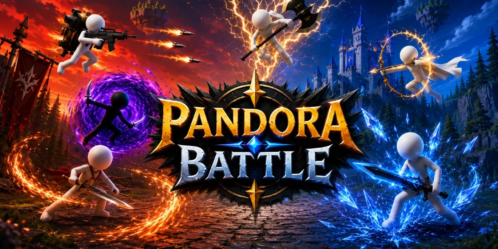</a>

# Pandora Battle

**판도라와 무기를 짝지어 싸우는 멀티플레이 액션 게임**

언리얼 엔진 5.8과 C++로 혼자 만들어 2026년 8월 27일 Steam에 출시했고, 지금도 업데이트하고 있습니다.


[](https://store.steampowered.com/app/4972140)

[**Steam 상점**](https://store.steampowered.com/app/4972140) ·
[**트레일러**](https://youtu.be/HN3CDNN-Ass) ·
[**기술 영상**](https://youtu.be/BBx7_GmUbII) ·
[**웹 포트폴리오**](https://hyeonsik-game-portfolio.vercel.app/projects/pandora-battle/)

</div>

## 영상

그림을 누르면 YouTube에서 재생됩니다.

<table>
<tr>
<td width="50%"><a href="https://youtu.be/HN3CDNN-Ass">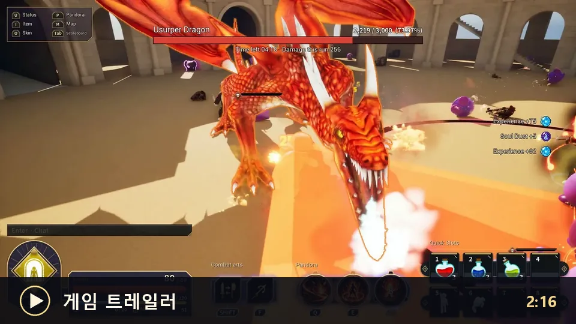</a></td>
<td width="50%"><a href="https://youtu.be/BBx7_GmUbII">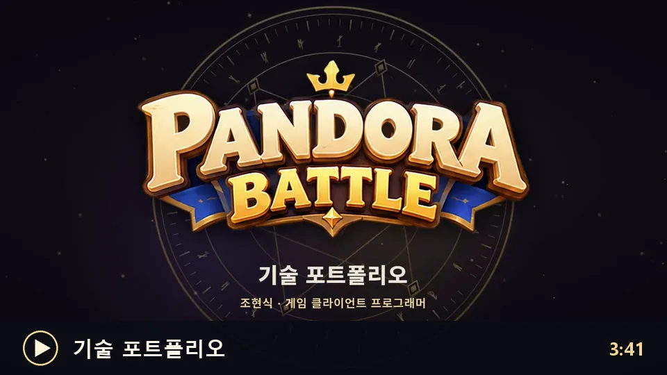</a></td>
</tr>
<tr>
<td><b>게임 트레일러</b><br>PvP 아레나와 보스 레이드의 실제 플레이</td>
<td><b>기술 포트폴리오</b><br>플레이 흐름을 따라 기술을 게임·에디터 화면으로 설명</td>
</tr>
</table>

## 어떤 게임인가

판도라마다 쓸 수 있는 무기와 스킬이 정해져 있습니다. 판도라를 키워 스킬을 열고, 세 슬롯에 판도라와 무기를 짝지어 두고, 싸우는 중에 바꿔 씁니다.

<table>
<tr>
<td width="33%">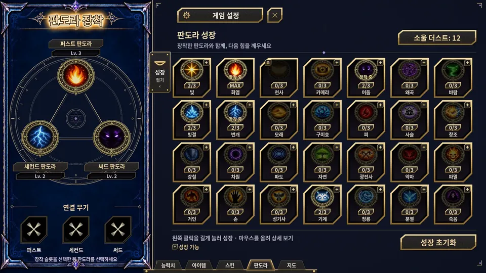</td>
<td width="33%">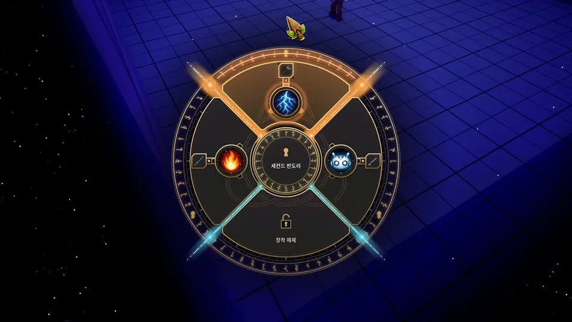</td>
<td width="33%">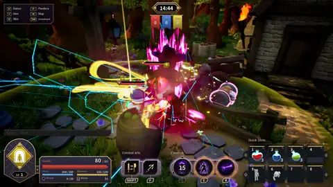</td>
</tr>
<tr>
<td><b>1. 성장</b><br>소울 더스트로 판도라 레벨을 올려 스킬을 엽니다.</td>
<td><b>2. 선택</b><br>원형 메뉴로 판도라와 무기 조합을 바꿉니다.</td>
<td><b>3. 전투</b><br>선택한 조합의 무기와 스킬로 싸웁니다.</td>
</tr>
</table>

### 게임 모드

<table>
<tr>
<td width="50%">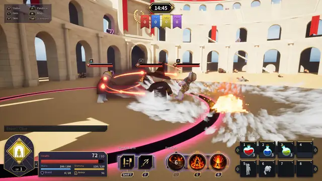</td>
<td width="50%">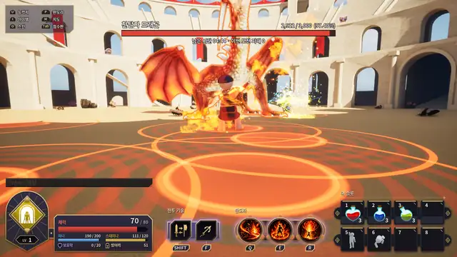</td>
</tr>
<tr>
<td><b>PvP 아레나</b> · 리슨 서버, 최대 6인<br>대기실에서 팀과 맵을 정하고 싸웁니다. 빈 자리는 봇으로 채울 수 있습니다.</td>
<td><b>보스 레이드</b> · 전용 서버<br>드래곤에게 다 함께 도전합니다. 타이틀의 '레이드 연습'으로 혼자 연습할 수도 있습니다.</td>
</tr>
<tr>
<td>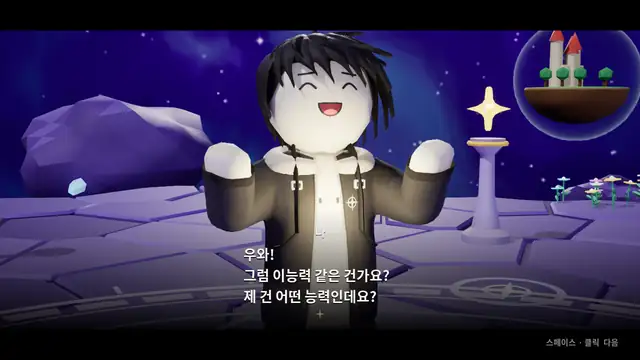</td>
<td>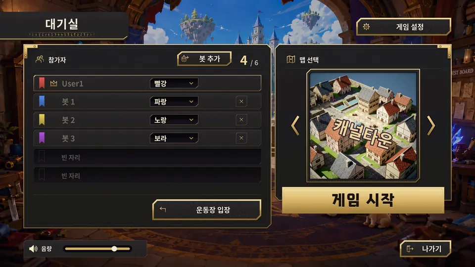</td>
</tr>
<tr>
<td><b>스토리 모드</b> · 혼자 하기<br>프롤로그 「여신의 환생」. 대사·카메라·조작이 이어지는 이야기입니다.</td>
<td><b>대기실과 봇</b><br>봇도 무기를 얻고 판도라를 키우며 사람처럼 싸웁니다.</td>
</tr>
<tr>
<td>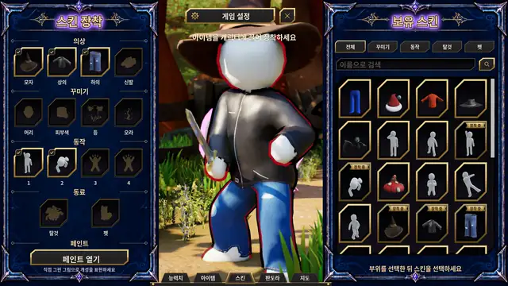</td>
<td>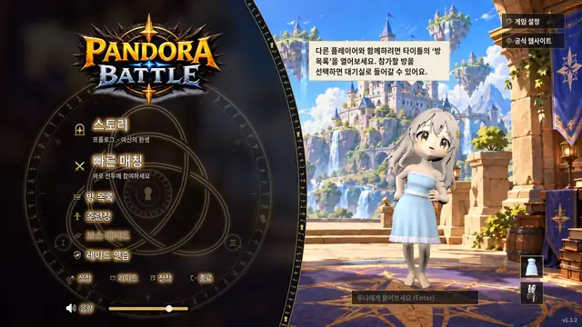</td>
</tr>
<tr>
<td><b>꾸미기</b><br>옷과 모자를 바꿔 입고, 직접 그린 그림을 얼굴이나 말풍선에 붙입니다.</td>
<td><b>안내 캐릭터 Luna</b><br>타이틀에서 질문하면 로컬 언어 모델이 게임 가이드를 근거로 답합니다.</td>
</tr>
</table>

## 전체 구조

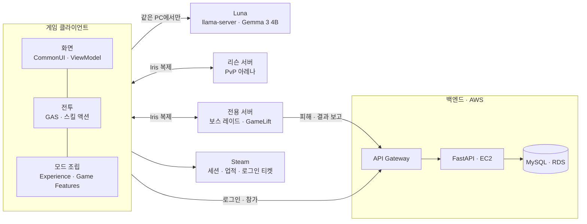

| 영역 | 쓰인 기술 |
| --- | --- |
| 게임플레이 | Gameplay Ability System, Game Features, Experience, Data Asset, 아이템 조각(Fragment), Instanced UObject |
| 네트워크 | Iris, Push Model, Fast Array, 예측 키, 지연 보상, 리슨 서버·전용 서버 |
| 온라인 | Online Subsystem Steam, GameLift, FastAPI, MySQL |
| 화면 | CommonUI, UMG ViewModel, Enhanced Input, 문자열 테이블, 12개 언어 |
| AI | StateTree, Behavior Tree, AI Perception, 로컬 언어 모델 |
| 그래픽·애니메이션 | HLSL 머티리얼, CustomDepth 스텐실, Control Rig, Level Sequence, 스레드 안전 애니메이션 |

<details>
<summary><b>주요 클래스와 책임 보기</b></summary>
<br>

| 클래스 | 책임 |
| --- | --- |
| [`APdPlayerController`](Source/LabProject/Mode/PdPlayerController.h) | 로컬 명령, 빙의, 입력·표시·프로필 동기화·세션 컴포넌트 연결 |
| [`APdPlayerState`](Source/LabProject/Mode/PdPlayerState.h) | Pawn이 바뀌어도 남는 상태와 GAS 소유자, 인벤토리·판도라·스킨 보유 |
| [`ACharacterBase`](Source/LabProject/Character/CharacterBase.h) · [`APdPlayer`](Source/LabProject/Character/PdPlayer.h) | 현재 Pawn의 이동·충돌·장비 표현 |
| [`UInventoryComponent`](Source/LabProject/Component/Item/InventoryComponent.h) · [`UEquipmentComponent`](Source/LabProject/Component/Player/EquipmentComponent.h) | 보유 아이템 복제, 장착·해제와 장비 능력치 |
| [`ALobbyGameMode`](Source/LabProject/Lobby/Contents/LobbyGameMode.h) · [`ULobbyTravelCoordinator`](Source/LabProject/Lobby/Coordination/LobbyTravelCoordinator.h) | 시작 조건·팀·카운트다운, 세션 시작과 맵 이동 |
| [`UMatchFlowComponent`](Source/LabProject/Component/Match/MatchFlowComponent.h) | 경기 시간·점수·승패·골든킬·결과 |
| [`UOnlineSessionsSubsystem`](Source/LabProject/Online/OnlineSessionsSubsystem.h) | 방 만들기·찾기·참가·시작·종료의 비동기 흐름 |
| [`UPlayerProfileSubsystem`](Source/LabProject/Profile/PlayerProfileSubsystem.h) | 변경을 모아 저장하고, 완료된 스냅숏에서 프로필 복구 |
| [`UUiSubsystem`](Source/LabProject/UI/Core/UiSubsystem.h) | 화면 수명과 로딩 대기 표시 |

</details>

## 기술

| | 주제 | 한 줄 요약 |
| --- | --- | --- |
| 1 | [스킬과 GAS](#1-스킬과-gas) | 스킬 18개를 액션 9종에 값만 정해 만듭니다. |
| 2 | [서버 판정](#2-서버-판정) | 근접은 칼날 궤적으로, 총은 되감기로 서버가 판정합니다. |
| 3 | [모드 조립](#3-모드-조립) | 맵마다 다른 규칙과 콘텐츠를 데이터로 붙입니다. |
| 4 | [보스 레이드 연출](#4-보스-레이드-연출) | 보이는 범위와 실제 판정을 맞춥니다. |
| 5 | [스토리 모드](#5-스토리-모드) | 이야기를 단계 데이터로 적고 감독이 재생합니다. |
| 6 | [봇과 몬스터 AI](#6-봇과-몬스터-ai) | 봇이 사람과 같은 서버 경로로 자라고 싸웁니다. |
| 7 | [온라인과 백엔드](#7-온라인과-백엔드) | 늦게 온 결과와 중복 보고를 구분합니다. |
| 8 | [화면과 12개 언어](#8-화면과-12개-언어) | 화면을 다시 만들지 않고 언어를 바꿉니다. |
| 9 | [포털과 그림](#9-포털과-그림) | 시점과 이동을 맞추고, 픽셀 대신 획을 나눕니다. |
| 10 | [Luna](#10-luna) | 게임과 함께 배포한 언어 모델이 가이드를 근거로 답합니다. |
| 11 | [성능](#11-성능) | 몬스터 200마리 교전의 서버 시간을 절반으로 줄였습니다. |

### 1. 스킬과 GAS

시전·비용·종료는 `USkillAbility` 하나가 맡고, 동작은 `USkillAction`을 상속한 액션 9종이 맡습니다. 스킬 데이터 애셋은 액션 하나를 골라 값을 정합니다.

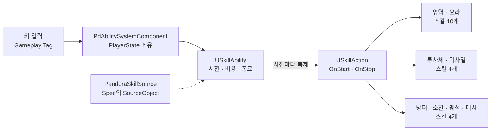

- **섞이지 않는 실행 상태**: 액션 설정을 시전마다 복제해, 타이머와 태스크가 다른 시전과 섞이지 않습니다.
- **바꿔도 남는 출처**: 시전 중에 판도라를 바꿔도 능력을 부여할 때 넣어 둔 출처를 읽으므로 피해 보너스가 그대로입니다.
- **같은 액션, 다른 값**: 아래 두 스킬은 같은 액션을 쓰고 데칼·반경·효과 큐 값만 다릅니다.

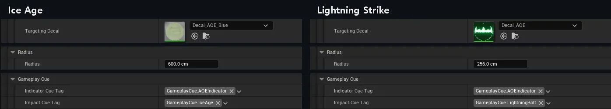

관련 코드: [SkillAbility](Source/LabProject/AbilitySystem/Ability/SkillAbility.cpp) · [SkillAction](Source/LabProject/Skill/Actions) · [PandoraSkillSource](Source/LabProject/Pandora/PandoraSkillSource.h) · [PandoraComponent](Source/LabProject/Component/Pandora)

### 2. 서버 판정

클라이언트는 의도만 보내고 결과는 서버가 정합니다. 무기마다 판정 방식이 다릅니다.

<table>
<tr>
<td width="50%">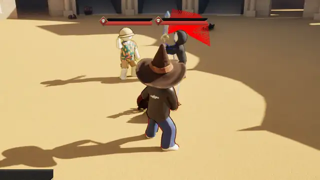</td>
<td width="50%">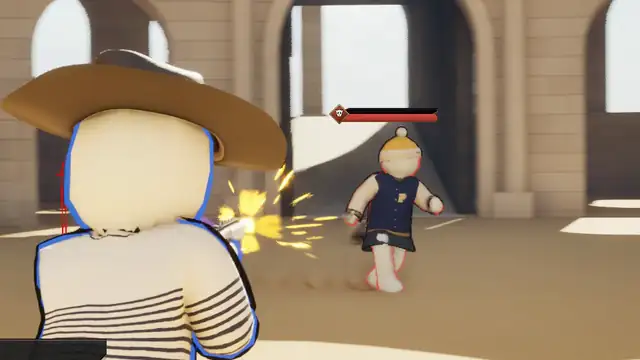</td>
</tr>
<tr>
<td><b>근접</b><br>직전과 현재 칼날 사이를 움직인 거리만큼 나눠 검사합니다. 빨강은 빗나감, 초록은 적중입니다. 콤보 구간마다 이미 맞은 대상은 다시 맞지 않습니다.</td>
<td><b>총</b><br>빨강은 서버의 현재 위치, 초록은 쏜 사람이 본 시각으로 되감은 위치입니다. 되감는 폭은 서버가 잰 왕복 지연이고 최대 200ms라, 클라이언트가 바꿀 수 없습니다.</td>
</tr>
</table>

활은 당긴 시간과 발사 토큰을, 그래플은 도착점과 이동 경로의 충돌을 서버가 다시 확인합니다.

관련 코드: [MeleeWeapon](Source/LabProject/Weapon/MeleeWeapon.cpp) · [Gun](Source/LabProject/Weapon/Gun.cpp) · [LagCompensationSubsystem](Source/LabProject/Character/LagCompensationSubsystem.cpp) · [CombatComponent](Source/LabProject/Component/Player/CombatComponent.cpp) · [GrappleComponent](Source/LabProject/Component/Player/GrappleComponent.cpp)

### 3. 모드 조립

Experience가 기본 Pawn과 켤 Game Feature를 정하고, Game Feature 액션이 능력·위젯·스포너를 붙입니다. 같은 콜로세움이 PvP 경기장도, 레이드 경기장도 됩니다.

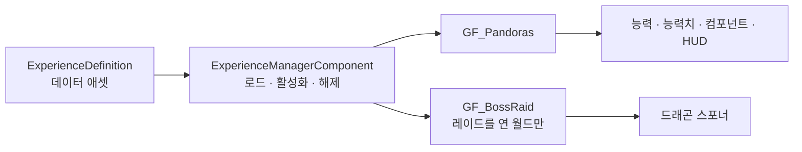

- **각 월드가 스스로 판단**: 서버는 Experience ID만 복제하고, 각 월드가 자기 로딩과 준비를 확인합니다.
- **필요한 동안만 보유**: 쓰는 쪽이 `FContentLease`를 쥐고 있는 동안만 리소스가 메모리에 남습니다.
- **데이터에서 잡는 실수**: 정의 클래스가 `IsDataValid`로 0 이하 체력 같은 값을 애셋 단계에서 막습니다.

관련 코드: [ExperienceManager](Source/LabProject/Component/Experience) · [GameFeature 액션](Source/LabProject/GameFeature) · [Game Feature 플러그인](Plugins/GameFeatures) · [ContentLease](Source/LabProject/Data/ContentLease.h) · [Definition](Source/LabProject/Definition)

### 4. 보스 레이드 연출

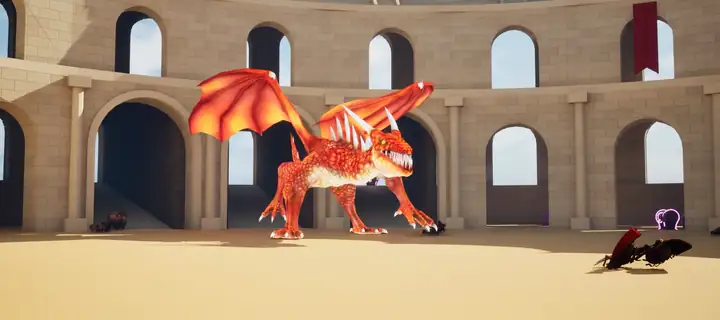

**등장 연출.** 처음 들어온 플레이어의 화면이 준비되면 서버가 레벨 시퀀스를 재생하고, 재생 위치를 복제해 모두가 같은 장면을 봅니다. 그동안 실제 보스는 멈춰 있고 플레이어는 피해를 받지 않으며, 도전 시간은 연출이 끝난 뒤부터 흐릅니다.

<table>
<tr>
<td width="33%">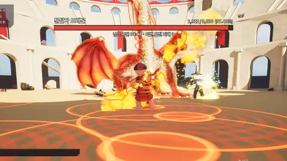</td>
<td width="33%">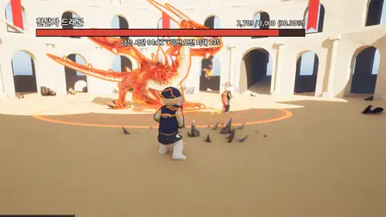</td>
<td width="33%">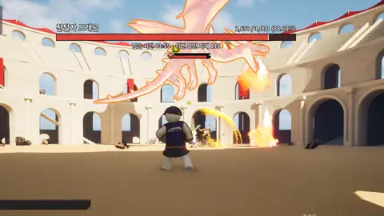</td>
</tr>
<tr>
<td><b>메테오</b><br>떨어질 자리마다 원이 차오르고, 다 찬 순간에 떨어집니다.</td>
<td><b>꼬리 휩쓸기</b><br>제자리에서 한 바퀴 돌며 맞은 사람을 날려 보냅니다.</td>
<td><b>비행 브레스</b><br>곧게 날 수 있는 거리를 먼저 재고, 날아가며 바닥을 쓸어 냅니다.</td>
</tr>
</table>

**공격 예고 장판 = 피해 범위.** HLSL 머티리얼이 월드 시간으로 채움과 깜빡임을 계산하므로 게임 코드는 시작·채움·종료 시각만 넘깁니다. 브레스 피해도 장판과 같은 부채꼴로 판정합니다. 아래는 같은 장면의 전후 캡처입니다.

<table>
<tr>
<td width="50%">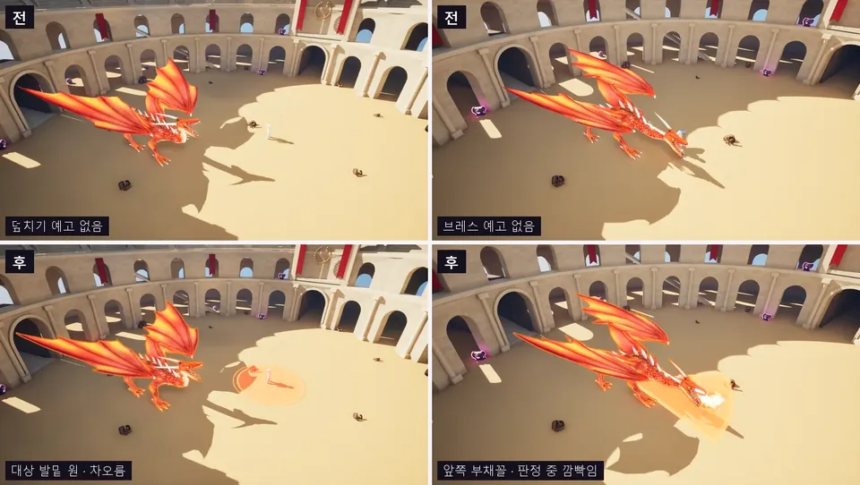</td>
<td width="50%">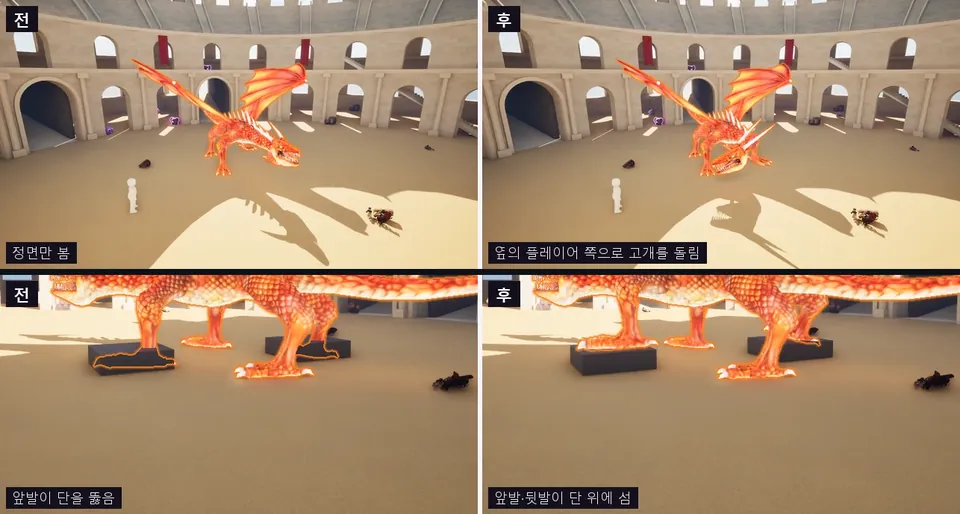</td>
</tr>
<tr>
<td><b>공격 예고 장판</b> · 위가 전, 아래가 후</td>
<td><b>머리 Look-At · 발 IK</b> · 왼쪽이 전, 오른쪽이 후</td>
</tr>
</table>

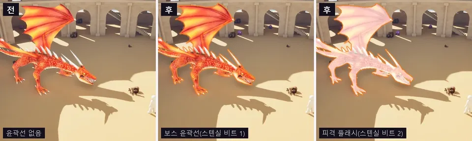

**윤곽선과 피격 플래시.** CustomDepth 스텐실 비트로 기둥 뒤에서도 보이는 윤곽선과 짧은 피격 플래시를 그립니다.

<details>
<summary><b>이 효과를 만든 에디터 그래프 보기</b></summary>
<br>

| 공격 예고 머티리얼 | 드래곤 Control Rig |
| --- | --- |
| 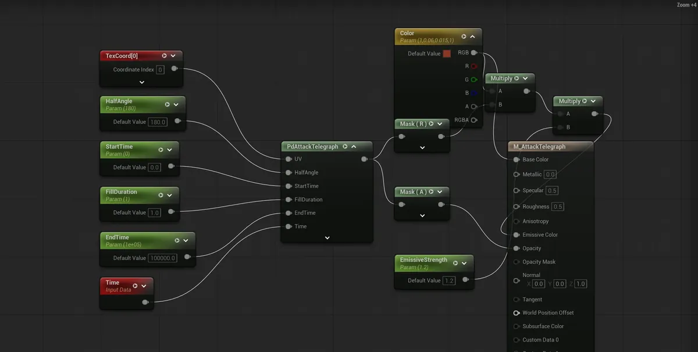 | 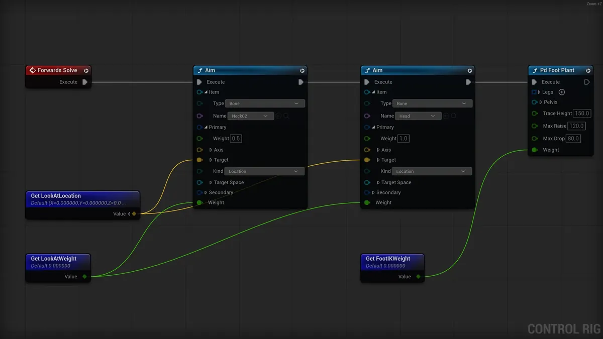 |

</details>

관련 코드: [WorldBossRaid](Source/LabProject/Mode/WorldBossRaid.cpp) · [CinematicSequenceActor](Source/LabProject/Cinematic/CinematicSequenceActor.cpp) · [AttackTelegraph.ush](Shaders/AttackTelegraph.ush) · [CombatHighlight.ush](Shaders/CombatHighlight.ush) · [MonsterAreaStrike](Source/LabProject/AI/Monster/MonsterAreaStrike.cpp) · [StrafeFlight 노티파이](Source/LabProject/Animation/AnimNotifyState_StrafeFlight.cpp) · [RigUnit_PdFootPlant](Source/LabProject/Animation/RigUnit_PdFootPlant.cpp)

### 5. 스토리 모드

장(`StoryChapterDefinition`)은 인물과 단계 목록을 담은 데이터 애셋이고, 감독(`AStoryDirector`)이 단계를 차례로 재생합니다. 새 이야기는 단계를 골라 이어 붙여 만듭니다.

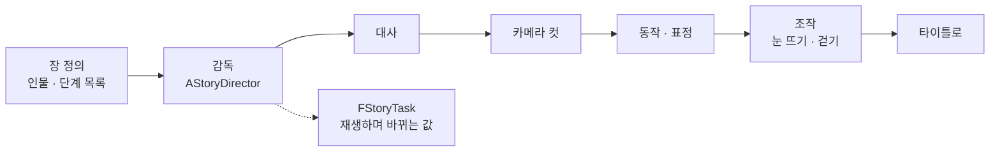

<table>
<tr>
<td width="50%">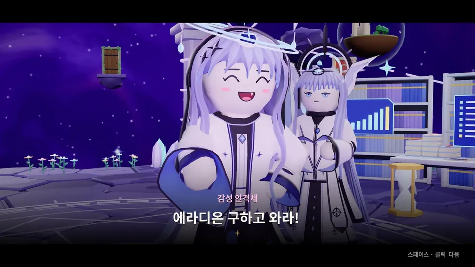</td>
<td width="50%">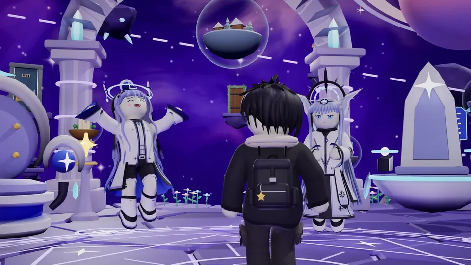</td>
</tr>
<tr>
<td>말하는 인물이 바뀌면 다른 인물이 그쪽을 보고, 표정은 표정 시트의 칸을 바꿉니다.</td>
<td>무대와 옷·머리·표정은 Blender로 직접 만들었습니다.</td>
</tr>
</table>

- **기다리는 단계와 겹치는 단계**: 대사가 나오는 동안 인물이 걷고 카메라가 흐르도록, 다음 단계를 기다릴지 단계마다 정합니다.
- **정의와 실행 분리**: 단계는 값만 갖고, 재생 중에 바뀌는 값은 시작할 때 만드는 할 일에 둡니다.

관련 코드: [StoryDirector](Source/LabProject/Story/StoryDirector.cpp) · [StoryStep](Source/LabProject/Story/StoryStep.h) · [단계 구현](Source/LabProject/Story/Steps) · [StoryScreen](Source/LabProject/UI/Story/StoryScreen.cpp)

### 6. 봇과 몬스터 AI

| 대상 | 두뇌 | 하는 일 |
| --- | --- | --- |
| 대기실 봇 | C++ 컨트롤러 | 사람과 같은 팀·점수·부활 흐름으로 경기에 참가 |
| 트레이닝 봇 | Behavior Tree | 거리 유지, 무기 교체, 판도라 스킬 연습 상대 |
| 몬스터·드래곤 | StateTree + AI Perception | 감지, 추적, 공격 패턴 선택 |

대기실 봇은 무기 없이, 키우지 않은 판도라 3개로 시작합니다.

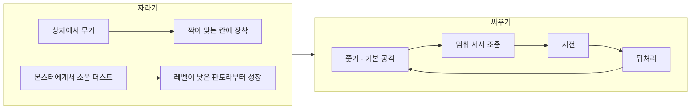

상자 열기와 레벨 올리기, 무기 선택은 모두 사람과 같은 서버 경로를 씁니다. 봇 처치는 골드에 세지 않고, 봇이 낀 경기는 전적에 남기지 않습니다.

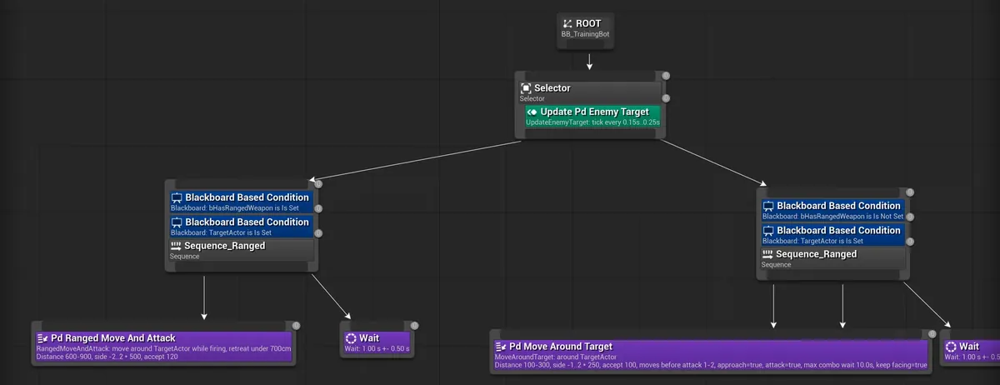

관련 코드: [PdBotController](Source/LabProject/AI/Bot/PdBotController.cpp) · [BotGrowthComponent](Source/LabProject/AI/Bot/BotGrowthComponent.cpp) · [트레이닝 봇](Source/LabProject/AI/Training) · [몬스터](Source/LabProject/AI/Monster) · [StateTree 태스크](Source/LabProject/AI/StateTree)

### 7. 온라인과 백엔드

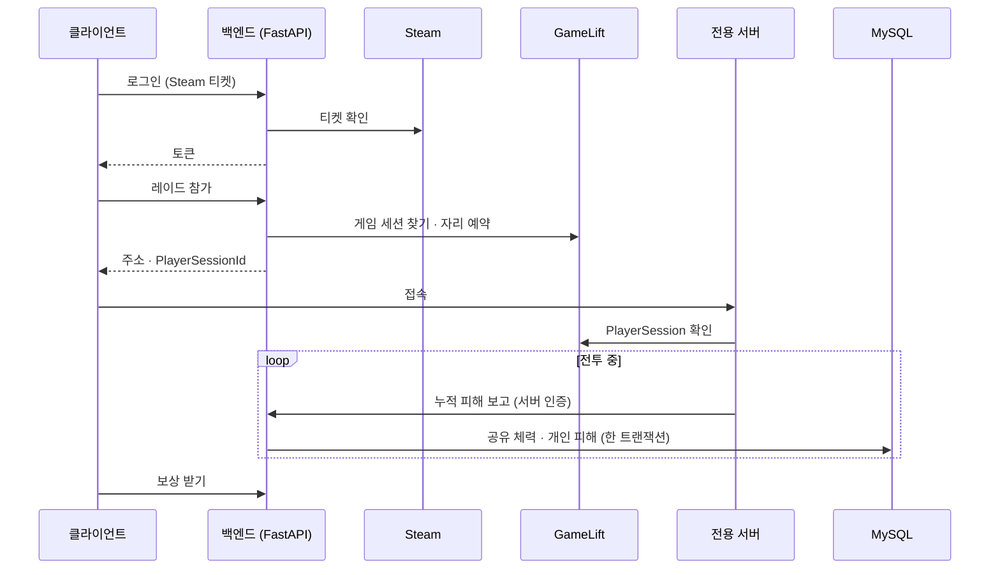

- **늦게 온 결과 구분**: 방 생성·검색·참가 요청마다 ID를 붙이고, 취소한 뒤 만들어진 세션은 맵으로 넘어가지 않고 정리합니다.
- **한 번만 기록**: 같은 경기 결과나 피해 보고가 다시 와도 두 번 더해지지 않습니다.
- **패치 없는 운영**: 보스 레이드는 백엔드 설정 하나로 열고 닫고, 타이틀이 들어올 때마다 개최 여부를 묻습니다.

관련 코드: [OnlineSessionsSubsystem](Source/LabProject/Online/OnlineSessionsSubsystem.h) · [백엔드 클라이언트](Source/LabProject/Online/Backend) · [GameLift](Source/LabProject/Online/GameLift) · [API 서버](Backend/server/app) · [배포 템플릿](Backend/template.yaml)

### 8. 화면과 12개 언어

<table>
<tr>
<td width="50%">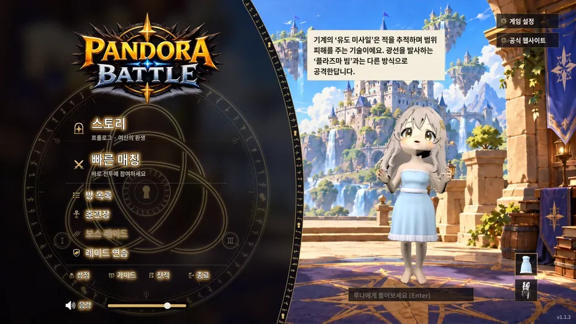</td>
<td width="50%">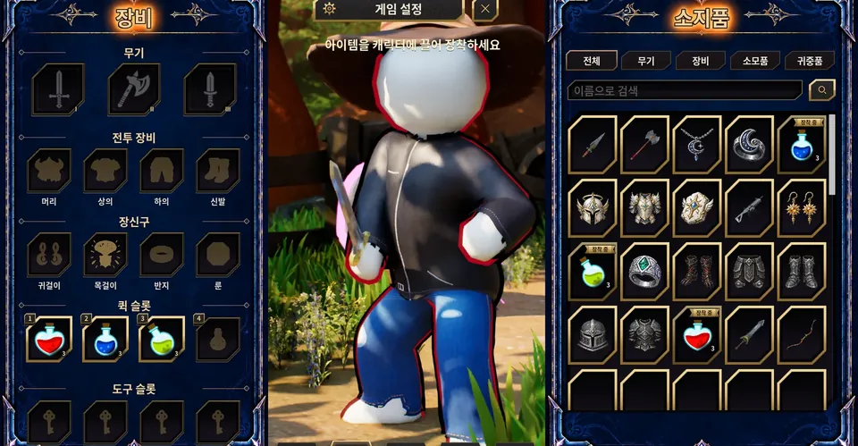</td>
</tr>
</table>

- **상태에서 화면까지**: 서버가 바꾼 인벤토리를 Fast Array로 복제하고, 변경 묶음이 끝날 때 한 번만 알려 중간 상태를 보여 주지 않습니다.
- **새지 않는 키**: 메뉴가 떠 있는 동안 누른 키는 뗄 때까지 게임 입력으로 넘기지 않습니다.
- **언어 바꾸기**: 영어 원문은 문자열 테이블과 애셋의 `FText`에 두고, 지역화 파이프라인으로 12개 언어를 만듭니다. 언어를 바꾸면 열린 화면의 글자와 글꼴만 바꿉니다.

관련 코드: [UiSubsystem](Source/LabProject/UI/Core) · [ViewModel](Source/LabProject/ViewModel) · [InventoryComponent](Source/LabProject/Component/Item) · [Localization](Source/LabProject/Localization) · [문자열 테이블](Content/UI/Localization/StringTables) · [번역](Content/Localization/Game)

### 9. 포털과 그림

<table>
<tr>
<td width="50%">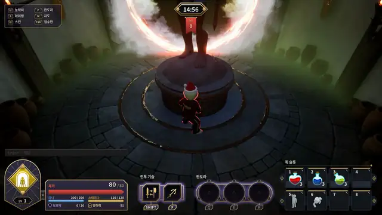</td>
<td width="50%">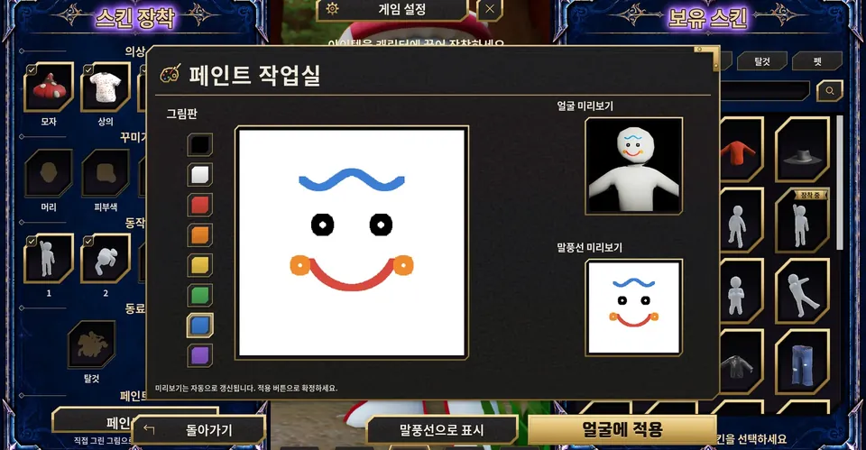</td>
</tr>
<tr>
<td><b>포털</b><br>카메라·위치·회전·속도에 같은 좌표 변환을 써서, 너머로 보이던 곳으로 그대로 나옵니다.</td>
<td><b>그림</b><br>픽셀 대신 획(브러시 크기·색·정규화 좌표)을 보내고 화면마다 다시 그립니다.</td>
</tr>
</table>

관련 코드: [PortalActor](Source/LabProject/Room/PortalActor.cpp) · [PaintCanvas](Source/LabProject/Component/Player/PaintCanvas)

### 10. Luna

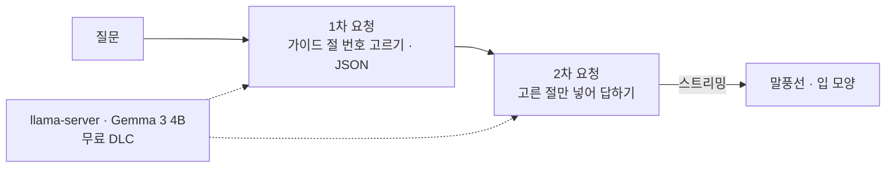

<table>
<tr>
<td width="32%">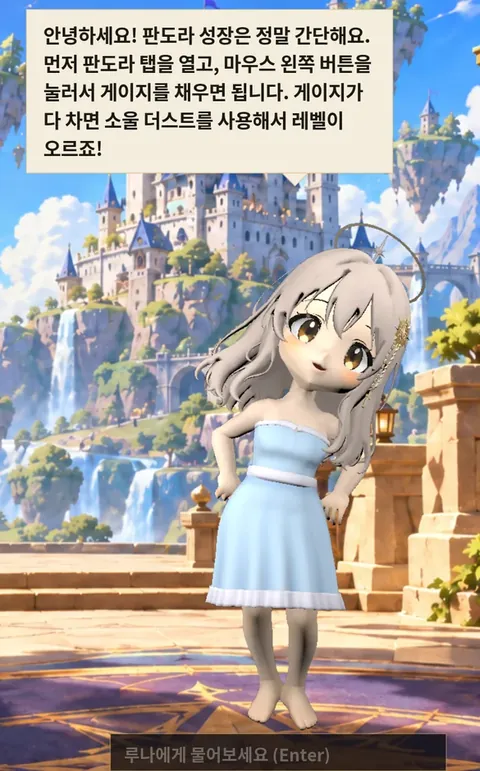</td>
<td width="68%">
<b>근거가 있는 답</b><br>
가이드 전체를 넣지 않고 먼저 관련 절을 고른 뒤, 그 절만 근거로 답합니다. 근거에 없는 내용은 모른다고 답하고 가이드 메뉴를 권합니다.<br><br>
<b>무료 DLC로 나눈 모델</b><br>
약 2.5GB인 모델은 원하는 사람만 받습니다. 게임 서버나 외부 API는 쓰지 않습니다.<br><br>
<b>남지 않는 프로세스</b><br>
타이틀에 있는 동안만 모델 서버를 띄우고, Windows 작업 개체로 묶어 게임이 비정상 종료돼도 함께 끝납니다.<br><br>
<b>늦은 응답 버리기</b><br>
질문마다 번호를 붙이고, 취소하면 번호를 올려 이전 요청의 응답을 버립니다.
</td>
</tr>
</table>

관련 코드: [LunaChatSubsystem](Source/LabProject/Luna/LunaChatSubsystem.cpp) · [LunaLocalServer](Source/LabProject/Luna/LunaLocalServer.cpp)

### 11. 성능

몬스터 200마리 소환 부하를 만들고 Unreal Insights로 서버 애니메이션·경로 탐색·시야 질의·생성 비용을 추적해 줄였습니다.

<picture>
  <source media="(prefers-color-scheme: dark)" srcset="Docs/images/readme/perf-dark.svg">
  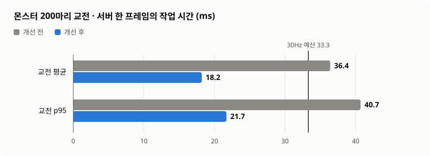
</picture>

| 측정 항목 | 개선 전 | 개선 후 |
| --- | ---: | ---: |
| 교전 평균 | 36.4 ms | **18.2 ms** |
| 교전 p95 | 40.7 ms | **21.7 ms** |
| 소환 직후 최대 프레임 | 396.9 ms | **26.9 ms** |
| 30Hz 예산 초과 프레임 | 539 / 551 | **0 / 600** |
| 클라이언트 1명당 서버 송신량 | 43.4 KB/s | **24.7 KB/s** |

같은 PC에서 에디터 실행 파일로 전용 서버와 클라이언트 1개를 함께 돌려 잰 값이며, GameLift 운영 환경의 수치는 아닙니다.

관련 코드: [BossRaidBenchmarkSubsystem](Source/LabProject/AI/Monster/BossRaidBenchmarkSubsystem.cpp) · [MonsterSignificanceSubsystem](Source/LabProject/AI/Monster/MonsterSignificanceSubsystem.cpp) · [CombatUiPool](Source/LabProject/UI/HUD/Combat/CombatUiPool.cpp) · [RunPerfBenchmark.ps1](Scripts/RunPerfBenchmark.ps1)

## 업데이트 기록

| 버전 | 날짜 | 내용 |
| --- | --- | --- |
| **1.1.2** | 2026.11.25 | 스토리 모드 프롤로그, 사람처럼 자라는 봇, 드래곤의 꼬리 휩쓸기·메테오·비행 브레스 |
| **1.1.0** | 2026.11.14 | 화면 재디자인, 새 맵 캐널타운, 레이드 연습, 화면 설정, 새 의상 |
| **1.0.2** | 2026.10.12 | Luna 무료 DLC, 백엔드로 여닫는 보스 레이드 |
| **1.0.1** | 2026.10.09 | 12개 언어, 총 지연 보상, 화면 개편, 설치 용량 축소 |
| **1.0.0** | 2026.08.27 | Steam 출시 · 최대 6인 PvP 아레나와 훈련장 |

## 프로젝트 구조

<details>
<summary><b>폴더 보기</b></summary>

```text
Source/LabProject/
├─ AbilitySystem/ · Skill/ · Pandora/     # GAS 능력, 스킬 액션, 판도라
├─ Character/ · AI/ · Pet/ · Weapon/      # 캐릭터, 봇·몬스터, 무기
├─ Component/                             # 소유자별 게임플레이 컴포넌트
├─ Definition/ · Data/                    # 데이터 애셋 정의, 콘텐츠 로딩
├─ Experience/ · GameFeature/             # 월드 구성, Game Feature 액션
├─ Mode/ · Lobby/ · Room/ · Map/          # 게임 흐름, 대기실, 맵 장치
├─ Online/ · Profile/ · Provision/        # 세션·백엔드·GameLift, 저장, 기본 지급
├─ Story/ · Cinematic/ · Animation/       # 스토리 모드, 연출, 애니메이션
├─ UI/ · ViewModel/ · Localization/       # 화면, 표시 상태, 언어
├─ Luna/                                  # 로컬 언어 모델 안내 캐릭터
└─ Tests/                                 # 단위·통합 자동화 테스트
Source/LabProjectShaders/ · Shaders/      # HLSL 머티리얼 함수
Plugins/GameFeatures/                     # GF_Pandoras, GF_BossRaid
Backend/                                  # FastAPI 서버, MySQL 마이그레이션, 배포
Scripts/                                  # 패키징, 테스트, 성능 측정, 맵 제작
Content/                                  # 로직 애셋(블루프린트, 데이터 애셋, 위젯, 번역)
```

</details>

## 빌드와 테스트

> 공개 저장소에는 코드와 로직 애셋만 있습니다. 마켓플레이스 애셋이 들어간 맵과 그래픽 애셋은 빼 두어서, 그대로 받아 게임을 실행할 수는 없습니다. 플레이는 [Steam](https://store.steampowered.com/app/4972140)에서 할 수 있습니다.

| 대상 | 필요한 것 |
| --- | --- |
| `LabProjectEditor` | Unreal Engine 5.8, Win64 C++ 개발 도구 |
| `LabProject`, `LabProjectServer` | 소스로 빌드한 Unreal Engine 5.8 (Push Model을 켠 고유 빌드 환경) |
| `Backend/server` | Python 3.12, MySQL 8.4 |

에디터 빌드와 단위·통합 테스트를 한 번에 돌립니다.

```powershell
powershell -ExecutionPolicy Bypass -File Scripts\RunAutomationTests.ps1 -EngineRoot <엔진 경로>
```

백엔드는 로컬 MySQL을 준비한 뒤 테스트합니다.

```powershell
powershell -ExecutionPolicy Bypass -File Backend\server\local.ps1 setup
```

```powershell
powershell -ExecutionPolicy Bypass -File Backend\server\local.ps1 test
```
